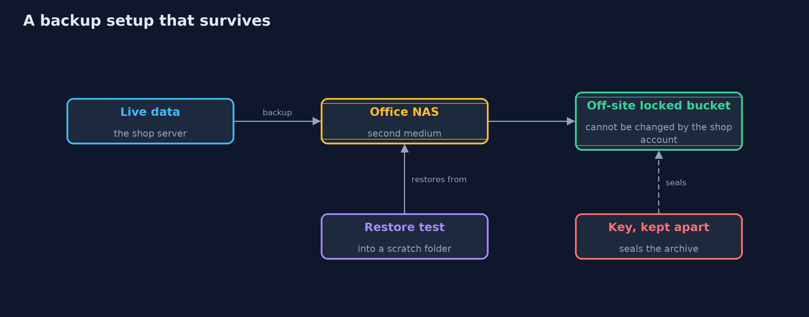
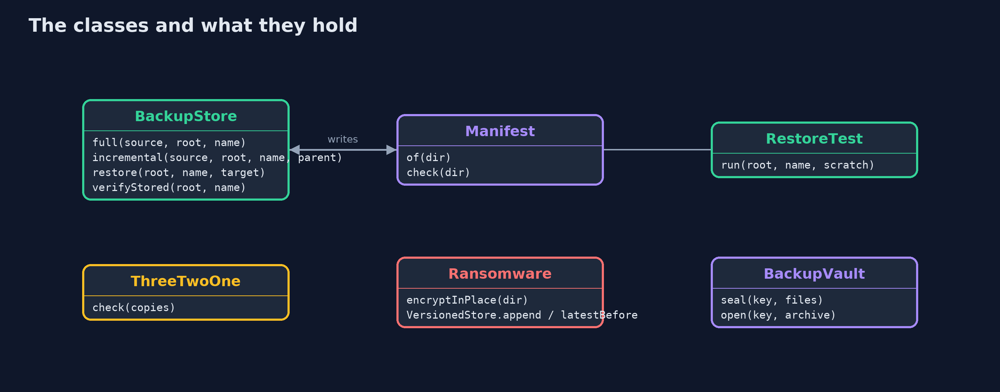
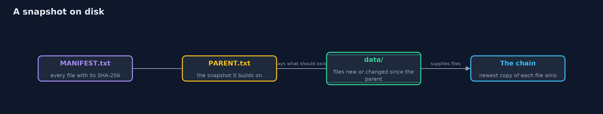

# Backups and Recovery

```
src/main/java/com/jk/explore/security/backups/
├── BackupStore.java  A folder of snapshots
├── BackupVault.java  A backup is a copy of every secret in the system, so the archive is sealed with AES-256-GCM and its key lives apart from it
├── BackupsDemo.java  Runs the online store story in five numbered acts and prints exact, repeatable results
├── Manifest.java     A list of every file in a folder with its SHA-256, one "hash path" line each: the backup's own record of what it should contain
├── Objectives.java   Recovery point objective and recovery time objective, worked out from a timeline in minutes since midnight
├── Ransomware.java   What ransomware does to files it can write to, and the copy it cannot: a store that only ever adds new versions
├── RestoreTest.java  A restore test: restore into a scratch folder and ask the application's own question, "is there a usable orders file?"
├── Retention.java    Which daily snapshots to keep: the newest few days, the newest few Sundays, and the first snapshot of each of the newest few months
├── Sha256.java       SHA-256 as lower-case hex: the fingerprint a manifest records for each file
└── ThreeTwoOne.java  The 3-2-1 rule as a checker: three copies of the data, on two kinds of media, one of them off site (and, today, one that cannot be changed)
```

**Backups are what turns a disaster into an inconvenience, but only if they are complete, checked by a real restore, kept where ransomware cannot reach them, kept long enough, and sealed like the secrets they are.**

Every other defence in this repository tries to stop something going wrong. A **backup** is for when it does anyway: a mistake, a failed disk, a fire, or **ransomware** that encrypts everything it can write to.
A good backup has a few properties. It is **complete**, which a **manifest** of SHA-256 fingerprints helps to prove. It has been **restored** at least once, because a backup that cannot be restored is not a backup. It follows the **3-2-1 rule**:
three copies, on two kinds of media, one of them off site. It includes a copy that the shop's own account **cannot change**, because ransomware encrypts every backup it can reach. It is kept for as long as it is useful and no longer, by a **retention policy**.
And it is **sealed**, because it contains every customer's data.

The demo makes full and incremental backups of an online store's files, damages them, grades two setups against the rule, prunes 400 snapshots, runs a ransomware attack, works out how much work a failure loses and how long recovery takes, and seals the archive.

## The idea in everyday terms

Think of a fire drill. Having a plan is not the same as knowing it works: the exits turn out to be locked only when the building is full of smoke. A backup that has never been restored is the same, a plan that looks fine on paper.
A copy in the next room of the same building is gone in the same fire, and a copy kept in a cabinet that any thief can open is a second way to lose.

## The scenario

An online store keeps orders, customers and stock in files. The demo takes backups of them, finds damage by comparing fingerprints, discovers a backup that cannot be restored, grades two setups, prunes old snapshots, lets ransomware loose on the shop and its mounted backup folder,
calculates what a failure costs, and seals the archive.

## Run

```bash
./gradlew run
```

The demo tells the story in 5 acts, each printing exact numbers that the tests check:

| Act | What it shows |
| --- | --- |
| 1. Full and incremental backups, with a manifest | A full backup stores 3 files, an incremental one only the files that changed, and the day 3 state of 4 files restores from the chain with no problems. |
| 2. Can the backup be trusted? Only a restore test says | A changed byte and a deleted file are both found from the manifest, yet a backup that skipped the orders file passes the manifest and fails the restore test. |
| 3. The 3-2-1 rule, and how long to keep backups | A second folder on the same server scores 0 of 4 against the rule while a server, a NAS and an off-site locked bucket score 4 of 4; 400 snapshots shrink to 21. |
| 4. Ransomware, and the copy it cannot change | Ransomware encrypts the shop's 3 files and the 3 files in the mounted backup folder, but a store that only adds versions restores every original, and read-only files stop it only until the same user changes them. |
| 5. How much can be lost, how long it takes, and backups as secrets | A nightly backup loses 13:30 of work, about 162 orders, and takes 01:55 to recover, an hourly one loses 6; the archive is sealed with AES-256-GCM and a wrong key is refused. |

## Test

```bash
./gradlew test
```

18 tests in `BackupStoreTest`, `DemoRunsTest`, `PoliciesTest`. SHA-256 is checked against the published value for "abc". Backups are files in a temporary folder, the clock is simulated, and keys and nonces are random but never printed, so the golden output is the same on every run.

## What the simulation got right, and what it left out

All backups are files in a temporary folder, and the clock is simulated, so the demo is exact. Keys and nonces are random, so the demo prints only facts that do not depend on them. SHA-256 is checked against the published value for "abc".
File permissions are the POSIX ones that macOS and Linux use, and a true write-once store needs a storage service, so it is modelled by a store that only adds versions.

## Technologies and versions

Every version below is pinned in the project's build files and was the latest stable release when the project was built.

| Technology | Version | Used for |
| --- | --- | --- |
| Java | 25 | the language and runtime; a Gradle toolchain finds or downloads the JDK |
| Gradle | 9.8.1 (wrapper) | build and run; nothing to install, the wrapper downloads it |
| org.junit.jupiter:junit-jupiter | 6.1.3, set by junit-bom | JUnit 5: the tests (tests only) |
| org.junit.platform:junit-platform-launcher | 6.1.3, set by junit-bom | JUnit platform launcher, which Gradle needs to run the tests (tests only) |
| videokit | repository tool (`tools/videokit`) | the narrated video and animation: Piper `en_US-amy-medium`, speed 0.8, longer pauses (the amy-slow voice) |

## Learning Material

| Document | What it is for |
| --- | --- |
| [Problem statement](docs/problem-statement.md) | the situation and what the project must show |
| [Prerequisites](docs/prerequisites.md) | what you need to know first |
| [Backups and Recovery, explained](docs/backups-and-recovery-explained.md) | the acts in prose |
| [Session guide](docs/session.md) | a one-hour lesson with exercises |
| [Animated walkthrough](docs/animation.html) | the acts step by step, narrated |
| [Threat model](docs/threat-model.md) | what is protected, who could harm it, and how, using STRIDE |
| [Spec](docs/spec.md) | what this project must be true of |
| [Expected output](docs/expected-output.txt) | the golden demo output every test and every port checks against |

### The idea in one picture

Three copies on two media, one off site and unchangeable, each checked by a restore test, and the archive sealed.



### Where each piece sits

BackupStore makes snapshots with manifests; the other classes judge, protect and measure them.



### How the data moves

A snapshot holds a manifest of the whole state, a pointer to its parent, and the files it stored.



### Who calls whom, in order


### Video

`video/backups-and-recovery-explained.mp4` (with `.m4a` audio and `.srt` subtitles) is built by `video/build_video.sh`. Rendered media is not committed.

## What it costs

- **Backups cost storage, time and attention.** Incremental backups are small but need the whole chain to restore, and every copy is one more thing to monitor.
- **Restore tests cost effort.** They take time and a scratch environment, and they are the only way to know. Schedule them.
- **A backup is a copy of every secret.** Anyone who can read the backup can read the data, so it needs encryption, access control and its own key management.
- **Immutable storage is not free.** Data cannot be deleted before its retention ends, even by mistake or on request, which has to be reconciled with rules about deleting personal data.
- **The demo is small.** It shows the ideas with files in a folder. Real systems add databases that must be backed up consistently, object storage with object lock, and backup products.

## When this is too much

Every business that has data it cannot recreate needs this. How far to go depends on the recovery point and recovery time it can afford: a shop that can lose an hour of orders is a different problem from one that cannot lose one.

## Where you have already met this

- `rsync`, `restic`, `borg` and cloud snapshot features.
- Object lock and write-once storage in cloud object stores.
- Disaster recovery plans and "RPO" and "RTO" in service agreements.
- News stories about ransomware that also took the backups.

## Where this sits

This project is the third in [safe-habits](..), after [least-privilege](../least-privilege) and [patching-and-dependency-hygiene](../patching-and-dependency-hygiene). It uses the key habits from [keystore-basics](../../cryptography/keystore-basics) to protect the archive.
