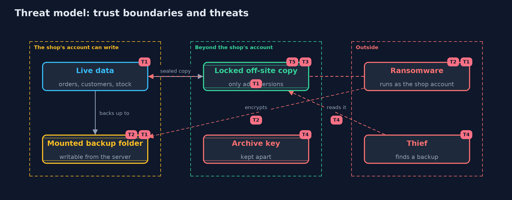

# Threat Model — Backups and Recovery

A threat model answers four questions: what are we protecting, who or what could harm it, how, and what do we do about it. This one covers this project's own demo system, not a production deployment. Domain: an online store.

## Scope

How an online store protects and restores its files: the backups it takes, the places they live, who can write to those places, how long they are kept and how the archive is protected. It covers ransomware running as the shop's own account,
accidental loss and corruption, and a thief who finds a backup. It does not cover the security of the live system itself or of a backup service provider.

## What we protect (assets)

- The shop's orders, customers and stock.
- The backups, which are copies of all of it.
- The ability to restore: manifests, chains, keys and a tested procedure.
- The archive key.

## Who and what acts on the system

- The shop's operators, who take and restore backups.
- Ransomware running with the shop account's permissions.
- A thief who finds a backup copy.

## Trust boundaries

A trust boundary is a line that data or a request crosses between parts that trust each other differently. Threats cluster where those lines are.

- The shop's account to the places it can write: everything a mounted folder or an access key reaches can be encrypted.
- The shop's account to a copy it cannot change: the line ransomware must not cross.
- The backup to the key: a sealed archive is only as safe as its key's home.

Each dashed box is a trust boundary. A rose tag such as T1 shows where the threat of that number, in the table below, applies.

## Threats, using STRIDE

STRIDE is a checklist of six kinds of threat: **Spoofing** (S), **Tampering** (T), **Repudiation** (R), **Information disclosure** (I), **Denial of service** (D), **Elevation of privilege** (E).

| Id | Kind | Threat | Where it shows up | Control in this project | What is left |
| --- | --- | --- | --- | --- | --- |
| T1 | Tampering | Ransomware encrypts the live files | `Ransomware.encryptInPlace` | Backups taken before the attack and kept where the attack cannot reach | Everything since the last backup is lost, which is the recovery point |
| T2 | Tampering | Ransomware encrypts a backup folder that is mounted and writable | the mounted backup folder | Do not mount backups writable from the server, and keep a copy that only adds versions | Read-only permissions are only a speed bump for the same user |
| T3 | Repudiation | A backup is deleted or replaced, and nobody can show what it used to contain | `Ransomware.VersionedStore`, `Manifest` | A store that only adds versions, and a manifest of fingerprints | The retention period decides how long old versions exist, and a deletion rule for personal data must be reconciled with it |
| T4 | Information disclosure | A thief reads a backup, which holds every customer's data | `BackupVault` | AES-256-GCM, with the key kept apart in an owner-only file | A lost key is a lost backup, so the key needs its own safe copy |
| T5 | Denial of service | A backup that looks fine cannot be restored | `RestoreTest` | A scheduled restore test that asks the application's own question | Only the checks the test makes are proven, so they must grow with the system |

## Assumptions

- The unchangeable copy is protected by something other than the shop's own credentials.
- Restore tests are really run, on a schedule.
- In the demo, keys and nonces are random and never printed, and the store that only adds versions stands for object lock or a similar service.

## Out of scope

- Securing the live system against the attack.
- Backing up databases consistently.
- The security of a backup provider.

## How the tests check this

- `BackupStoreTest` checks the SHA-256 value, manifests, incremental snapshots, restores of older days, tamper and loss detection, and the restore test.
- `PoliciesTest` checks the 3-2-1 rule, retention, objectives, the ransomware simulation, the versioned store, the sealed archive and the key file.
- `DemoRunsTest` compares the whole demo with the golden output.

## Where this model goes next

That completes the plain projects of the beginner track. The tool versions follow: scanning dependencies with real tools, and backups with an object store that supports object lock.
