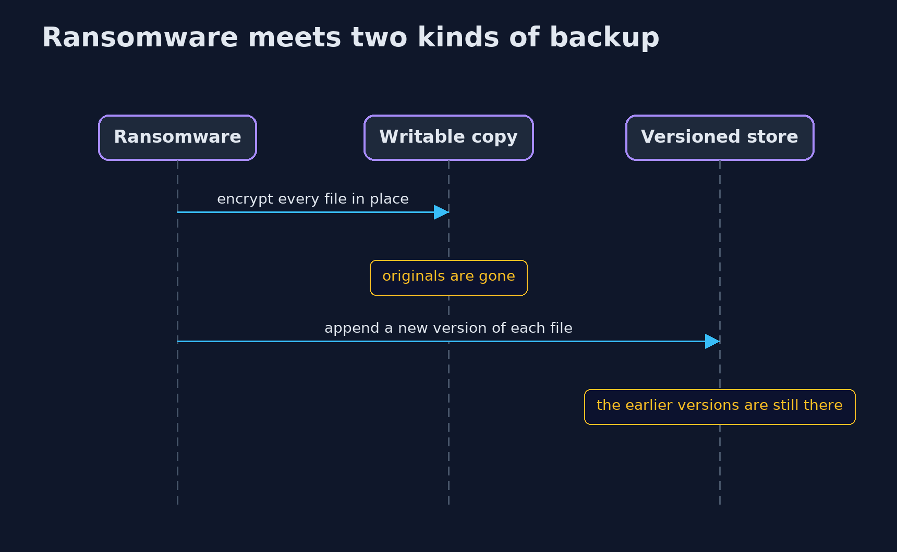
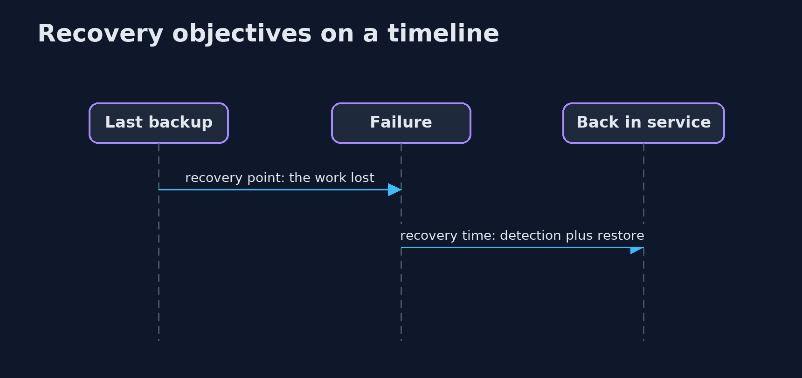

# Backups and Recovery — UML Sequence Diagrams

## 1. Ransomware meets two kinds of backup

A writable copy is encrypted with the data; a store that only adds versions keeps the old ones.

## 2. Recovery objectives on a timeline

The recovery point is the distance back to the last good backup; the recovery time is how long until service returns.

