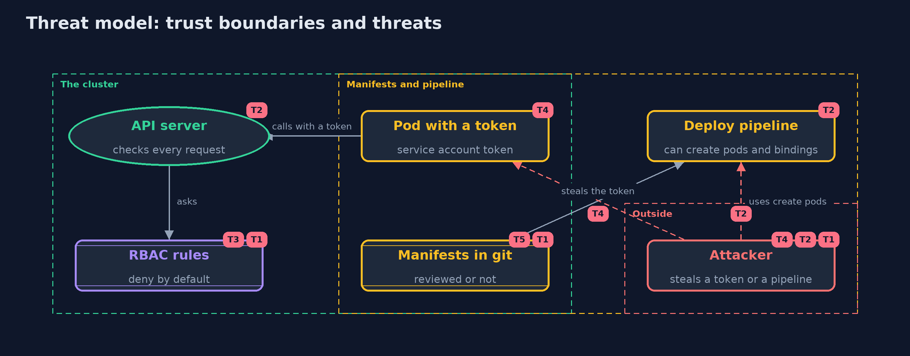

# Threat Model — Least Privilege with Kubernetes RBAC

A threat model answers four questions: what are we protecting, who or what could harm it, how, and what do we do about it. This one covers this project's own demo system, not a production deployment. Domain: an online store.

## Scope

The RBAC configuration of a Kubernetes cluster that runs an online store's jobs: service accounts, roles, bindings, and the pipeline that applies them. It covers an attacker who steals a service account token or takes over a pipeline. It does not cover the nodes, the network, admission control or the applications' own authorization.

## What we protect (assets)

- Secrets in the cluster, such as payment keys and database passwords.
- The ability to create workloads and bindings.
- Service account tokens.
- The manifests that define the rules.

## Who and what acts on the system

- Jobs and pipelines running as service accounts.
- An attacker who steals a token or takes over a job.
- A developer who writes or reviews the manifests.

## Trust boundaries

A trust boundary is a line that data or a request crosses between parts that trust each other differently. Threats cluster where those lines are.

- Pod to API server: the token is the only proof of identity.
- Git repository to cluster: whatever is applied becomes the rules.
- Namespace to namespace: only bindings set the boundary.

Each dashed box is a trust boundary. A rose tag such as T1 shows where the threat of that number, in the table below, applies.

## Threats, using STRIDE

STRIDE is a checklist of six kinds of threat: **Spoofing** (S), **Tampering** (T), **Repudiation** (R), **Information disclosure** (I), **Denial of service** (D), **Elevation of privilege** (E).

| Id | Kind | Threat | Where it shows up | Control in this project | What is left |
| --- | --- | --- | --- | --- | --- |
| T1 | Elevation of privilege | A job is bound to cluster-admin or a wildcard role, so a stolen token controls the cluster | `nightly-export-is-admin`, `report-reader` | One service account per workload, scoped roles that name resources, and a linter that fails on cluster-admin and wildcards | Roles still need review as features grow |
| T2 | Elevation of privilege | An identity that can create pods or bindings makes itself more powerful | `deployer`, `ci-deployer` | Treat create pods, bind and escalate as the permissions they can reach, and limit them with admission policy | RBAC alone cannot stop a pod from mounting the secrets of its namespace |
| T3 | Tampering | A role is edited to grant more, and nobody notices | the RBAC rules | Keep manifests in git with review, and diff `kubectl auth can-i --list` over time | Someone with escalate can change roles without review |
| T4 | Information disclosure | A service account token is read from a pod, a log or a backup | the pod's mounted token | Turn off automounting where the pod does not call the API, and use short-lived bound tokens | A token used by a running pod can still be read from that pod |
| T5 | Repudiation | Nobody can tell who applied a permission change, or why | the manifests repository | Review in git, and enable the API server's audit log | Audit logs have to be kept and read |

## Assumptions

- The API server enforces RBAC correctly and the nodes are not compromised.
- Manifests are reviewed before they are applied.
- In the demo, names, passwords and keys are demo values, and the cluster is a throwaway kind cluster.

## Out of scope

- Admission control, pod security standards and network policies.
- Cloud identity mapping.
- Runtime detection.

## How the tests check this

- `RbacTest` checks deny by default, cluster-admin, resource names, wildcards, binding scope, subresources and escalation paths.
- `ManifestsAndLinterTest` checks YAML parsing and the six lint findings.
- `KubectlInteropTest` (integration) makes a real kind cluster and compares 490 kubectl answers, the bind, escalate and exec verbs, and a named config map with the Java evaluator.
- `DemoRunsTest` compares the whole demo with the golden output.

## Where this model goes next

This is the last project in the safe-habits track so far. The later projects return to identity and add a real identity provider.
