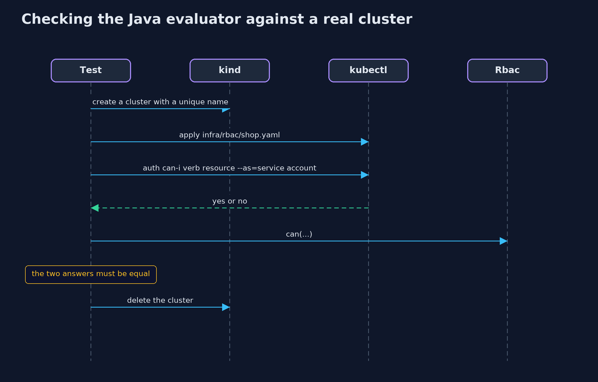
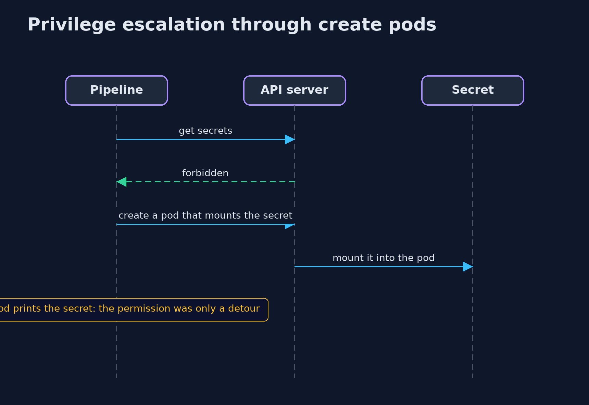

# Least Privilege with Kubernetes RBAC — UML Sequence Diagrams

## 1. Checking the Java evaluator against a real cluster

The same manifests are applied to kind and kubectl is asked.

## 2. Privilege escalation through create pods

A pod can mount any secret in its namespace, so creating one is a way to read them.

