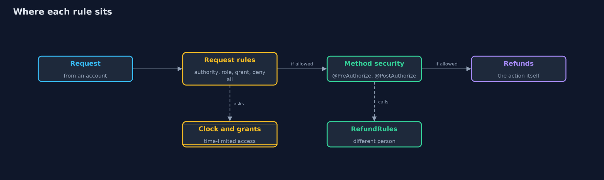
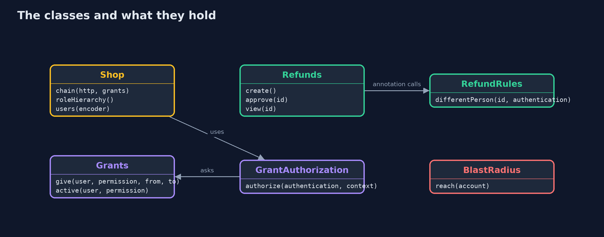

# Least Privilege with Spring Security

```
src/main/java/com/jk/explore/security/leastprivilegespring/
├── BlastRadius.java               What a stolen credential can do: ask Spring Security's own authorization manager about every action in the store
├── Catalogue.java                 Everything that can be done in the online store, and who holds what
├── GrantAuthorization.java        A custom rule: the request is allowed for someone who holds the permission, or who has an active time-limited grant for it
├── Grants.java                    Access that expires by itself: a permission given to one person for a window of time, judged by an injected clock
├── LeastPrivilegeSpringDemo.java  Runs the online store story in five numbered acts against a real Spring Boot server on the loopback interface
├── RefundRules.java               Separation of duties, named so that an expression can call it: {@code @refundRules.differentPerson(#id, authentication)}
├── Refunds.java                   Refunds, guarded by method security: who may create one, who may approve one, and who may read one
├── Shop.java                      The online store with least privilege: scoped authorities, deny by default, a role hierarchy, method security and time-limited grants
├── ShopController.java            The store's endpoints
├── SimulatedClock.java            A clock that moves only when the demo says so: tick N is N seconds after the epoch
└── Wire.java                      A tiny HTTP client for the demo: one request with optional basic credentials
```

**Spring Security can make least privilege the default: deny every path that has no rule, give accounts exact permissions instead of an admin role, keep separation of duties in one rule that no role can switch off, and let access expire by itself.**

The plain version of this lesson modelled **least privilege** by hand: every account gets only the permissions its job needs, so that a stolen credential, a mistake or a bad day can do only so much harm. **Spring Security** is the framework most Java
stores use for this, and it has a place for each idea. A request rule can say **deny anything not listed**. A **method security** annotation, `@PreAuthorize`, puts the rule next to the code it guards. A **role hierarchy** says that an admin includes the other jobs.
A custom **AuthorizationManager** can hold any rule at all, such as a grant that expires. This project starts a real Spring Boot server and checks each of them with real requests.

The demo ends with the number that matters: what a stolen token can reach, for an admin account and for a scoped service account.

## The idea in everyday terms

Think of a hotel. The easy way to run it is to give every employee the master key. Least privilege gives the cleaner the keys for the rooms on their floor, the night porter the front door, and the manager a key that cannot open the safe without a second person.
A key that stops working at checkout time is better than one that someone has to remember to take back.

## The scenario

An online store has support staff, warehouse staff, finance staff, an admin and a nightly export job. The demo starts the store with Spring Boot and asks, with real requests, who may do what: reading orders, creating and approving refunds, and writing a payment.

## Run

```bash
./gradlew run
```

The demo tells the story in 5 acts, each printing exact numbers that the tests check:

| Act | What it shows |
| --- | --- |
| 1. Deny by default: every path needs a rule | No credentials gets 401, alice gets 200 for orders and 403 for reports, and an admin asking for a path nobody wrote a rule for also gets 403. |
| 2. Method security: the rule sits next to the code | Bob cannot create a refund, alice can; bob cannot read alice's refund, but the method ran before the answer was withheld, which is what PostAuthorize does. |
| 3. Separation of duties: two people for a refund | Alice cannot approve her own refund, dave the admin cannot approve his own, carol approves alice's, and dave may approve alice's other request. |
| 4. A role hierarchy, and what a stolen credential can reach | An admin includes support, finance does not; a stolen admin token reaches 15 of 15 actions, a stolen exporter token reaches 2 of 15. |
| 5. Access that expires by itself | Carol is granted payments:write for ticks 10 to 12 and gets 403 at tick 9, 200 at ticks 10 and 12, and 403 at tick 13; alice never had it. |

## Test

```bash
./gradlew test
```

12 tests in `AccessRulesTest`, `DemoRunsTest`. The store runs on a free loopback port and the demo prints only status codes and facts that do not depend on the port. Time is a simulated clock, the password hashes use random salts but are never printed, so the golden output is the same on every run.

## What the simulation got right, and what it left out

The store runs on a free port on the loopback interface, and the demo prints only status codes and facts that do not depend on the port. Passwords are one demo value, hashed with Spring Security's default encoder at start-up. Time is a simulated clock.
The blast radius is computed by asking Spring Security's authorization manager about every action, not by a separate list.

## Technologies and versions

Every version below is pinned in the project's build files and was the latest stable release when the project was built.

| Technology | Version | Used for |
| --- | --- | --- |
| Java | 25 | the language and runtime; a Gradle toolchain finds or downloads the JDK |
| Gradle | 9.8.1 (wrapper) | build and run; nothing to install, the wrapper downloads it |
| org.springframework.boot:spring-boot-starter-webmvc | 4.1.1, set by spring-boot-dependencies | library the code uses |
| org.springframework.boot:spring-boot-starter-security | 4.1.1, set by spring-boot-dependencies | library the code uses |
| org.springframework.boot:spring-boot-starter-webmvc-test | 4.1.1, set by spring-boot-dependencies | library the code uses (tests only) |
| org.springframework.boot:spring-boot-starter-security-test | 4.1.1, set by spring-boot-dependencies | library the code uses (tests only) |
| org.junit.jupiter:junit-jupiter | 6.1.3, set by junit-bom | JUnit 5: the tests (tests only) |
| org.junit.platform:junit-platform-launcher | 6.1.3, set by junit-bom | JUnit platform launcher, which Gradle needs to run the tests (tests only) |
| Spring Boot | 4.1.1 | the latest stable release; its dependency list pins the Spring and Tomcat versions below, and it starts the real web server |
| Spring Framework (Spring MVC) | 7.0.9 | maps web addresses to Java methods; pinned by Spring Boot 4.1.1 |
| Spring Security | 7.1.1 | authorization rules for requests and methods, a role hierarchy and custom authorization managers; pinned by Spring Boot 4.1.1 |
| Apache Tomcat (embedded) | 11.0.24 | the web server inside the application; pinned by Spring Boot 4.1.1 |
| videokit | repository tool (`tools/videokit`) | the narrated video and animation: Piper `en_US-amy-medium`, speed 0.8, longer pauses (the amy-slow voice) |

## Learning Material

| Document | What it is for |
| --- | --- |
| [Dependencies](docs/dependencies.md) | what the framework and infrastructure are, and why they are here |
| [Problem statement](docs/problem-statement.md) | the situation and what the project must show |
| [Prerequisites](docs/prerequisites.md) | what you need to know first |
| [Least Privilege with Spring Security, explained](docs/least-privilege-with-spring-security-explained.md) | the acts in prose |
| [Session guide](docs/session.md) | a one-hour lesson with exercises |
| [Animated walkthrough](docs/animation.html) | the acts step by step, narrated |
| [Threat model](docs/threat-model.md) | what is protected, who could harm it, and how, using STRIDE |
| [Spec](docs/spec.md) | what this project must be true of |
| [Expected output](docs/expected-output.txt) | the golden demo output every test and every port checks against |

### The idea in one picture

The request chain decides by path, method security decides by action, and the grant rule asks a clock.



### Where each piece sits

Shop wires the rules, Refunds holds the guarded methods, and Grants and the clock hold time-limited access.



### How the data moves

Each stage can say no, and the last request rule says no to everything unlisted.


### Who calls whom, in order


### Video

`video/least-privilege-with-spring-security-explained.mp4` (with `.m4a` audio and `.srt` subtitles) is built by `video/build_video.sh`. Rendered media is not committed.

## What it costs

- **More accounts and more rules.** Scoped accounts need to be created, named and reviewed. Spring Security makes the rules short, and someone still has to decide them.
- **Rules in annotations are easy to forget.** A method with no annotation is open to anyone who can call it, so the request rules end with `denyAll` and tests call each endpoint as each account.
- **`@PostAuthorize` runs the method first.** It withholds the answer, it does not stop the work, so a method with side effects needs `@PreAuthorize`.
- **A role hierarchy can hide how much power a role has.** Keep it small and print what each role reaches, as the demo does.
- **Time-limited grants need a clock you can trust.** The demo injects a clock so tests control time; in production the clock and the grant store are things an attacker would like to change.

## When this is too much

For a small internal tool with three users, a couple of roles and a deny-by-default chain is plenty. The full set, scoped authorities, separation of duties and expiring grants, belongs where money moves or personal data lives, and anywhere one stolen credential would be a headline.

## Where you have already met this

- `@PreAuthorize("hasRole('ADMIN')")` on controller methods in most Spring tutorials.
- `anyRequest().authenticated()` at the end of a security configuration, which is one step weaker than `denyAll`.
- Cloud IAM policies with "allow only these actions" and temporary credentials.
- Approval workflows where the person who asked cannot approve.

## Where this sits

This project follows [least-privilege](../least-privilege) and is the second in [safe-habits](..). It reuses the ideas of [authentication-vs-authorization-with-spring-security](../../identity/authentication-vs-authorization-with-spring-security).
