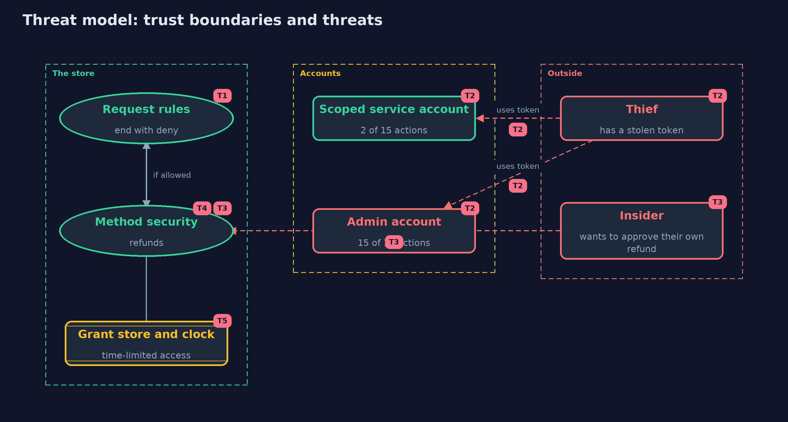

# Threat Model — Least Privilege with Spring Security

A threat model answers four questions: what are we protecting, who or what could harm it, how, and what do we do about it. This one covers this project's own demo system, not a production deployment. Domain: an online store.

## Scope

The authorization rules of an online store built with Spring Security: the request chain, method security on refunds, a role hierarchy, scoped service accounts and time-limited grants. It covers a stolen token, an insider who wants to approve their own refund, and a forgotten endpoint.
It does not cover how accounts log in, how tokens are issued, or the database underneath.

## What we protect (assets)

- The fifteen actions of the store, and the money and customer data behind them.
- The authorities held by each account.
- The refund approval rule.
- The grant store and the clock.

## Who and what acts on the system

- Support, warehouse and finance staff, an admin and a nightly export job.
- A thief with a stolen token.
- An insider who wants to approve their own refund.

## Trust boundaries

A trust boundary is a line that data or a request crosses between parts that trust each other differently. Threats cluster where those lines are.

- Request to the rule chain: every path crosses it and the last rule decides the unlisted ones.
- Account to its authorities: what a token carries is what an attacker can use.

Each dashed box is a trust boundary. A rose tag such as T1 shows where the threat of that number, in the table below, applies.

## Threats, using STRIDE

STRIDE is a checklist of six kinds of threat: **Spoofing** (S), **Tampering** (T), **Repudiation** (R), **Information disclosure** (I), **Denial of service** (D), **Elevation of privilege** (E).

| Id | Kind | Threat | Where it shows up | Control in this project | What is left |
| --- | --- | --- | --- | --- | --- |
| T1 | Elevation of privilege | A new endpoint is added and nobody writes a rule for it | `Shop.chain` | The last rule is deny, so an unlisted path is closed, even for an admin | A rule that is written too wide still opens too much, so each endpoint is tested as each account |
| T2 | Elevation of privilege | A stolen token of an over-privileged account reaches everything | `Catalogue`, `BlastRadius` | Service accounts hold exact authorities, and the reach of each account is measured | A scoped token still reaches its own actions, so it is rotated and monitored |
| T3 | Repudiation | A person approves their own refund | `Refunds.approve`, `RefundRules` | A rule in one bean, called by the annotation, that no role can switch off | Two colluding people can still do it, so refunds are also audited |
| T4 | Information disclosure | A post-authorized method does its work and leaks through a side effect | `Refunds.view` | `@PostAuthorize` withholds the result only, so methods with side effects use `@PreAuthorize` | Developers must know the difference, so the demo and a test show it |
| T5 | Elevation of privilege | A time-limited grant is extended or never expires | `Grants`, `GrantAuthorization` | The window is checked on every request against an injected clock | Whoever can write the grant store or change the clock can grant anything, so both are protected and audited |

## Assumptions

- Authentication works: a token belongs to the person it names, until it is stolen.
- The grant store and the clock cannot be changed by an attacker.
- In the demo, the password is one demo value and the accounts live in memory.

## Out of scope

- Login methods, tokens and single sign-on.
- Persistence of accounts and grants.
- Network and operating-system access.

## How the tests check this

- `AccessRulesTest` checks 401 and 403 answers, unlisted paths for an admin, the role hierarchy, the blast radius, the refund rule for admins and approvers, missing refunds, create without the permission, and the grant window.
- `DemoRunsTest` compares the whole demo with the golden output.

## Where this model goes next

The next project in the module, patching-and-dependency-hygiene, looks at keeping the software itself up to date, which limits what any attacker can do with a known flaw.
