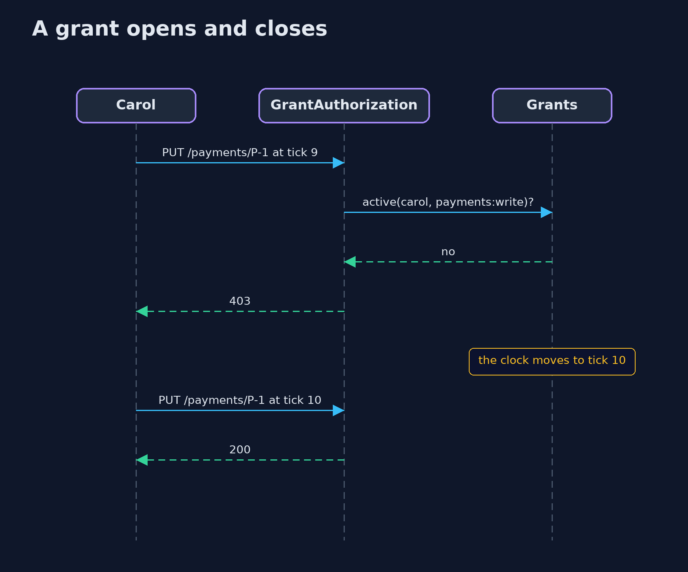
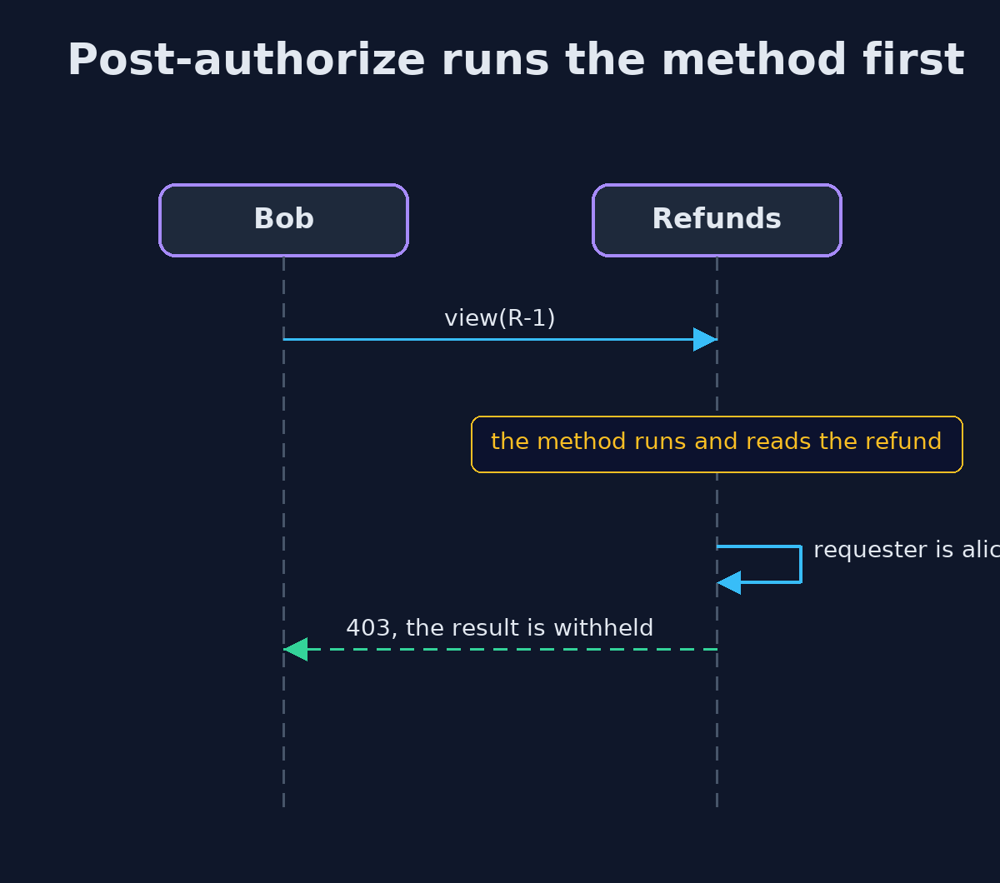

# Least Privilege with Spring Security — UML Sequence Diagrams

## 1. A grant opens and closes

The same request gets a different answer as the clock moves.

## 2. Post-authorize runs the method first

Bob's request does the work and then loses the answer.

