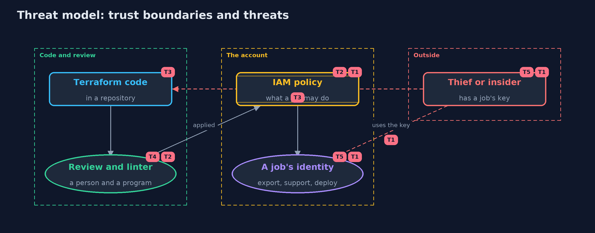

# Threat Model — Least Privilege with Terraform and LocalStack

A threat model answers four questions: what are we protecting, who or what could harm it, how, and what do we do about it. This one covers this project's own demo system, not a production deployment. Domain: an online store.

## Scope

How an online store's cloud permissions are written, reviewed and applied: Terraform code, the IAM policies it produces, and the identities that wear them. It covers a thief or insider who holds one job's key and a change to the code that widens a policy.
It does not cover how keys are stored, network access, or the cloud provider.

## What we protect (assets)

- The data and actions the account protects: reports, orders, customers, secrets and the key.
- The Terraform code and the policies it produces.
- The keys of each job's identity.

## Who and what acts on the system

- The nightly export, the support tool and the deploy pipeline.
- A thief or insider holding one job's key.
- A developer who changes the policy code.
- A reviewer, and the linter.

## Trust boundaries

A trust boundary is a line that data or a request crosses between parts that trust each other differently. Threats cluster where those lines are.

- Code repository to the account: a merged change becomes live permissions.
- A job's identity to the account: what its key can reach is the blast radius.

Each dashed box is a trust boundary. A rose tag such as T1 shows where the threat of that number, in the table below, applies.

## Threats, using STRIDE

STRIDE is a checklist of six kinds of threat: **Spoofing** (S), **Tampering** (T), **Repudiation** (R), **Information disclosure** (I), **Denial of service** (D), **Elevation of privilege** (E).

| Id | Kind | Threat | Where it shows up | Control in this project | What is left |
| --- | --- | --- | --- | --- | --- |
| T1 | Elevation of privilege | A stolen job key does everything a wildcard policy allows | `Catalogue.blastRadius` | One scoped policy per job, and a count of its blast radius | A small count can still hide escalation, so policies are read as well |
| T2 | Elevation of privilege | A policy that looks small grants a way to more power, such as iam:PassRole on every role | `Linter` | The linter flags escalation actions on every resource, and a person reviews the plan | The linter knows a fixed list, so new escalation paths need new rules |
| T3 | Tampering | A change to the code widens a policy and is merged without notice | the Terraform repository | Policies as code are reviewed as a diff, and the linter runs in the pipeline | Review only helps if someone reads it; require approval for permission changes |
| T4 | Information disclosure | The evaluator is trusted for something it does not model, such as a condition or an organisation rule | `PolicyDocument.parse` | A statement with a condition is refused, and the docs list what is not modelled | Real enforcement must be tested in a real account |
| T5 | Repudiation | Nobody can tell which job used a permission, because jobs share one identity | the job identities | One identity per job, so logs name the job | Logging itself is outside this project |

## Assumptions

- The emulator in the integration tests uses test credentials and is thrown away.
- Reviewers read the plan, and the linter runs in the pipeline.
- The catalogue of 25 things stands for the account, and the demo account number is a fake.

## Out of scope

- Enforcement by a real AWS account or a paid emulator.
- Conditions, resource policies, session policies and organisation rules.
- Where job keys are stored.

## How the tests check this

- `GlobTest` checks star, question mark and the case rules.
- `EvaluatorTest` checks deny by default, deny in any order, boundaries, NotAction and refused conditions.
- `FixturesAndLinterTest` checks the blast radius of every policy, the bucket against contents rule and the linter findings.
- `TerraformInteropTest` (integration) applies the code with OpenTofu to LocalStack and checks that what is stored equals the fixtures, that the boundary is attached and that a second plan has nothing to change.
- `DemoRunsTest` compares the whole demo with the golden output.

## Where this model goes next

That completes the safe-habits module. Higher levels build on it: applying least privilege to identity providers, secrets and the software supply chain.
