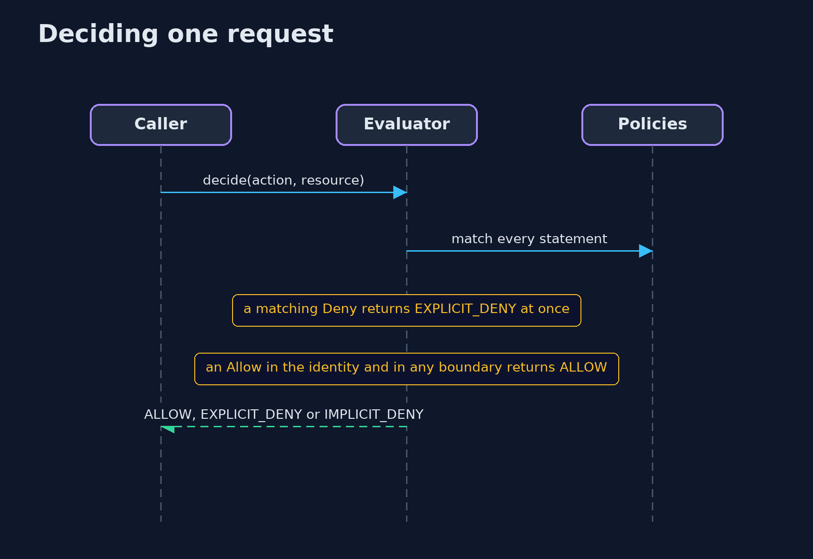
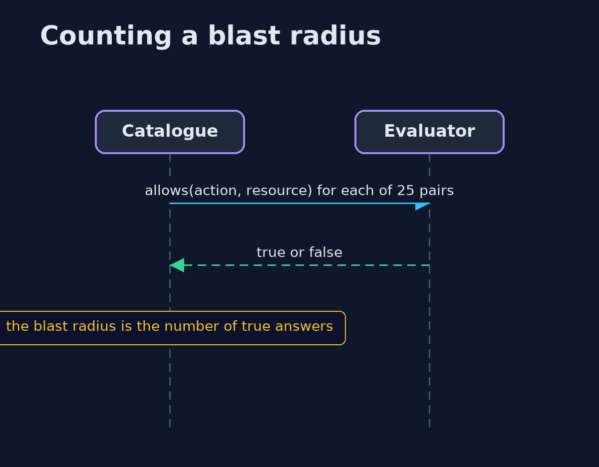

# Least Privilege with Terraform and LocalStack — UML Sequence Diagrams

## 1. Deciding one request

A deny wins; otherwise the identity and any boundary must both allow.

## 2. Counting a blast radius

The identity is asked about each of the 25 pairs.

