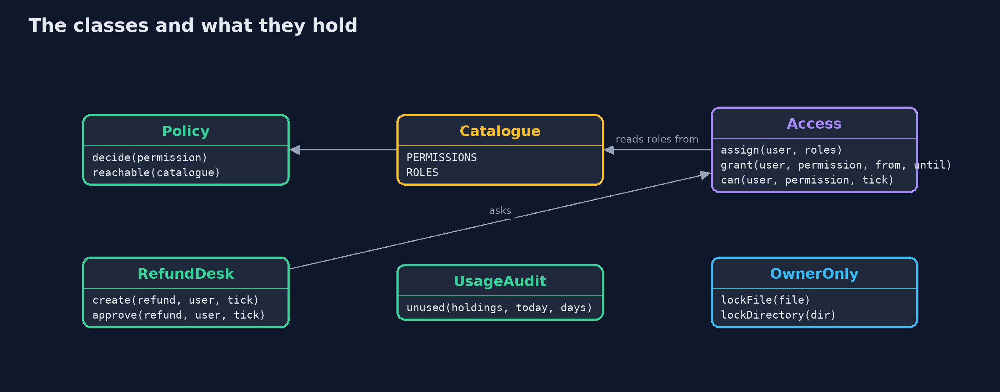
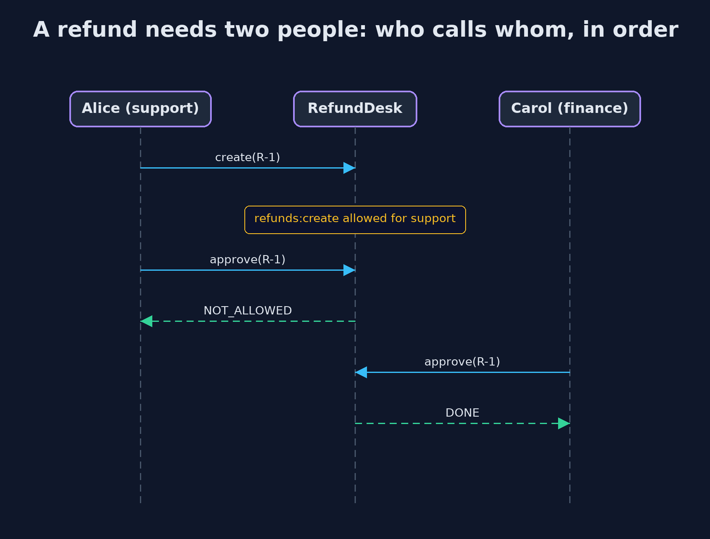

# The Principle of Least Privilege

```
src/main/java/com/jk/explore/security/leastprivilege/
├── Access.java              Who has which roles, plus grants that expire on a simulated clock (in ticks)
├── Catalogue.java           Everything that can be done in the online store, and the roles that bundle some of it
├── LeastPrivilegeDemo.java  Runs the online store story in five numbered acts and prints exact, repeatable results
├── OwnerOnly.java           Operating system permissions: the oldest least-privilege tool, and one the JDK can set directly
├── Policy.java              A list of allow and deny statements about permissions written as "resource:action", where either part may be " "
├── RefundDesk.java          Refunds need two different people: one creates, another approves
└── UsageAudit.java          Finds permissions that were granted and have not been used lately: privilege creep
```

**Everyone and every program should hold only the permissions the work needs, for only as long as it needs them, so that one stolen credential, one mistake or one dishonest person can reach as little as possible.**

The **principle of least privilege** says that every person and every program should have only the permissions its work needs, and no more. It matters because things go wrong: a password is stolen, a token leaks, a person makes a mistake or turns dishonest. What the
attacker or the mistake can reach is the **blast radius**, and it is exactly the privilege the account held. A policy that is **deny by default**, where nothing is allowed unless a statement allows it and an **explicit deny** beats any allow, keeps privilege small. Two more habits help:
**separation of duties**, so that no single account can complete something risky alone, and **access that expires**, so that a temporary need does not become a permanent permission.

The demo gives an online store a catalogue of 15 things that can be done, measures what a stolen credential reaches, requires two people for a refund, grants access on a simulated clock, audits unused permissions, and locks a file to its owner.

## The idea in everyday terms

Think of a hotel. A guest's key opens one room and stops working at checkout. A master key that opens every door is kept in a safe and signed out only for a reason. And the person who orders a refund at the front desk is not the person who approves it.
If a guest's key is stolen, one room is lost, not the hotel.

## The scenario

An online store has customers, orders, payments, refunds, inventory, reports and secrets. The demo asks what each role may do, what happens when a nightly export job's token is stolen, whether one person can refund themselves, what happens to access given for a month-end fix, and which permissions nobody uses.

## Run

```bash
./gradlew run
```

The demo tells the story in 5 acts, each printing exact numbers that the tests check:

| Act | What it shows |
| --- | --- |
| 1. Roles and permissions, and deny by default | The store has 15 things that can be done; admin allows all 15 and support, warehouse and finance allow 3 each; what nothing allows is denied, and an explicit deny beats any allow. |
| 2. Blast radius: what a stolen credential can reach | A nightly export that runs as admin reaches 15 of 15 if its token is stolen; with only the exporter role, 2 of 15; an admin with an explicit deny on secrets reaches 13. |
| 3. Separation of duties: two people for a refund | Alice creates a refund but cannot approve; Dave, an admin, creates one and is refused when he approves it himself; Carol approves Alice's. |
| 4. Access that expires by itself | Carol is granted payments:write for ticks 10 to 12; she can write at ticks 10 and 12, not at 9 or 13, and nobody has to remember to remove it. |
| 5. Privilege creep, and the operating system | Of 5 permissions held, 2 were not used in 90 days; a file is made readable by others and then owner-only, rw------- in a rwx------ folder; the SecurityManager is gone. |

## Test

```bash
./gradlew test
```

20 tests in `AccessTest`, `AuditAndFilesTest`, `DemoRunsTest`, `PolicyTest`. The policy, roles, grants and audit run on fixed data and a simulated clock, so the golden output is the same on every run. The file permissions are set explicitly, so they do not depend on the machine's default umask.

## What the simulation got right, and what it left out

The policy engine, roles, grants and audit are plain Java with a simulated clock and fixed data, so the demo is exact. The one real piece is the operating system: it sets POSIX file permissions on a temporary file, and so runs on macOS and Linux.

## Technologies and versions

Every version below is pinned in the project's build files and was the latest stable release when the project was built.

| Technology | Version | Used for |
| --- | --- | --- |
| Java | 25 | the language and runtime; a Gradle toolchain finds or downloads the JDK |
| Gradle | 9.8.1 (wrapper) | build and run; nothing to install, the wrapper downloads it |
| org.junit.jupiter:junit-jupiter | 6.1.3, set by junit-bom | JUnit 5: the tests (tests only) |
| org.junit.platform:junit-platform-launcher | 6.1.3, set by junit-bom | JUnit platform launcher, which Gradle needs to run the tests (tests only) |
| videokit | repository tool (`tools/videokit`) | the narrated video and animation: Piper `en_US-amy-medium`, speed 0.8, longer pauses (the amy-slow voice) |

## Learning Material

| Document | What it is for |
| --- | --- |
| [Problem statement](docs/problem-statement.md) | the situation and what the project must show |
| [Prerequisites](docs/prerequisites.md) | what you need to know first |
| [The Principle of Least Privilege, explained](docs/least-privilege-explained.md) | the acts in prose |
| [Session guide](docs/session.md) | a one-hour lesson with exercises |
| [Animated walkthrough](docs/animation.html) | the acts step by step, narrated |
| [Threat model](docs/threat-model.md) | what is protected, who could harm it, and how, using STRIDE |
| [Spec](docs/spec.md) | what this project must be true of |
| [Expected output](docs/expected-output.txt) | the golden demo output every test and every port checks against |

### The idea in one picture

Users get roles, roles hold permissions, a policy decides each request, and grants add time-limited exceptions.


### Where each piece sits

Access combines roles and grants into a Policy; RefundDesk and UsageAudit use it.



### How the data moves

Look for an explicit deny first, then for an allow, and otherwise deny.


### Who calls whom, in order




### Video

`video/least-privilege-explained.mp4` (with `.m4a` audio and `.srt` subtitles) is built by `video/build_video.sh`. Rendered media is not committed.

## What it costs

- **More roles to manage.** Many small roles take more design than one admin role, and need someone to own them.
- **Requests for more access.** People who are denied ask for access, so there must be a fast, recorded way to grant it temporarily.
- **Audits need data.** Finding unused permissions needs a record of what is actually used, kept for long enough to be meaningful.
- **Separation of duties slows work.** Two people for a refund is slower than one, which is the point, and it should be applied where the risk justifies it.

## When this is too much

Least privilege applied to the point where nobody can do their job leads people to share accounts and write permissions down, which is worse. Start with the highest risks: administrator access, programs that run unattended, and anything that moves money or reads secrets.

## Where you have already met this

- Cloud IAM policies, with their explicit deny and default deny, and temporary credentials.
- Kubernetes roles and role bindings, and `sudo` rules.
- Database users that can only read, and file permissions such as `chmod 600`.
- "Four eyes" approval for payments and production deploys.

## Where this sits

This project is the first in [safe-habits](..), and it applies [authentication-vs-authorization](../../identity/authentication-vs-authorization) at the level of design: once we know who is asking, how much should they be allowed?
