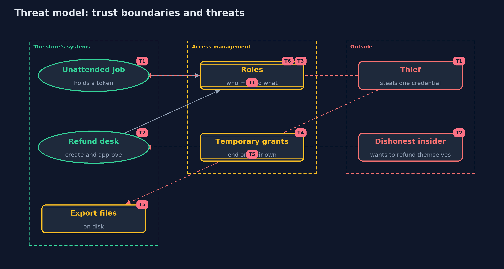

# Threat Model — The Principle of Least Privilege

A threat model answers four questions: what are we protecting, who or what could harm it, how, and what do we do about it. This one covers this project's own demo system, not a production deployment. Domain: an online store.

## Scope

How an online store gives access to its staff, its unattended jobs and its files: roles and permissions, refunds that need two people, temporary grants, the audit of unused permissions, and the file permissions of exports.
It covers theft of one credential and a dishonest insider. It does not cover how people prove their identity, network access, or the security of the systems the permissions apply to.

## What we protect (assets)

- Customer data, payments and refunds.
- Secrets such as keys and tokens.
- The roles and grants themselves.
- Export files on disk.

## Who and what acts on the system

- Staff in support, warehouse and finance roles.
- Unattended jobs and services holding tokens.
- An attacker who steals one credential.
- A dishonest insider.

## Trust boundaries

A trust boundary is a line that data or a request crosses between parts that trust each other differently. Threats cluster where those lines are.

- Credential to the permissions behind it: the blast radius is everything across it.
- Request to decision: the policy is the guard.
- Role management to everyone else: who may change roles is itself a permission.

Each dashed box is a trust boundary. A rose tag such as T1 shows where the threat of that number, in the table below, applies.

## Threats, using STRIDE

STRIDE is a checklist of six kinds of threat: **Spoofing** (S), **Tampering** (T), **Repudiation** (R), **Information disclosure** (I), **Denial of service** (D), **Elevation of privilege** (E).

| Id | Kind | Threat | Where it shows up | Control in this project | What is left |
| --- | --- | --- | --- | --- | --- |
| T1 | Elevation of privilege | A stolen token of an over-privileged job reaches everything | `Access`, `Policy.reachable` | Scoped roles for each job, and a measured blast radius | A scoped job is still a stolen job, so tokens should also be short-lived and rotated |
| T2 | Repudiation | One person creates and approves their own refund | `RefundDesk` | Creator and approver must be different people, whatever their roles | Two colluding people can still do it, so approvals should be reviewed |
| T3 | Elevation of privilege | Roles grow over time until they allow far more than the work needs | `Catalogue.ROLES` | Review roles regularly and keep them small | Needs an owner and a schedule; code cannot do it alone |
| T4 | Elevation of privilege | Temporary access is never removed | `Access.grant` | Grants have an end and expire on their own | A renewal that nobody checks turns a temporary grant into a permanent one |
| T5 | Information disclosure | An export file is read by another user on the machine | `OwnerOnly` | Owner-only file and folder permissions | The owner's account, backups and root can still read it |
| T6 | Tampering | Someone changes the roles to give themselves access | the management of roles | Changing roles is itself a permission that is held by very few and recorded | Not modelled here; needs an audit log that the changers cannot edit |

## Assumptions

- People and jobs are correctly identified before the policy is asked.
- The audit's usage records are complete and cannot be edited by the people they describe.
- In the demo, names and numbers are fixed and the clock is simulated.

## Out of scope

- Authentication and sessions.
- Cloud IAM and Kubernetes RBAC: the tools projects.
- Sandboxing code inside the JVM.

## How the tests check this

- `PolicyTest` checks pattern matching, deny by default, explicit deny in any order, and the blast radius counts.
- `AccessTest` checks combined roles, user denies, grant windows, and two-person refunds including for an admin.
- `AuditAndFilesTest` checks the audit limit and owner-only file permissions.
- `DemoRunsTest` compares the whole demo with the golden output.

## Where this model goes next

The next project, patching-and-dependency-hygiene, looks at the other half of staying safe over time: keeping the software itself up to date.
