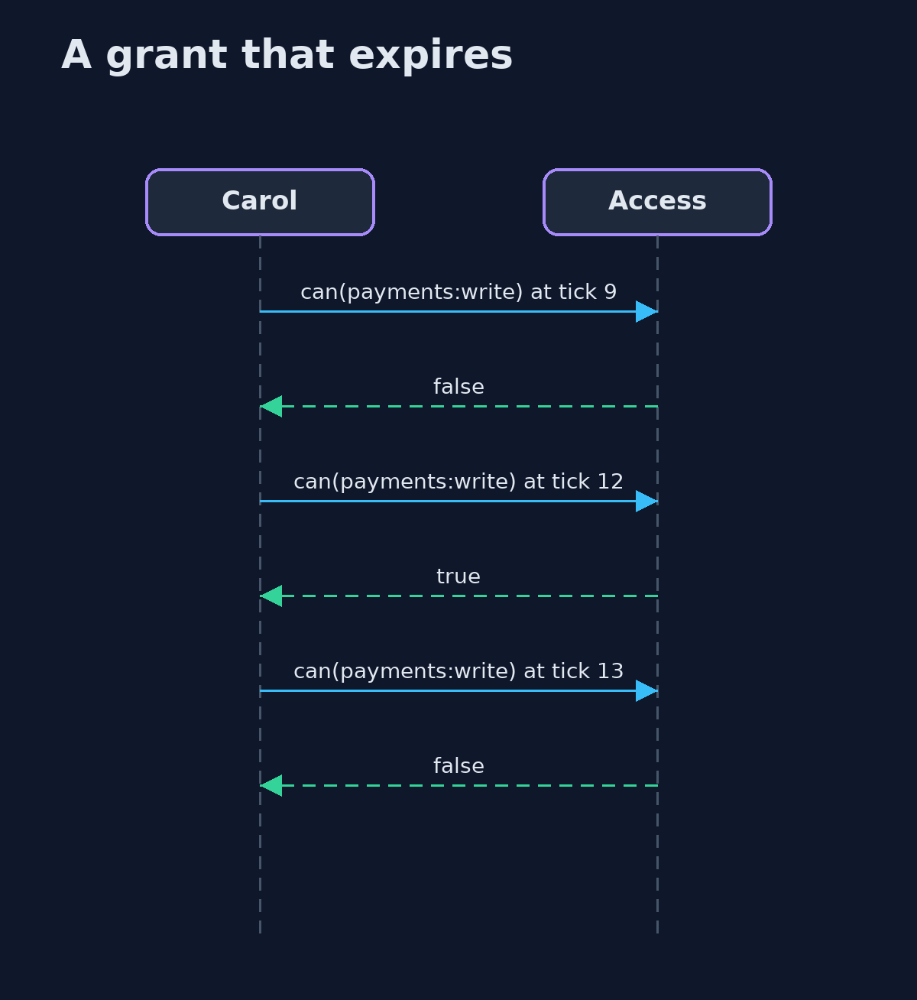
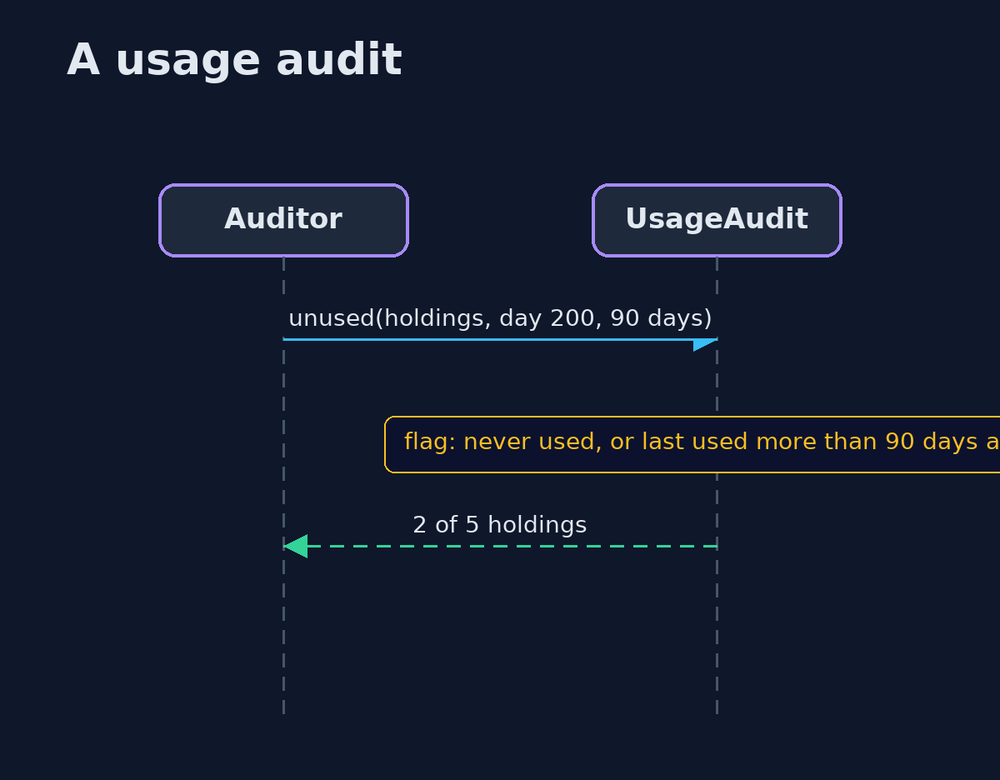

# The Principle of Least Privilege — UML Sequence Diagrams

## 1. A grant that expires

The decision depends on the clock, and the grant needs no clean-up.

## 2. A usage audit

A permission held and not used for more than the limit is a candidate for removal.

