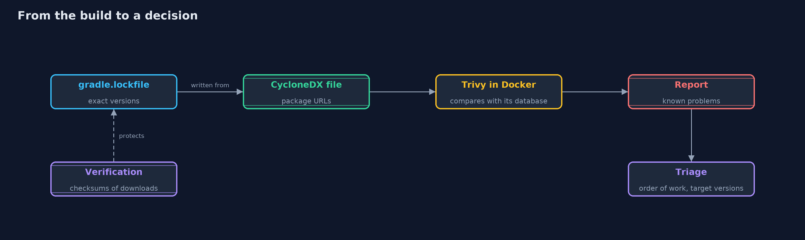

# Patching and Dependency Hygiene with Trivy and Gradle — Architecture Diagram

The lock file feeds the bill of materials, which Trivy compares with its database; the triage turns the report into work.

