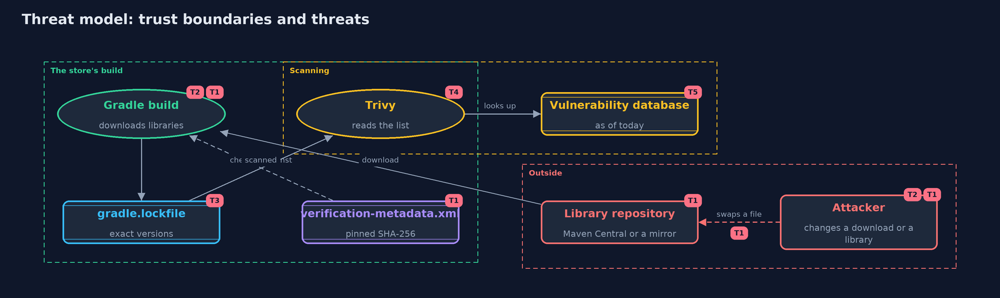

# Threat Model — Patching and Dependency Hygiene with Trivy and Gradle

A threat model answers four questions: what are we protecting, who or what could harm it, how, and what do we do about it. This one covers this project's own demo system, not a production deployment. Domain: an online store.

## Scope

How an online store finds out what its build contains and whether any of it is known to be vulnerable: the Gradle lock file, the bill of materials, the Trivy scan and its database, and the checksum verification of downloads. It does not cover container images, secrets, licences, or the store's own code.

## What we protect (assets)

- The libraries the store ships, and the integrity of what is downloaded.
- The lock file and the pinned checksums.
- The accuracy of the scan result, which drives the decision what to fix.

## Who and what acts on the system

- The store's developers and build servers.
- An attacker who can change a library in a repository or on the way.
- The scanner and its vulnerability database.

## Trust boundaries

A trust boundary is a line that data or a request crosses between parts that trust each other differently. Threats cluster where those lines are.

- Library repository to the build: every download crosses it.
- Vulnerability database to the scanner: a database that is old or unavailable changes the answer.

Each dashed box is a trust boundary. A rose tag such as T1 shows where the threat of that number, in the table below, applies.

## Threats, using STRIDE

STRIDE is a checklist of six kinds of threat: **Spoofing** (S), **Tampering** (T), **Repudiation** (R), **Information disclosure** (I), **Denial of service** (D), **Elevation of privilege** (E).

| Id | Kind | Threat | Where it shows up | Control in this project | What is left |
| --- | --- | --- | --- | --- | --- |
| T1 | Tampering | A library is changed in the repository or on the way, and the build uses the changed file | `VerificationMetadata`, the Gradle build | Gradle's dependency verification pins the SHA-256 of every download and fails the build on a mismatch | A bad file that was pinned when the file was written stays pinned, so review new hashes, and consider signatures |
| T2 | Tampering | A dependency version floats and the build picks up a malicious or broken release | `GradleLockfile` | Dependency locking records the exact version of every library | The lock file must be updated deliberately, with review, or the store falls behind |
| T3 | Repudiation | Nobody can say which versions a past release shipped | `CycloneDx` | A bill of materials is written for each build and kept with the release | It describes what the build resolved, not what was copied in by other means |
| T4 | Information disclosure | A scan gives a false sense of safety because the input is wrong or incomplete | `TrivyReport`, `OwnAdvisory` | The code checks that every reported library is in the list and cross-checks well known problems with its own ranges | Libraries copied into the source, or not in the list, are not scanned at all |
| T5 | Denial of service | The vulnerability database is old or cannot be downloaded, so the scan reports less than is known | the Trivy database | Download the database once and update it on a schedule, and fail the pipeline when it is too old | A clean report means no known problem on the day of the database |

## Assumptions

- The repository is reached over TLS, and Gradle's verification file was reviewed when it was written.
- The scan is repeated, since new problems appear after a library ships.
- In the demo, the libraries are real but never run, and the report is a saved copy from 17 October 2026.

## Out of scope

- Container image scanning, secret scanning and licence checks.
- Verifying signatures of artifacts.
- The store's own code.

## How the tests check this

- `FormatsTest` checks version comparison, the lock file, the CycloneDX file and its strict checks, the saved report, the triage, and the verification file.
- `ToolsIntegrationTest` (integration) runs the real Trivy in Docker on the files the code writes, compares the SBOM and lock file scans, checks that the upgrade removes the original critical problems, and runs a nested Gradle build that must refuse a changed checksum.
- `DemoRunsTest` compares the whole demo with the golden output.

## Where this model goes next

The next project, backups-and-recovery, covers what to do when prevention fails: copies that survive an attack, and a restore that has been tested.
