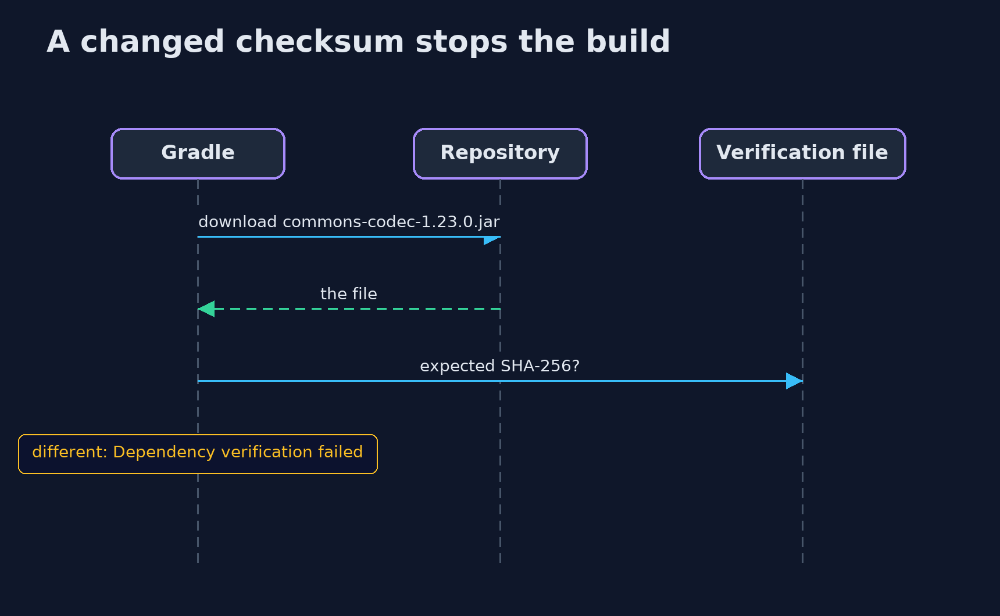
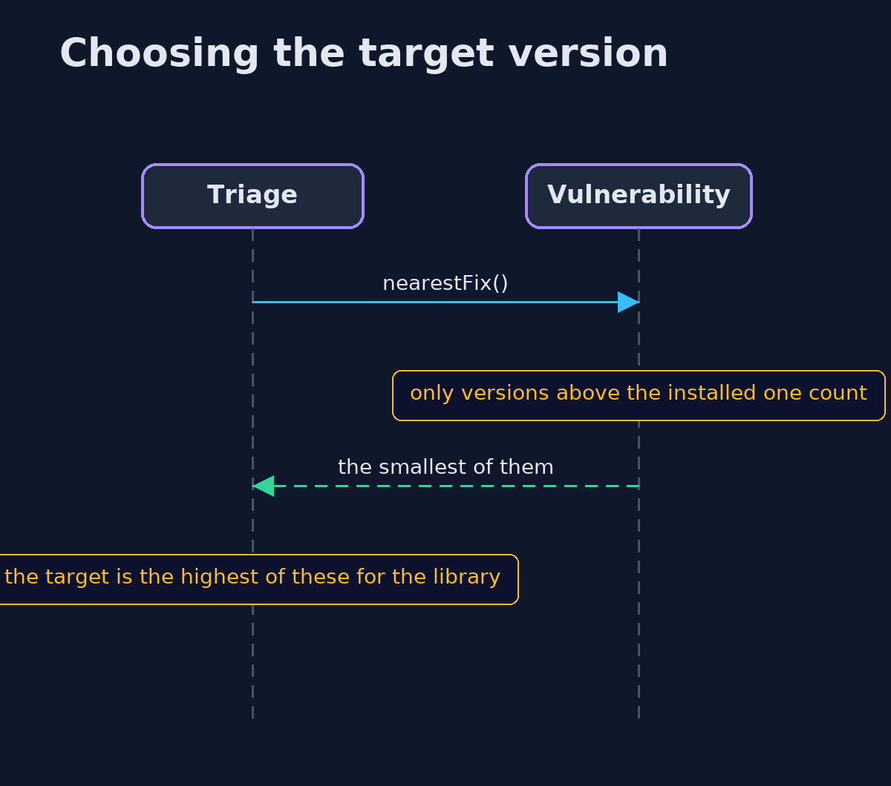

# Patching and Dependency Hygiene with Trivy and Gradle — UML Sequence Diagrams

## 1. A changed checksum stops the build

Gradle compares each download with the pinned SHA-256.

## 2. Choosing the target version

The nearest fix above the installed version, and the highest of those per library.

