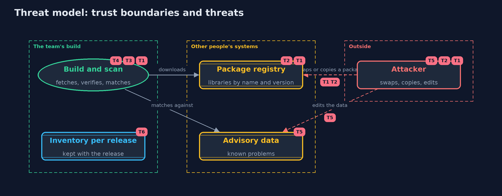

# Threat Model — Patching and Dependency Hygiene

A threat model answers four questions: what are we protecting, who or what could harm it, how, and what do we do about it. This one covers this project's own demo system, not a production deployment. Domain: an online store.

## Scope

How an online store knows what it ships, learns about flaws in it, decides what to fix and when, and receives the fixed libraries. It covers the build that downloads artifacts, the registry they come from, and the advisory data. It does not cover flaws in the store's own code or the security of the registry's servers.

## What we protect (assets)

- The running store, which contains every library in the inventory.
- The inventory of each release.
- The advisory data and the pinned hashes.
- The build that fetches and verifies artifacts.

## Who and what acts on the system

- The team that maintains the store.
- A library author, whose releases the store trusts.
- An attacker who can publish packages, or change a download on its way.

## Trust boundaries

A trust boundary is a line that data or a request crosses between parts that trust each other differently. Threats cluster where those lines are.

- Registry to build: every artifact crosses it and the hash is the check.
- Advisory data to the scanner: the data decides what the team believes is wrong.

Each dashed box is a trust boundary. A rose tag such as T1 shows where the threat of that number, in the table below, applies.

## Threats, using STRIDE

STRIDE is a checklist of six kinds of threat: **Spoofing** (S), **Tampering** (T), **Repudiation** (R), **Information disclosure** (I), **Denial of service** (D), **Elevation of privilege** (E).

| Id | Kind | Threat | Where it shows up | Control in this project | What is left |
| --- | --- | --- | --- | --- | --- |
| T1 | Tampering | A dependency is swapped for a changed artifact under the same name and version | `Pins.verify` | A SHA-256 recorded at review time, compared on every download | A pin proves the file is the one reviewed, not that the reviewed file was safe |
| T2 | Spoofing | A package is published under a name one letter from a real one, and gets installed by mistake | `Typosquat` | Flag names one edit from a known name, and take libraries only from an allow-listed repository | Only near misses are caught; a deliberately different name needs human review |
| T3 | Information disclosure | A library with a known flaw stays in the store because nobody knew it was there | `Sbom`, `Audit.scan` | An inventory for every build, including transitive libraries, matched against advisories | A scan finds known problems only, and the advisory data must be current |
| T4 | Elevation of privilege | A reachable critical flaw is exploited before it is fixed | `PatchWindow`, `Audit.triage` | Rank by score and reachability, and give each severity a deadline | Even a fix inside the window leaves days of exposure; mitigations such as a temporary block may be needed |
| T5 | Tampering | The advisory data or the inventory is edited to hide a problem | `Advisory.parse`, `Sbom.parse` | Keep both under version control with reviewed changes, and fetch advisories from a trusted source over TLS | Someone with write access to both can still hide a problem, so changes need a second reviewer |
| T6 | Repudiation | After an incident nobody can show what the store was built from at the time | `Sbom` | Keep the inventory of every release with the release | The inventory must be generated by the build, because a hand-kept list drifts |

## Assumptions

- The first review of an artifact before pinning is honest and careful.
- The advisory data is current and comes from a source the team trusts.
- In the demo, all libraries and problems are fictional and the clock is simulated.

## Out of scope

- Flaws in the store's own code.
- Signature verification of artifacts: the signing projects.
- The security of the registry's own servers.

## How the tests check this

- `VersionTest` checks numeric version order, every range operator, exact range boundaries and refused nonsense.
- `JsonTest` checks the reader on every kind of value and on malformed text.
- `CvssTest` checks the equation against published scores, the rounding rule and the severity bands.
- `AuditTest` checks the inventory, shortest paths, cycles, broken inventories, the findings, the advice and the ranking.
- `PatchWindowAndPinsTest` checks the deadlines, SHA-256 against published values, every single-bit change, unpinned artifacts and lookalike names.
- `DemoRunsTest` compares the whole demo with the golden output.

## Where this model goes next

The next project, backups-and-recovery, looks at what happens when prevention fails: how to restore data, and how to know that the backup works.
