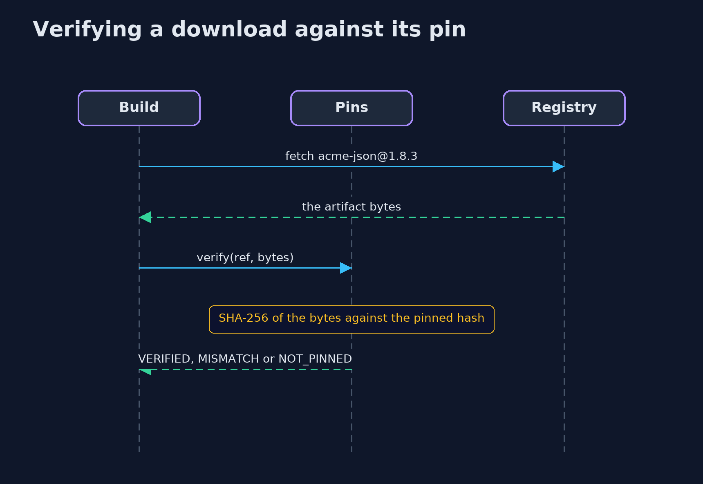
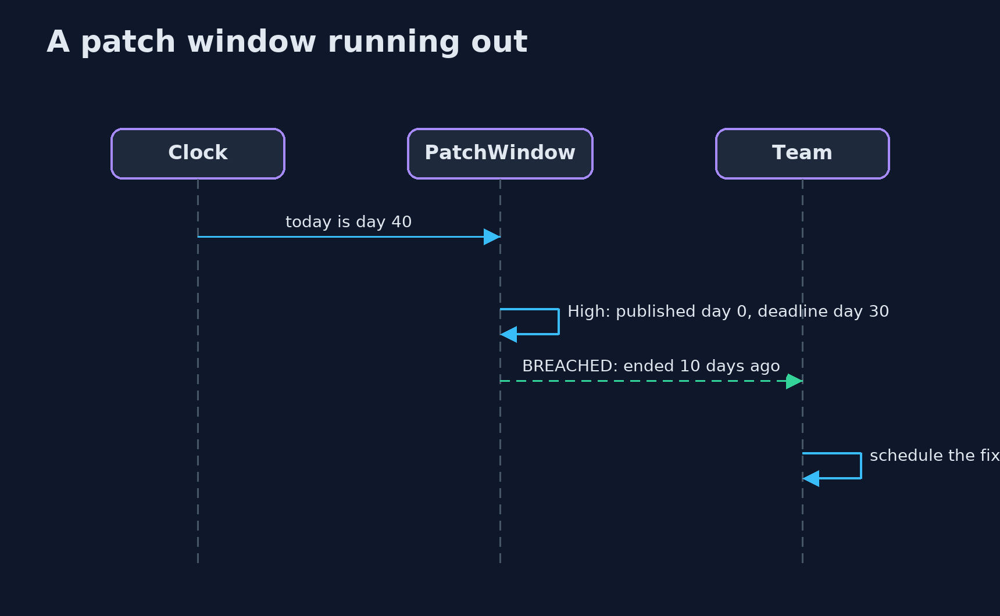

# Patching and Dependency Hygiene — UML Sequence Diagrams

## 1. Verifying a download against its pin

A reviewed hash is the only thing that makes a file acceptable.

## 2. A patch window running out

Each finding is checked against its deadline on the simulated clock.

