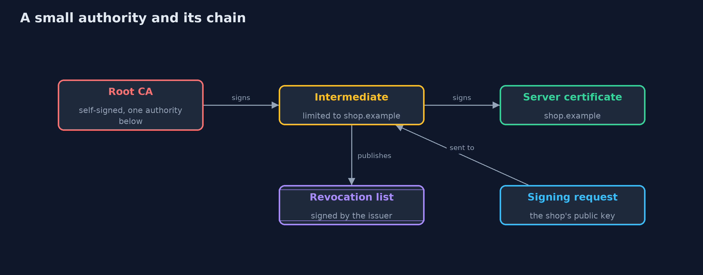
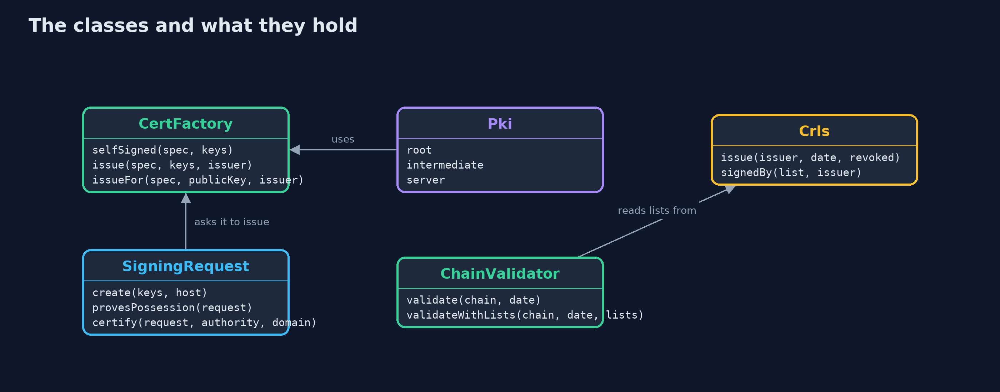
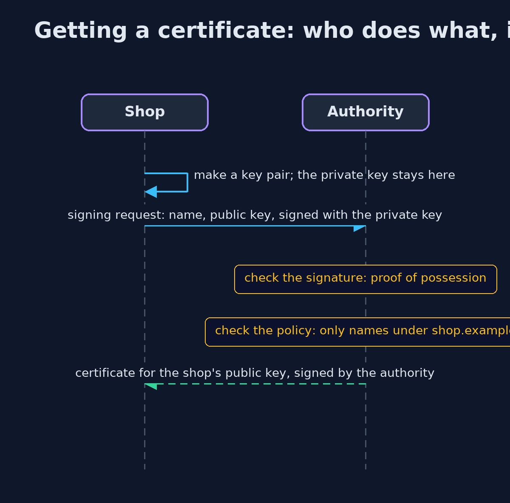

# Certificates and Chain of Trust with Bouncy Castle and OpenSSL

```
src/main/java/com/jk/explore/security/certsbc/
├── CertFactory.java     Builds X.509 version 3 certificates with Bouncy Castle's builders
├── CertsBcDemo.java     Runs the online store story in five numbered acts and prints exact, repeatable results
├── ChainValidator.java  Validates a certificate chain with the JDK's PKIX implementation, on a date the caller chooses, against the roots the caller trusts, optionally checking revocation lists
├── Crls.java            A certificate revocation list: the issuer's signed statement of which of its certificates should no longer be trusted
├── HostName.java        Does the certificate vouch for this host name?
├── Issued.java          A certificate together with the key pair of its subject
├── Pem.java             PEM is the text form every tool reads: a line saying what it is, the DER bytes in base 64, and a closing line
├── Pki.java             The online store's certificates, built fresh for each run: a root, an intermediate limited to the store's names, and the server certificate for shop.example
└── SigningRequest.java  How a shop gets a certificate without ever handing over its private key: it signs a request (PKCS#10) with that key, naming itself and carrying its public key
```

**Bouncy Castle builds real certificates, name limits, revocation lists and signing requests from named calls, and OpenSSL, written by other people, agrees with every one of them, but each extension is a place to get a rule quietly wrong.**

The plain version of this lesson wrote the bytes of a certificate by hand, because the JDK can **check** certificates but has no public way to **make** them. **Bouncy Castle** is an open-source library that supplies the missing builders. With
them the project makes a **root**, an **intermediate** and a **server certificate**, and attaches the extensions that say what each may do: whether it is an authority, how many authorities may sit below it, which keys may sign what, which names it
covers, and which names an authority is allowed to certify at all (a **name constraint**).

It also publishes **revocation lists** (CRLs), signed by the issuer, and walks through the **signing request** (PKCS#10) that lets a shop get a certificate without ever handing over its private key. Because all of this is standard, a different program can
check it, and this project proves that by asking **OpenSSL** to verify the same chain, read the same lists, and even sign a request that Java wrote.

## The idea in everyday terms

Think of a passport office. The government (the root) authorises regional offices (the intermediates) and can limit what each may do: this office may only issue passports to residents of one town. The traveller (the shop) makes their own signature and brings only a
form (the signing request), never the pen they sign with. Lost passports are published on a list the border officers check. A stolen office stamp is the disaster: forged passports look genuine until the office is struck off.

## The scenario

An online store runs its own small certificate authority for shop.example. The demo builds the chain, limits the intermediate to the store's names, publishes lists, handles a signing request, and then imagines the intermediate's key being stolen.

## Run

```bash
./gradlew run
```

The demo tells the story in 5 acts, each printing exact numbers that the tests check:

| Act | What it shows |
| --- | --- |
| 1. A chain built with Bouncy Castle | A root, an intermediate and a server certificate are built from named calls, with authority flags, key usages and key identifiers that link each to its parent. |
| 2. A limit the authority carries in its own certificate | The intermediate may only certify shop.example and names below it; a certificate for another name from the same intermediate is refused with INVALID_NAME. |
| 3. A revocation list signed by the issuer | A signed list naming the shop's serial makes the chain REVOKED; a list signed by someone else, or no list, leaves the status undetermined and the chain refused. |
| 4. Asking for a certificate without handing over the private key | The shop signs a request with its own key; the authority checks the signature and its policy, certifies only names under shop.example, and the certificate holds the shop's public key. |
| 5. A stolen authority key, and the bill | A forged chain from a stolen intermediate key is accepted until the root revokes the intermediate; then both the forged and the real chains are refused and the shop needs a new certificate. |

## Test

```bash
./gradlew test
```

32 tests in `ChainTest`, `DemoRunsTest`, `HostNameTest`, `ListAndRequestTest`, `OpenSsl`, `OpenSslInteropTest`. Chains are validated on a fixed date. Keys are random, so the demo and its tests check only facts that do not depend on them. The ordinary tests need only a JDK; the integration tests (tagged openssl) run the real OpenSSL 3 as an independent check.

## What the simulation got right, and what it left out

Keys are random, so the demo prints only facts that do not depend on them: what an extension says, whether a chain is accepted and why, and whether a request or list verifies. The validation date is fixed (2026-01-01), not the real clock.
OpenSSL is used only by the integration tests, so the demo and the ordinary tests need nothing installed.

## Technologies and versions

Every version below is pinned in the project's build files and was the latest stable release when the project was built.

| Technology | Version | Used for |
| --- | --- | --- |
| Java | 25 | the language and runtime; a Gradle toolchain finds or downloads the JDK |
| Gradle | 9.8.1 (wrapper) | build and run; nothing to install, the wrapper downloads it |
| org.bouncycastle:bcprov-jdk18on | 1.86 | Bouncy Castle: algorithms and providers the JDK lacks |
| org.bouncycastle:bcpkix-jdk18on | 1.86 | Bouncy Castle PKIX: PEM, X.509 certificates and CMS |
| org.junit.jupiter:junit-jupiter | 6.1.3, set by junit-bom | JUnit 5: the tests (tests only) |
| org.junit.platform:junit-platform-launcher | 6.1.3, set by junit-bom | JUnit platform launcher, which Gradle needs to run the tests (tests only) |
| OpenSSL (command-line tool) | 3.x | the independent check that verifies the chain, reads the lists and requests, and acts as a second authority; needed for the integration tests |
| videokit | repository tool (`tools/videokit`) | the narrated video and animation: Piper `en_US-amy-medium`, speed 0.8, longer pauses (the amy-slow voice) |

## Learning Material

| Document | What it is for |
| --- | --- |
| [Dependencies](docs/dependencies.md) | what the framework and infrastructure are, and why they are here |
| [Problem statement](docs/problem-statement.md) | the situation and what the project must show |
| [Prerequisites](docs/prerequisites.md) | what you need to know first |
| [Certificates and Chain of Trust with Bouncy Castle and OpenSSL, explained](docs/certificates-and-chain-of-trust-with-bouncy-castle-explained.md) | the acts in prose |
| [Session guide](docs/session.md) | a one-hour lesson with exercises |
| [Animated walkthrough](docs/animation.html) | the acts step by step, narrated |
| [Threat model](docs/threat-model.md) | what is protected, who could harm it, and how, using STRIDE |
| [Spec](docs/spec.md) | what this project must be true of |
| [Expected output](docs/expected-output.txt) | the golden demo output every test and every port checks against |

### The idea in one picture

The root signs the intermediate, the intermediate signs the shop, and each certificate limits the one below.



### Where each piece sits

CertFactory builds; Crls and SigningRequest support it; ChainValidator checks the result.



### How the data moves

A signed bundle: the subject, its public key, the extensions that limit it, and the issuer's signature.


### Who calls whom, in order




### Video

`video/certificates-and-chain-of-trust-with-bouncy-castle-explained.mp4` (with `.m4a` audio and `.srt` subtitles) is built by `video/build_video.sh`. Rendered media is not committed.

## What it costs

- **Every extension is a chance to be wrong.** A missing critical flag or constraint silently weakens a rule, and nothing fails until someone relies on it.
- **The library is large.** About a few megabytes of code to build a handful of structures, and its own release cycle to keep up with.
- **A stolen authority key breaks everything below it.** Name constraints limit the damage, and revocation only protects clients that fetched the newest list.
- **Revocation is weak in practice.** Many browsers go ahead when they cannot fetch a list, so short-lived certificates are the stronger defence.
- **Running an authority is a duty.** Offline keys, audit logs, procedures and backups matter more than the code.

## When this is too much

For a real public website, use a public authority and an automated client. Run your own authority for internal systems, tests and mutual TLS between services, where you control who trusts the root, and keep the root key offline.

## Where you have already met this

- `openssl x509 -text`, which prints exactly the extensions this project writes.
- Let's Encrypt and other public authorities, which publish intermediates and revocation information.
- Internal certificate authorities in service meshes and Kubernetes.
- `keytool -importcert`, which adds a root to a trust store.

## Where this sits

This project follows [certificates-and-chain-of-trust](../certificates-and-chain-of-trust) and is the fifth in [transport-security](..). It builds on [asymmetric-encryption-with-bouncy-castle](../../cryptography/asymmetric-encryption-with-bouncy-castle), which first used the library.
