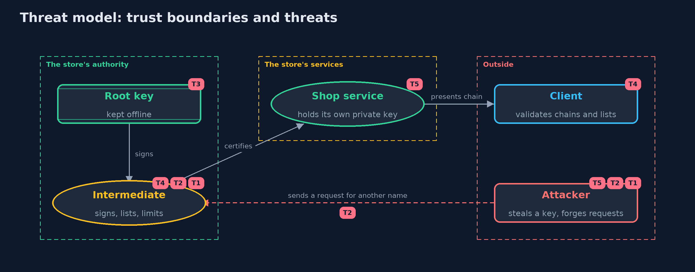

# Threat Model — Certificates and Chain of Trust with Bouncy Castle and OpenSSL

A threat model answers four questions: what are we protecting, who or what could harm it, how, and what do we do about it. This one covers this project's own demo system, not a production deployment. Domain: an online store.

## Scope

A small certificate authority run by an online store for its own services: a root, an intermediate limited to the store's names, server certificates, revocation lists and signing requests. It covers an attacker who steals a key, sends a request for a name that is not theirs, or relies on a
client that cannot fetch a list. It does not cover public authorities, OCSP, certificate transparency or hardware key storage.

## What we protect (assets)

- The root private key and the intermediate private key.
- The shop service's private key.
- The clients' trust in the root.
- The revocation lists and the policy for signing requests.

## Who and what acts on the system

- The store's operators, who run the authority.
- The shop service, which requests certificates.
- Clients that validate chains and lists.
- An attacker who steals a key or sends forged requests.

## Trust boundaries

A trust boundary is a line that data or a request crosses between parts that trust each other differently. Threats cluster where those lines are.

- Root key to everything else: the root stays offline and signs only intermediates.
- Signing request to the authority: a request from outside is untrusted until its signature and names are checked.
- Client to the lists: a client either gets a current list or must decide whether to trust anyway.

Each dashed box is a trust boundary. A rose tag such as T1 shows where the threat of that number, in the table below, applies.

## Threats, using STRIDE

STRIDE is a checklist of six kinds of threat: **Spoofing** (S), **Tampering** (T), **Repudiation** (R), **Information disclosure** (I), **Denial of service** (D), **Elevation of privilege** (E).

| Id | Kind | Threat | Where it shows up | Control in this project | What is left |
| --- | --- | --- | --- | --- | --- |
| T1 | Spoofing | An attacker who steals the intermediate's key signs certificates that clients accept | `Pki.intermediate`, `CertFactory` | A name constraint limits the names, the key is kept offline or in hardware, and the root can revoke the intermediate | Until clients fetch the new list the forged certificates are accepted, so lifetimes must be short |
| T2 | Spoofing | A request for a name the requester does not own is certified | `SigningRequest.certify` | The authority checks the request's signature and refuses names outside its domain | The domain check here is by suffix; real authorities also prove control of the name |
| T3 | Elevation of privilege | The root key is stolen, so any name can be certified | `Pki.root` | The root key is kept offline and used only to sign intermediates | Clients must replace the root, which is slow and disruptive |
| T4 | Repudiation | A revoked certificate is still accepted because the client could not or did not fetch the list | `ChainValidator.validateWithLists` | The client refuses when the status is undetermined, and lists are signed and dated | Many real clients go ahead instead, so short-lived certificates are the stronger defence |
| T5 | Information disclosure | The shop's private key is exposed while getting a certificate | `SigningRequest` | The request carries only the public key and a signature; the private key never leaves the shop | The shop must still protect its private key at rest |

## Assumptions

- The root key is kept offline and the root certificate reaches clients in a trustworthy way.
- Clients check revocation and refuse when they cannot find out.
- In the demo, keys are random and never printed, the dates are fixed, and the domain is the example domain shop.example.

## Out of scope

- OCSP, certificate transparency and automated issuance.
- Hardware security modules.
- The TLS handshake that carries the chain: the next projects.

## How the tests check this

- `ChainTest` checks the extensions, key identifiers, expiry, an untrusted root, name constraints, the path length limit and a changed certificate.
- `ListAndRequestTest` checks revocation, list signatures, missing and foreign lists, stale lists, requests, the authority's policy and PEM.
- `OpenSslInteropTest` (integration) checks that OpenSSL verifies the chain, shows the extensions, enforces the name constraint, reads the lists and request, and that an OpenSSL authority can sign a Java request.
- `DemoRunsTest` compares the whole demo with the golden output.

## Where this model goes next

The next project, https-server, puts a certificate chain to work on a real server.
