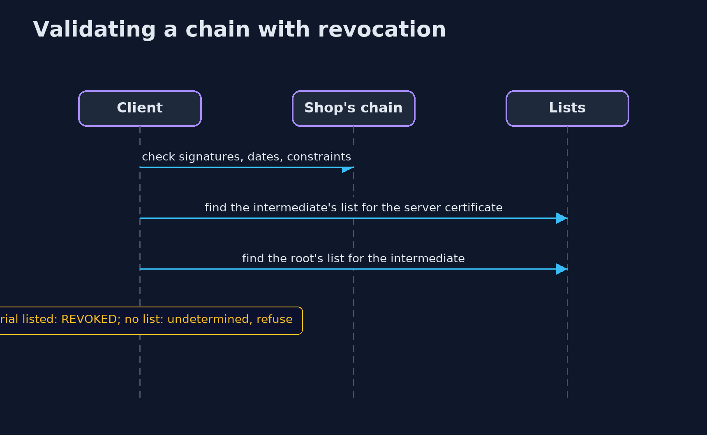
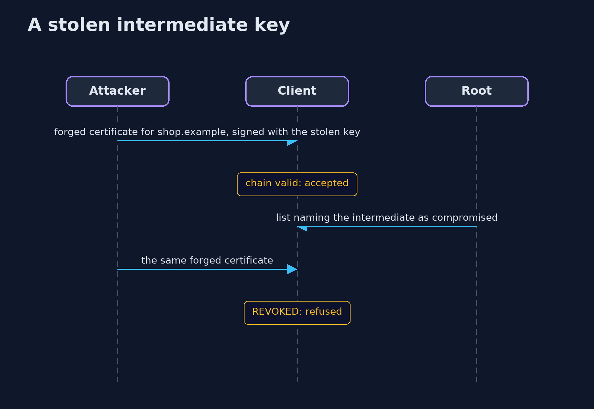

# Certificates and Chain of Trust with Bouncy Castle and OpenSSL — UML Sequence Diagrams

## 1. Validating a chain with revocation

Every certificate needs a current list from its issuer, or the chain is refused.

## 2. A stolen intermediate key

The forged certificate chains correctly until the root revokes the intermediate.

