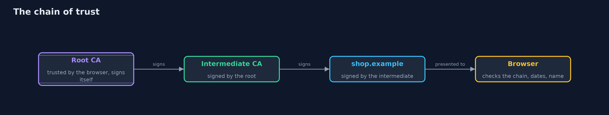
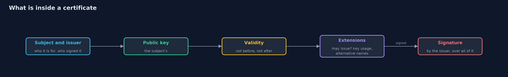

# Certificates and the Chain of Trust

```
src/main/java/com/jk/explore/security/certs/
├── CertBuilder.java     Builds X.509 version 3 certificates by writing their DER encoding directly and signing it with the JDK
├── CertsDemo.java       Runs the online store story in five numbered acts and prints exact, repeatable results
├── ChainValidator.java  Validates a certificate chain with the JDK's PKIX implementation, on a date the caller chooses, against the roots the caller trusts
├── Der.java             The small part of DER (the binary encoding behind X.509) that a certificate needs: tag, length, value
├── HostName.java        Does the certificate vouch for this host name?
├── Issued.java          A certificate together with the key pair of its subject
├── Pki.java             The online store's certificates, built fresh for each run: a root, an intermediate under it, and the server certificate for shop.example
├── RevocationList.java  An explicit list of revoked serial numbers, plugged into the JDK's path validation as an extra check
└── Tamper.java          Changes one letter inside the signed part of a certificate, as an attacker or a bit error would
```

**A certificate ties a name to a public key with an issuer's signature, and a chain of them leads back to a root that the client already trusts, but a chain proves who signed, not that the name is the one you meant, and one stolen authority key breaks everything below it.**

A public key is useful only if you know whose it is. A **certificate** answers that: it holds a name, a public key, a validity period and rules about what the key may do, and it carries the **signature** of an **issuer**, so
anyone with the issuer's public key can check it. The issuer's own key comes in a certificate signed by a higher issuer, and so on up to a **root** that the client was shipped with and trusts without proof. The list from the server's certificate
up to the root is the **chain of trust**.

The demo builds that chain for an online store, writing the X.509 encoding byte by byte, since the JDK reads and validates certificates but has no public API to make them. It validates the chain with the JDK's own PKIX validator
and then breaks it in five ways.

## The idea in everyday terms

Think of a passport. The passport carries your photo and your name, and a stamp from the passport office. You do not know the officer, but you know the office's stamp is certified by a ministry, and you already trust the ministry. A forged
passport can look identical in every way except that its stamp was not made by an office the ministry certified. And a valid passport is still no use if it belongs to someone else, so you also compare the name.

## The scenario

An online store's customers connect to shop.example. The store's server presents a certificate issued by an intermediate authority, which was issued by a root authority that the customer's browser trusts. The demo builds the chain,
validates it on a fixed date, and tries an expired certificate, a certificate from an unknown authority, a changed certificate, a server key that signs other certificates, a revoked certificate and a stolen authority key.

## Run

```bash
./gradlew run
```

The demo tells the story in 5 acts, each printing exact numbers that the tests check:

| Act | What it shows |
| --- | --- |
| 1. A chain of three certificates | A root signs itself, an intermediate is signed by the root and may issue certificates, and the server certificate for shop.example is signed by the intermediate and may not. |
| 2. The browser's check | The server sends its certificate and the intermediate; the browser trusts the root, so the chain is accepted, and the name shop.example matches but evil.example does not. |
| 3. Three reasons to refuse | An expired certificate is refused with reason EXPIRED, a certificate from an unknown authority with the same name is refused because its signature does not match, and a valid chain still needs a separate name check. |
| 4. Changed certificates, and certificates that overstep | One changed letter in the name still parses but fails the signature, and a server certificate that signs another certificate is refused because it is not allowed to. |
| 5. Revocation, and the bill | A stolen intermediate key forges a certificate that is accepted until the intermediate is revoked; revocation only works if clients have the latest list. |

## Test

```bash
./gradlew test
```

21 tests in `ChainTest`, `DemoRunsTest`, `DerTest`, `HostNameTest`. The keys are random, so the demo prints only facts that do not depend on them, and every check runs on a fixed date rather than the real clock. The DER encodings are checked against published values, and the JDK parses and validates every certificate the builder makes.

## What the simulation got right, and what it left out

The keys are random, so the demo prints only facts that do not depend on them: who signed what, whether a chain is accepted and the JDK's reason when it is not. All checks run on a fixed date, 2026-01-01, never on the real clock.
The encoding is checked against published object identifier encodings, and the JDK itself parses and validates every certificate the builder makes.

## Technologies and versions

Every version below is pinned in the project's build files and was the latest stable release when the project was built.

| Technology | Version | Used for |
| --- | --- | --- |
| Java | 25 | the language and runtime; a Gradle toolchain finds or downloads the JDK |
| Gradle | 9.8.1 (wrapper) | build and run; nothing to install, the wrapper downloads it |
| org.junit.jupiter:junit-jupiter | 6.1.3, set by junit-bom | JUnit 5: the tests (tests only) |
| org.junit.platform:junit-platform-launcher | 6.1.3, set by junit-bom | JUnit platform launcher, which Gradle needs to run the tests (tests only) |
| videokit | repository tool (`tools/videokit`) | the narrated video and animation: Piper `en_US-amy-medium`, speed 0.8, longer pauses (the amy-slow voice) |

## Learning Material

| Document | What it is for |
| --- | --- |
| [Problem statement](docs/problem-statement.md) | the situation and what the project must show |
| [Prerequisites](docs/prerequisites.md) | what you need to know first |
| [Certificates and the Chain of Trust, explained](docs/certificates-and-chain-of-trust-explained.md) | the acts in prose |
| [Session guide](docs/session.md) | a one-hour lesson with exercises |
| [Animated walkthrough](docs/animation.html) | the acts step by step, narrated |
| [Threat model](docs/threat-model.md) | what is protected, who could harm it, and how, using STRIDE |
| [Spec](docs/spec.md) | what this project must be true of |
| [Expected output](docs/expected-output.txt) | the golden demo output every test and every port checks against |

### The idea in one picture

Each certificate is signed by the one above; the client trusts only the root.



### Where each piece sits

CertBuilder makes certificates with Der; ChainValidator checks them; HostName is a separate check.


### How the data moves

The signature covers everything before it.



### Who calls whom, in order


### Video

`video/certificates-and-chain-of-trust-explained.mp4` (with `.m4a` audio and `.srt` subtitles) is built by `video/build_video.sh`. Rendered media is not committed.

## What it costs

- **Trust is concentrated.** A root may vouch for any name, so the root store is a security decision and a stolen authority key breaks everything below it.
- **Revocation is hard.** A list only works if the client has the latest one. Real systems use CRLs, OCSP, short lifetimes, or all three.
- **Certificates expire.** They must be renewed before the end date, and an expired certificate on a production server is an outage.
- **The demo builds certificates by hand.** The encoding is a minimal subset, for teaching: use a certificate authority, keytool or a library for real work, as the next project does.

## When this is too much

Never build your own certificates for production by hand. The point of this project is to see what a certificate is made of and what a validator checks, so the failures in real systems become readable.

## Where you have already met this

- The padlock in the browser, and the "your connection is not private" warning.
- `cacerts`, the Java file listing the roots the JDK trusts, and the roots in your operating system.
- Let's Encrypt and other certificate authorities, and their 90-day certificates.
- Certificate-expiry outages in the news.

## Where this sits

This project follows [tls-handshake](../tls-handshake) and is in [transport-security](..). The next steps are a version with Bouncy Castle and an OpenSSL certificate authority, and then a working HTTPS server.
