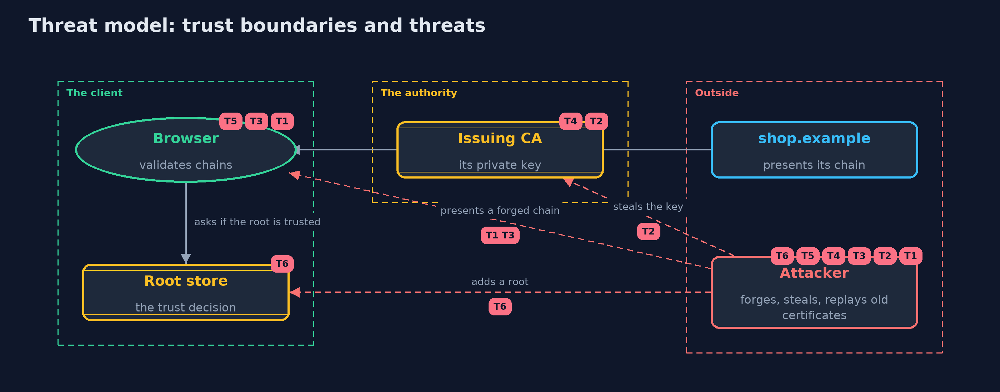

# Threat Model — Certificates and the Chain of Trust

A threat model answers four questions: what are we protecting, who or what could harm it, how, and what do we do about it. This one covers this project's own demo system, not a production deployment. Domain: an online store.

## Scope

How a client decides that a public key belongs to shop.example: the chain of certificates the server presents, the client's list of trusted roots, the authorities' private keys and the revocation information. It covers a forger, a thief of authority keys and
a careless root store. It does not cover the TLS handshake itself, or the web application.

## What we protect (assets)

- The issuing authority's private key.
- The client's list of trusted roots.
- The server's private key.
- The customer's belief that they are talking to the shop.

## Who and what acts on the system

- The customer's browser, which validates chains.
- The certificate authorities.
- An attacker on the path who can present any chain.
- An attacker who can steal an authority's key, or add a root to a store.

## Trust boundaries

A trust boundary is a line that data or a request crosses between parts that trust each other differently. Threats cluster where those lines are.

- Server to client: the chain crosses the internet and none of it is trusted until validated.
- Authority to the world: the authority's private key is the line that keeps every issued certificate meaningful.
- Root store to everything else: the store is the client's trust decision.

Each dashed box is a trust boundary. A rose tag such as T1 shows where the threat of that number, in the table below, applies.

## Threats, using STRIDE

STRIDE is a checklist of six kinds of threat: **Spoofing** (S), **Tampering** (T), **Repudiation** (R), **Information disclosure** (I), **Denial of service** (D), **Elevation of privilege** (E).

| Id | Kind | Threat | Where it shows up | Control in this project | What is left |
| --- | --- | --- | --- | --- | --- |
| T1 | Spoofing | An attacker presents a certificate for shop.example from an authority the client does not trust | `ChainValidator` | Validate the chain to a trusted root; a rogue root with the same name still fails the signature check | Depends on the root store being right |
| T2 | Spoofing | An authority's private key is stolen and used to issue certificates for any name below it | `CertBuilder.issue`, the issuing CA | Keep authority keys offline or in hardware, use short-lived intermediates, and revoke at once if stolen | Until revocation reaches clients, forged certificates are accepted |
| T3 | Tampering | A certificate is changed after it was issued | `Tamper`, `ChainValidator` | The issuer's signature covers every field, so any change fails validation | None for the signed fields |
| T4 | Elevation of privilege | A server certificate, or too deep an intermediate, is used to issue further certificates | `ChainValidator` | Basic constraints and key usage are enforced, with a path length limit | A badly configured authority can still issue a CA certificate it should not |
| T5 | Spoofing | A valid chain for a different site is accepted for shop.example | `HostName` | Check the host name against the certificate's names on every connection | Clients that skip the name check are open to this |
| T6 | Tampering | A malicious or careless root is added to the client's root store | the root store | Keep the store small, controlled and audited | Every root in the store can vouch for any name |

## Assumptions

- The client has the right root certificates, put there by the operating system or platform.
- The client's clock is correct.
- In the demo, keys are generated at run time and the date is fixed at 2026-01-01.

## Out of scope

- The TLS handshake: the tls-handshake project.
- Running a real certificate authority.
- Certificate transparency monitoring.

## How the tests check this

- `DerTest` checks the encodings against published object identifier encodings and length rules.
- `ChainTest` checks parsing, a good chain, expiry, not-yet-valid, an unknown root with a matching name, a missing intermediate, a changed certificate, overstepping, path length, revocation and a stolen authority key.
- `HostNameTest` checks exact names, case and one-label wildcards.
- `DemoRunsTest` compares the whole demo with the golden output.

## Where this model goes next

The next project, https-server, brings the certificate, the handshake and the web together in a working server.
