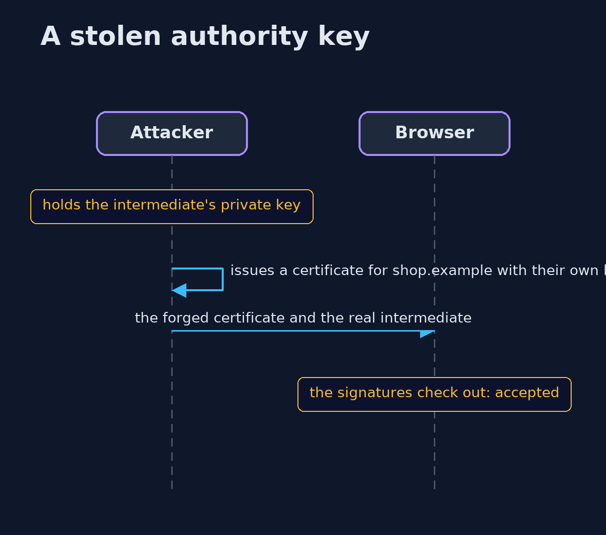
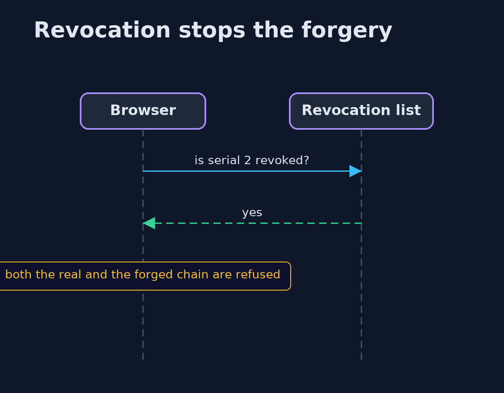

# Certificates and the Chain of Trust — UML Sequence Diagrams

## 1. A stolen authority key

The attacker's certificate chains correctly, so the browser accepts it.

## 2. Revocation stops the forgery

The intermediate's serial is on the list, so every chain through it is refused.

