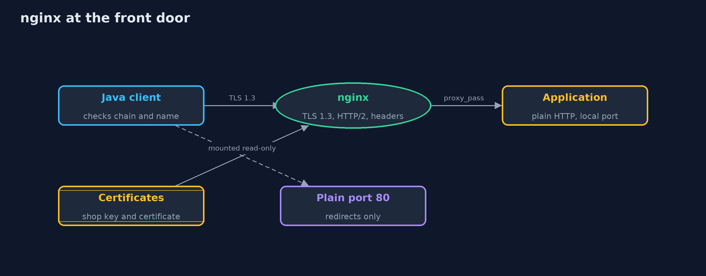
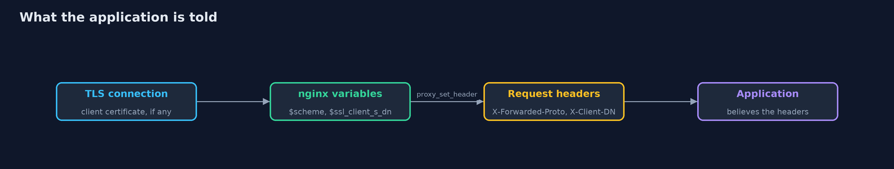
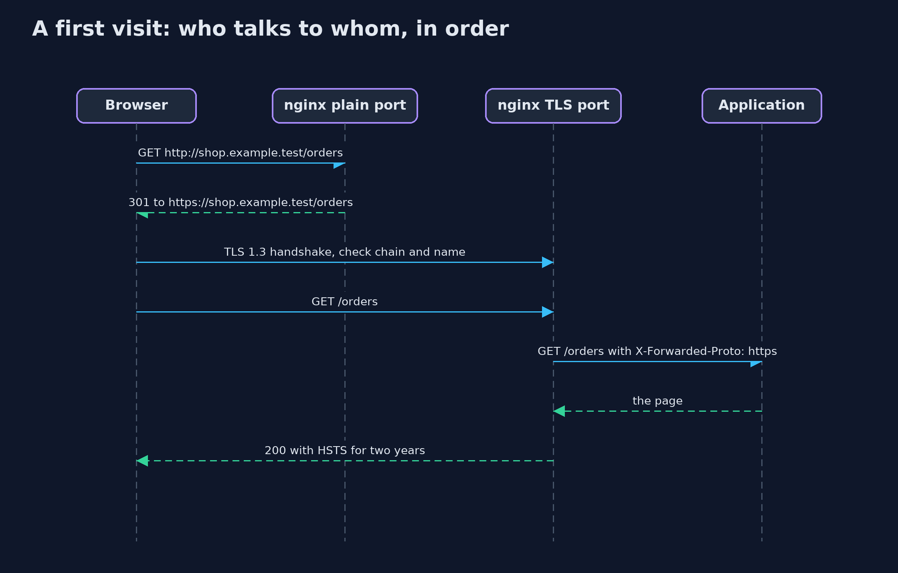

# HTTPS Server with nginx

```
src/main/java/com/jk/explore/security/httpsnginx/
├── ConfigScore.java     Reads an nginx configuration as text and scores it against seven TLS habits, one point each
├── HeaderAudit.java     Scores a response against five security headers, one point each
├── HttpsNginxDemo.java  Runs the online store story in five numbered acts against real nginx containers and prints repeatable results
├── Nginx.java           One nginx container with a given configuration and the demo certificates, started for a demo and stopped afterwards
├── NginxConfig.java     Writes the nginx configuration for each version of the online store's front door
├── Pki.java             The demo's certificates and keys, made once by infra/make-test-pki.sh
├── Probe.java           Sends raw bytes to a port and reads the whole answer, so malformed requests can be sent that an HTTP client library would never send
└── TlsClient.java       A Java HTTPS client that checks the certificate chain and the host name, the way a browser does
```

**nginx can end TLS for an online store with HTTP/2, HSTS, a redirect and optional client certificates in a few lines, but the lines have traps: old protocols, a forwarded header the client can forge, and a certificate file that is not there.**

The plain version of this lesson put TLS inside the Java server. In production, TLS is usually ended by the web server or load balancer in front of the application, and **nginx** is very often that server. This project
runs real nginx containers and checks them with a Java client that does what a browser does: it verifies the **certificate chain** and the **host name**.

The settings are few and each one matters. `ssl_protocols TLSv1.3` leaves out the older versions. `http2 on` speeds up pages. `add_header Strict-Transport-Security ... always` tells browsers to use HTTPS next time, and `always`
keeps it on error pages. `ssl_session_tickets off` avoids long-lived ticket keys. The plain port 80 only redirects. `ssl_verify_client on` asks visitors for a **client certificate**, which is **mutual TLS**. And the application behind nginx
should be told what nginx saw, in the `X-Forwarded-Proto` header, never what the client claims.

## The idea in everyday terms

Think of a receptionist at the front door of an office. Visitors show their pass to the receptionist, who then phones the right person inside, so the staff never see the passes. That works as long as the receptionist writes down what they saw, and not
what the visitor says. A receptionist who repeats "the visitor says they were checked at the gate" to the staff has handed every visitor a way to skip the check.

## The scenario

An online store puts nginx in front of its application. The demo starts nginx in several versions: careful, one that also allows TLS 1.2, one with a certificate nobody trusts, one that demands client certificates, and two that differ in one header line.
A Java client checks each one, and the configuration is tested with `nginx -t` and scored against seven habits.

## Run

```bash
./gradlew run
```

The demo tells the story in 5 acts, each printing exact numbers that the tests check:

| Act | What it shows |
| --- | --- |
| 1. nginx ends the TLS for the shop | A Java client that trusts the demo root gets 200 over TLS 1.3 with HTTP/2, five of five security headers, and the application behind nginx is told the request was https. |
| 2. Which TLS versions the shop allows | With TLS 1.3 only, a client limited to TLS 1.2 is refused; allowing TLS 1.2 with three strong ciphers lets it in, and TLS 1.3 clients still get 1.3. |
| 3. The plain port, the redirect and HSTS | The plain port answers 301 to the same address on https and sends no HSTS; the HTTPS answer carries a two-year HSTS, which protects every visit after the first. |
| 4. Who the client trusts, and who the server trusts | The client refuses an unknown root, a wrong name and an impostor certificate; with ssl_verify_client on, nginx refuses a client without a certificate and sets the client's identity itself. |
| 5. The proxy trap, a config check and a score | Passing on the client's X-Forwarded-Proto makes the application believe a plain request is secure; nginx -t catches a missing certificate; the careful config scores 7 of 7 and a copied one 1 of 7. |

## Test

```bash
./gradlew test
```

27 tests in `ConfigAndScoreTest`, `DemoRunsTest`, `NginxContainerTest`, `PkiTest`, `ProbeTest`, `ReferenceConfigTest`. The default tests need only a JDK. The tests tagged docker start real nginx containers (nginx:1.31.7-alpine) on free local ports and always remove them; a test checks that none are left behind. The demo prints no port numbers or random values, so its golden output is the same on every run.

## What the simulation got right, and what it left out

The demo and its golden-output test start real nginx containers, so they need a running Docker and run with `./gradlew integrationTest`. The default `./gradlew test` needs no Docker: it checks the generated configuration, the score, the demo certificates and the
reply parser. The demo prints only facts that do not depend on port numbers or on random values. The certificates are made once by `infra/make-test-pki.sh` and the shop is named shop.example.test through a hosts file kept in the project.

## Technologies and versions

Every version below is pinned in the project's build files and was the latest stable release when the project was built.

| Technology | Version | Used for |
| --- | --- | --- |
| Java | 25 | the language and runtime; a Gradle toolchain finds or downloads the JDK |
| Gradle | 9.8.1 (wrapper) | build and run; nothing to install, the wrapper downloads it |
| org.junit.jupiter:junit-jupiter | 6.1.3, set by junit-bom | JUnit 5: the tests (tests only) |
| org.junit.platform:junit-platform-launcher | 6.1.3, set by junit-bom | JUnit platform launcher, which Gradle needs to run the tests (tests only) |
| nginx (container image) | nginx:1.31.7-alpine | the web server and reverse proxy in front of the store, pinned to an exact version |
| Docker | any recent Docker Engine or Docker Desktop | runs the nginx containers for the demo and the container tests |
| OpenSSL (script only) | 3.6.3 | made the demo certificates once, in infra/make-test-pki.sh; not needed to run the project |
| videokit | repository tool (`tools/videokit`) | the narrated video and animation: Piper `en_US-amy-medium`, speed 0.8, longer pauses (the amy-slow voice) |

## Learning Material

| Document | What it is for |
| --- | --- |
| [Dependencies](docs/dependencies.md) | what the framework and infrastructure are, and why they are here |
| [Problem statement](docs/problem-statement.md) | the situation and what the project must show |
| [Prerequisites](docs/prerequisites.md) | what you need to know first |
| [HTTPS Server with nginx, explained](docs/https-server-with-nginx-explained.md) | the acts in prose |
| [Session guide](docs/session.md) | a one-hour lesson with exercises |
| [Animated walkthrough](docs/animation.html) | the acts step by step, narrated |
| [Threat model](docs/threat-model.md) | what is protected, who could harm it, and how, using STRIDE |
| [Spec](docs/spec.md) | what this project must be true of |
| [Expected output](docs/expected-output.txt) | the golden demo output every test and every port checks against |

### The idea in one picture

TLS ends at nginx; the application behind it speaks plain HTTP on a local port.



### Where each piece sits

NginxConfig writes the configuration; Nginx runs it in a container; TlsClient checks it.


### How the data moves

nginx sets the headers from what it saw. A header the client sends with the same name is replaced.



### Who calls whom, in order




### Video

`video/https-server-with-nginx-explained.mp4` (with `.m4a` audio and `.srt` subtitles) is built by `video/build_video.sh`. Rendered media is not committed.

## What it costs

- **The application behind nginx speaks plain text.** Traffic between nginx and the application is not encrypted in this setup, which is fine on one machine and not fine across a network. Use TLS to the application too, or a trusted private network.
- **Every setting is a place to go wrong.** A copied configuration can allow old protocols or forget `always`, so the configuration needs a test and a score.
- **TLS 1.2 is a trade-off.** Allowing it keeps older clients working and brings back the choice of ciphers, which must then be kept short.
- **Certificates expire.** nginx reads them at start, so renewal needs a reload, and the plan for it matters more than the settings.
- **Demo keys are not secrets.** The certificates in this project are made for the demo and are committed on purpose. Real private keys never go in a repository.

## When this is too much

For a small site, an nginx with a short, tested TLS configuration or a managed load balancer is the right answer. Client certificates are for machine-to-machine traffic and special users, not for ordinary customers.

## Where you have already met this

- `ssl_protocols`, `ssl_certificate` and `ssl_certificate_key` in every nginx tutorial.
- Mozilla's SSL configuration generator, and SSL Labs' test of a site.
- `X-Forwarded-For` and `X-Forwarded-Proto` headers in application logs.
- Load balancers that "terminate TLS" in cloud diagrams.

## Where this sits

This project follows [https-server](../https-server) and [https-server-with-spring-boot](../https-server-with-spring-boot) and uses the same ideas as [tls-handshake](../tls-handshake) and [certificates-and-chain-of-trust](../certificates-and-chain-of-trust). It is the nginx twin of the HTTPS lesson.
