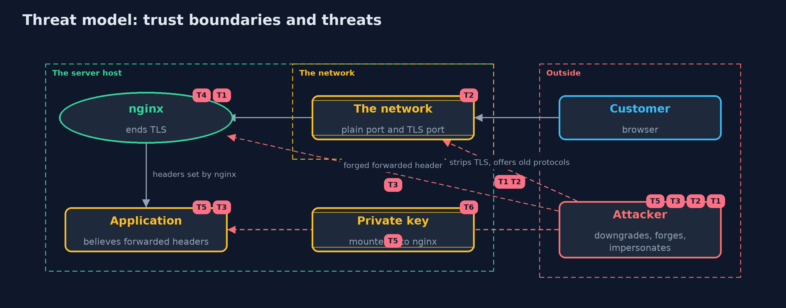

# Threat Model — HTTPS Server with nginx

A threat model answers four questions: what are we protecting, who or what could harm it, how, and what do we do about it. This one covers this project's own demo system, not a production deployment. Domain: an online store.

## Scope

The front door of an online store: nginx ending TLS on port 443, redirecting port 80, passing requests to an application on a local port, and optionally asking clients for certificates. It covers a network attacker who can downgrade, impersonate or forge headers.
It does not cover the application's own logic, the host's security, or TLS between nginx and the application.

## What we protect (assets)

- The confidentiality and integrity of customer traffic.
- The server's private key.
- The application's belief about who is calling and over what.
- Client identities presented through certificates.

## Who and what acts on the system

- Customers using browsers.
- A network attacker who can read and change traffic and send forged requests.
- An operator who writes and reloads the configuration.

## Trust boundaries

A trust boundary is a line that data or a request crosses between parts that trust each other differently. Threats cluster where those lines are.

- Internet to nginx: the TLS port and the plain port.
- nginx to the application: headers that nginx sets become the application's facts.
- Configuration repository to the running server: a copied or untested configuration crosses it.

Each dashed box is a trust boundary. A rose tag such as T1 shows where the threat of that number, in the table below, applies.

## Threats, using STRIDE

STRIDE is a checklist of six kinds of threat: **Spoofing** (S), **Tampering** (T), **Repudiation** (R), **Information disclosure** (I), **Denial of service** (D), **Elevation of privilege** (E).

| Id | Kind | Threat | Where it shows up | Control in this project | What is left |
| --- | --- | --- | --- | --- | --- |
| T1 | Tampering | An attacker strips or downgrades the protection on the connection | `ssl_protocols`, the plain port | TLS 1.3 only (or 1.2 with a short cipher list), a redirect from port 80, and HSTS with always | The first visit is plain unless the site is preloaded |
| T2 | Information disclosure | Traffic is read on the network | the plain port and the TLS port | All real traffic goes over TLS, and the plain port only redirects | Metadata such as addresses and timing remains visible |
| T3 | Spoofing | A client forges a forwarded header so the application believes the request was secure | `proxy_set_header X-Forwarded-Proto` | nginx sets the header from `$scheme`, never from the client's header | Other headers the application trusts must be set the same way |
| T4 | Tampering | A copied or untested configuration is deployed with weak settings or errors | `nginx.conf` | `nginx -t` before deployment and a score of the TLS habits | The score covers seven habits, not everything |
| T5 | Spoofing | A client claims an identity through a header or an unchecked certificate | `ssl_verify_client`, `X-Client-DN` | Client certificates are checked against the demo root, and nginx overwrites the identity header | Revocation of client certificates is not checked here |
| T6 | Information disclosure | The server's private key is stolen from the host or a repository | `/pki/shop.key` | Mounted read-only, readable only by nginx in a real deployment, and never committed (the demo key is a demo value) | A stolen key allows impersonation until the certificate is replaced and revoked |

## Assumptions

- The application listens only on a local port that outsiders cannot reach.
- The private key is readable only by nginx and is not in a repository.
- In the demo, the certificates and keys are made for the demo and protect nothing.

## Out of scope

- TLS between nginx and the application.
- Certificates from a public authority and OCSP stapling.
- Denial-of-service protection and load balancing.

## How the tests check this

- `ConfigAndScoreTest` checks the seven-point score, protocol parsing, the forwarded-header trap and the variants' directives.
- `ReferenceConfigTest` checks that `infra/nginx-careful.conf` is what the code generates.
- `PkiTest` checks the demo certificates: chain, names, key usage and the impostor.
- `NginxContainerTest` (integration) starts real nginx containers and checks TLS, redirects, trust, mutual TLS, the trap, `nginx -t` and that no containers are left.
- `DemoRunsTest` (integration) compares the whole demo with the golden output.

## Where this model goes next

The transport-security module is complete. The safe-habits module looks at the habits that keep a system safe over time: least privilege, patching and backups.
