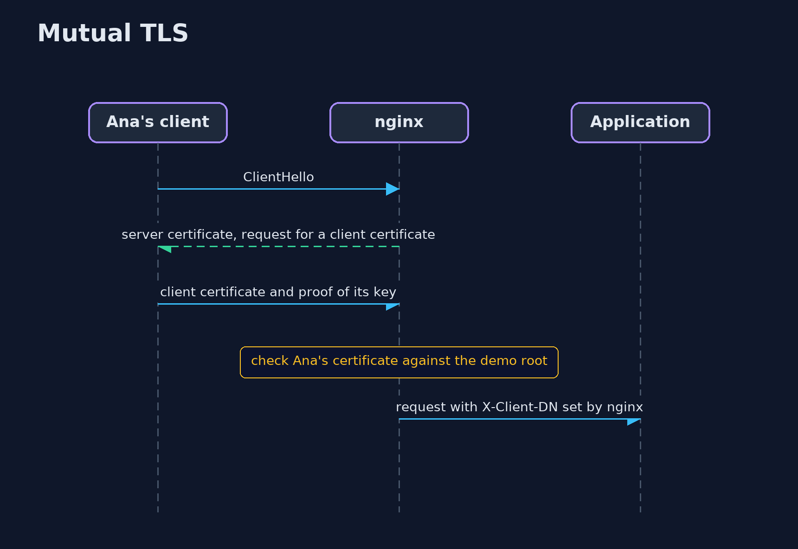
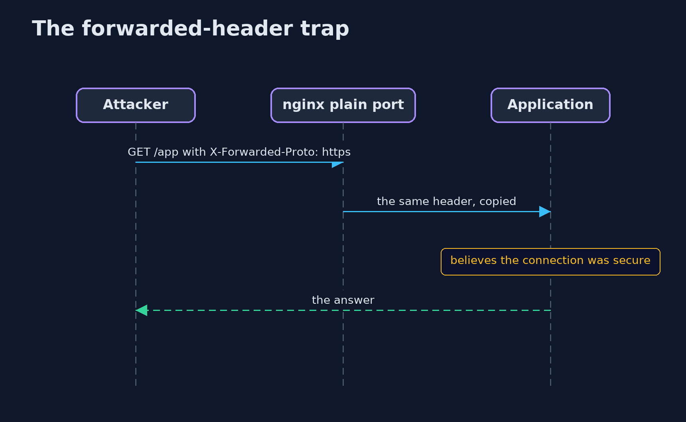

# HTTPS Server with nginx — UML Sequence Diagrams

## 1. Mutual TLS

The server asks for a certificate and tells the application who the client is.

## 2. The forwarded-header trap

When nginx copies the client's header, the client decides what the application believes.

