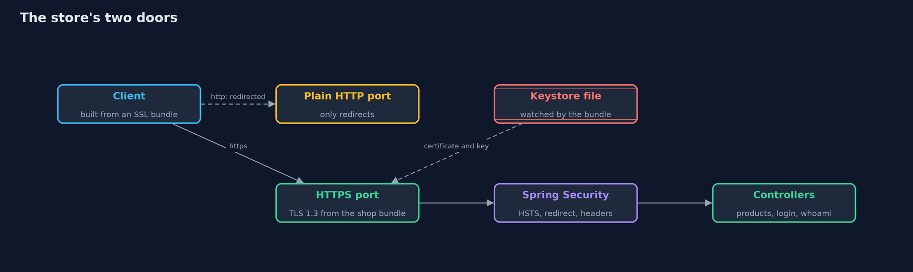
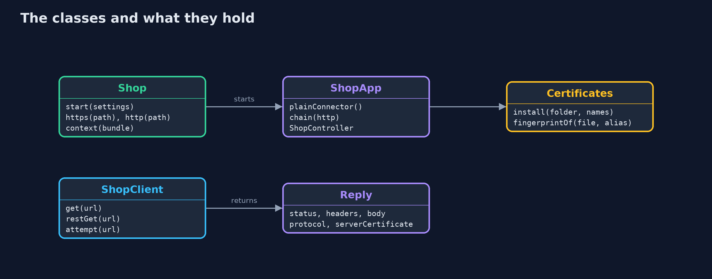
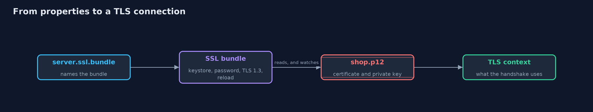

# An HTTPS Server with Spring Boot

```
src/main/java/com/jk/explore/security/httpsspring/
├── Certificates.java     The demo keystores, made with keytool on the first build into build/ and never committed (see infra/make-test-keystores.sh): a root CA's trust store, two server certificates for shop.example.test signed by it (the second stands for a renewed certificate), a client certificate, and an impostor's certificate signed by nobody
├── HttpsSpringDemo.java  Runs the online store story in five numbered acts against real Spring Boot servers on the loopback interface
├── Reply.java            What a client saw: the status, the headers, the body, and what TLS negotiated
├── Shop.java             A running store: a Spring Boot server on two free loopback ports (HTTPS and plain HTTP), configured by properties that name SSL bundles
├── ShopApp.java          The online store as a Spring Boot application
└── ShopClient.java       A client built from an SSL bundle's context
```

**Spring Boot turns a keystore, a TLS version and a client-certificate rule into a working HTTPS server with a few properties, and can renew a certificate without a restart, but a wrong property is as silent as a right one, so check the result from outside.**

The plain HTTPS project built a secure web server from the JDK's parts. Real stores use a framework. **Spring Boot** starts a web server (**Tomcat**) inside the program, and TLS becomes **configuration**: a property names an **SSL bundle**, and the bundle names
a **keystore** file, a password, and the TLS versions allowed. Another property asks the server to require a **client certificate**, which is **mutual TLS**. A bundle can also **watch** its files, so when a certificate is renewed
the server starts using it without a restart. **Spring Security** adds what configuration cannot: it redirects the plain HTTP port to HTTPS and writes the **HSTS** header.

The demo starts real servers on the loopback interface, builds clients from the same kind of bundle (a client that trusts only a demo root and checks the host name), and tries to break each setting: a wrong name, an old TLS version, an untrusted certificate,
a missing client certificate. It ends with what Spring does not do for you.

## The idea in everyday terms

The plain project was building a door and its lock from raw metal. This one fits a standard door that a locksmith has certified, and a key cabinet that the shop can swap keys in without closing. You still have to walk round the outside
and try the handle, because a door that was fitted wrongly looks exactly like one fitted right.

## The scenario

An online store runs a small Spring Boot application. Its customers' browsers, and one internal service, connect over HTTPS. The demo configures the server, builds clients that verify it, redirects plain HTTP, renews the certificate while running, and requires a client certificate.

## Run

```bash
./gradlew run
```

The demo tells the story in 5 acts, each printing exact numbers that the tests check:

| Act | What it shows |
| --- | --- |
| 1. TLS from an SSL bundle | TLS 1.3 only, from properties and a bundle; a client built from a bundle trusting the demo root gets 200 over TLS 1.3, and a wrong name, TLS 1.2 only, or the JDK's default trust is refused. |
| 2. Redirect, HSTS and secure cookies | The plain HTTP port answers 302 to an https address with an empty body and no HSTS; the HTTPS answer carries HSTS, and the session cookie is Secure, HttpOnly and SameSite=Strict and is never sent over plain HTTP. |
| 3. Renewing a certificate without a restart | With reload-on-update the bundle watches its keystore file; replacing the file changes the served certificate, matched by fingerprint, and clients that trust the root need no change. |
| 4. Mutual TLS: the server checks the client too | With client-auth need, Ana's client with a certificate signed by the demo root is identified; a client with no certificate, or one signed by nobody, is refused. |
| 5. What Spring leaves to you | The actuator is not on the class path and gives 404, an error page does not leak its message, no Server header names the software; but configuration is silent when wrong and the private key is a file. |

## Test

```bash
./gradlew test
```

22 tests in `CertificatesTest`, `DemoRunsTest`, `HttpsSpringTest`. Every test starts a real Spring Boot server on free loopback ports. The demo prints only port-independent facts, certificates are compared by fingerprint and never printed, and the renewal test polls until the new certificate is served, so the golden output is the same on every run.

## What the simulation got right, and what it left out

The servers run on free loopback ports, so the demo prints only facts that do not depend on a port number. The shop's name, shop.example.test, resolves to this machine through a hosts file in the project that Gradle passes to the JVM.
The keystores are made on the first build by `infra/make-test-keystores.sh` with keytool, into `build/` and never committed, with a demo password, and are valid for a hundred years. Fingerprints are compared, not printed.

## Technologies and versions

Every version below is pinned in the project's build files and was the latest stable release when the project was built.

| Technology | Version | Used for |
| --- | --- | --- |
| Java | 25 | the language and runtime; a Gradle toolchain finds or downloads the JDK |
| Gradle | 9.8.1 (wrapper) | build and run; nothing to install, the wrapper downloads it |
| org.springframework.boot:spring-boot-starter-webmvc | 4.1.1, set by spring-boot-dependencies | library the code uses |
| org.springframework.boot:spring-boot-starter-security | 4.1.1, set by spring-boot-dependencies | library the code uses |
| org.springframework.boot:spring-boot-starter-webmvc-test | 4.1.1, set by spring-boot-dependencies | library the code uses (tests only) |
| org.springframework.boot:spring-boot-starter-security-test | 4.1.1, set by spring-boot-dependencies | library the code uses (tests only) |
| org.junit.jupiter:junit-jupiter | 6.1.3, set by junit-bom | JUnit 5: the tests (tests only) |
| org.junit.platform:junit-platform-launcher | 6.1.3, set by junit-bom | JUnit platform launcher, which Gradle needs to run the tests (tests only) |
| Spring Boot | 4.1.1 | the latest stable release (the 4.2 line is only milestones); it starts the web server and reads the SSL bundles |
| Spring Framework (Spring MVC, RestClient) | 7.0.9 | maps web addresses to Java methods, and its RestClient is the client in the demo; pinned by Spring Boot 4.1.1 |
| Spring Security | 7.1.1 | redirects plain HTTP to HTTPS and writes the HSTS header; pinned by Spring Boot 4.1.1 |
| Apache Tomcat (embedded) | 11.0.24 | the web server inside the application; it does the TLS handshake; pinned by Spring Boot 4.1.1 |
| keytool (JDK) | 25 | made the demo keystores once; the script is in infra/ |
| videokit | repository tool (`tools/videokit`) | the narrated video and animation: Piper `en_US-amy-medium`, speed 0.8, longer pauses (the amy-slow voice) |

## Learning Material

| Document | What it is for |
| --- | --- |
| [Dependencies](docs/dependencies.md) | what the framework and infrastructure are, and why they are here |
| [Problem statement](docs/problem-statement.md) | the situation and what the project must show |
| [Prerequisites](docs/prerequisites.md) | what you need to know first |
| [An HTTPS Server with Spring Boot, explained](docs/https-server-with-spring-boot-explained.md) | the acts in prose |
| [Session guide](docs/session.md) | a one-hour lesson with exercises |
| [Animated walkthrough](docs/animation.html) | the acts step by step, narrated |
| [Threat model](docs/threat-model.md) | what is protected, who could harm it, and how, using STRIDE |
| [Spec](docs/spec.md) | what this project must be true of |
| [Expected output](docs/expected-output.txt) | the golden demo output every test and every port checks against |

### The idea in one picture

The plain port only redirects; the HTTPS port does TLS from the bundle and passes requests through the security filters.



### Where each piece sits

Shop starts a Spring Boot server from properties; ShopClient is the verifying client; Certificates holds the demo keystores.



### How the data moves

A property names the bundle, the bundle names the files and the TLS versions, and the server builds its TLS context from them.



### Who calls whom, in order


### Video

`video/https-server-with-spring-boot-explained.mp4` (with `.m4a` audio and `.srt` subtitles) is built by `video/build_video.sh`. Rendered media is not committed.

## What it costs

- **A large dependency.** Spring Boot, Spring Security and Tomcat must be updated together when a vulnerability is fixed.
- **Configuration is silent.** A misspelt property does nothing and says nothing, so the demo checks the result from outside, as an attacker would.
- **Reload helps only if someone renews.** The server can swap a file without a restart, but a person or a tool still has to get a new certificate before the old one expires.
- **mTLS identifies machines, not people.** It suits calls between services. A customer in a browser would need a password and more on top.
- **The private key is a file.** The server must be able to read it, so protect the folder, and consider a key management service or hardware module for the real thing.

## When this is too much

For a small shop, the usual advice is to put the TLS in front of the application, in a reverse proxy or a load balancer that renews certificates by itself, and keep the application on plain HTTP inside a trusted network.
Terminating TLS in the application, as here, fits when the traffic between the proxy and the application also needs protecting, or when there is no proxy.

## Where you have already met this

- `server.ssl.*` properties in `application.properties` files.
- `.p12` and `.jks` files next to an application, and a password in its configuration.
- The "certificate has expired" outage that wakes people up.
- Service meshes and internal APIs that require client certificates.

## Where this sits

This project is the third in [transport-security](..), after [tls-handshake](../tls-handshake) and [certificates-and-chain-of-trust](../certificates-and-chain-of-trust), and is the framework version of [https-server](../https-server).
