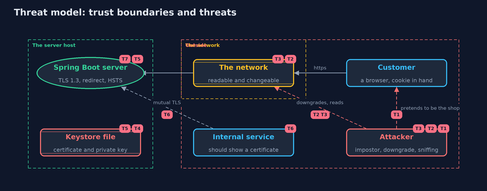

# Threat Model — An HTTPS Server with Spring Boot

A threat model answers four questions: what are we protecting, who or what could harm it, how, and what do we do about it. This one covers this project's own demo system, not a production deployment. Domain: an online store.

## Scope

A Spring Boot web server for an online store, terminating TLS itself: its SSL bundle and keystore file, the plain HTTP port that redirects, the HSTS header and session cookie, certificate renewal, and an internal service that connects with a client certificate.
It covers an attacker on the network and an attacker who impersonates the shop. It does not cover the application's own logic, a reverse proxy, or the operating system.

## What we protect (assets)

- Customers' traffic and session cookies.
- The server's private key and the keystore file.
- The shop's availability, which depends on a valid certificate.
- The internal service's access to the shop.

## Who and what acts on the system

- Customers using browsers.
- An attacker on the network path.
- An attacker who runs a server with the shop's name.
- An internal service that calls the shop.
- An operator who renews certificates.

## Trust boundaries

A trust boundary is a line that data or a request crosses between parts that trust each other differently. Threats cluster where those lines are.

- Internet to the HTTPS port: everything crossing it is protected by TLS.
- Internet to the plain port: nothing is protected, and the port only redirects.
- Keystore file to the server process: the file is readable by the server, so by anyone who gets that access.

Each dashed box is a trust boundary. A rose tag such as T1 shows where the threat of that number, in the table below, applies.

## Threats, using STRIDE

STRIDE is a checklist of six kinds of threat: **Spoofing** (S), **Tampering** (T), **Repudiation** (R), **Information disclosure** (I), **Denial of service** (D), **Elevation of privilege** (E).

| Id | Kind | Threat | Where it shows up | Control in this project | What is left |
| --- | --- | --- | --- | --- | --- |
| T1 | Spoofing | A server with the shop's name but a certificate nobody trusts impersonates the shop | `ShopClient`, the `trust` bundle | The client trusts only the demo root and checks the host name | A stolen or wrongly issued certificate from a trusted authority still passes |
| T2 | Tampering | An attacker forces an old TLS version or plain HTTP | the `shop` bundle, `ShopApp.chain` | TLS 1.3 only, a redirect from the plain port, and HSTS | A first visit before the browser has seen HSTS can still start on plain HTTP, which preload lists address |
| T3 | Information disclosure | A session cookie is read from the network or sent over plain HTTP | the session cookie settings | Secure, HttpOnly and SameSite=Strict | A cross-site scripting hole in the application would still reach the page's data |
| T4 | Information disclosure | The private key is read from the keystore file | `shop.p12` | File permissions on the folder and a password on the keystore | The server must read the file, so a key management service or hardware module is stronger |
| T5 | Denial of service | The certificate expires, or a renewal is mishandled, and customers cannot connect | the bundle's reload setting | Reload on update, so a renewed file is served without a restart | Someone must obtain the new certificate in time, and a bad file could break the reload, so monitor expiry |
| T6 | Spoofing | An unauthorised client calls an internal endpoint | `server.ssl.client-auth=need` | Mutual TLS: only a certificate signed by the trusted root is accepted | It identifies a machine, not a person, and a stolen client key works until the certificate expires |
| T7 | Information disclosure | Error pages, headers or extra endpoints reveal internal details | `ShopApp`, the defaults | No actuator on the class path, error messages off, and no Server header | A custom error handler or an extra dependency could bring these back, so test from outside |

## Assumptions

- The root certificate authority is trusted and its key is safe.
- Clients check the certificate and the host name, as browsers and java.net.http do.
- In the demo, the host name comes from a hosts file, and the keys and password are demo values.

## Out of scope

- Reverse proxies, load balancers and service meshes.
- Certificate authorities, ACME and revocation: see the certificates project.
- User authentication and authorization on top of TLS.

## How the tests check this

- `CertificatesTest` checks that the two server certificates differ, name the host, and chain to the demo root, and that the impostor and the client certificates are what they claim.
- `HttpsSpringTest` starts real servers and checks TLS 1.3, every refusal, the redirect and HSTS, the cookie flags, renewal with and without reload, mutual TLS, and the error page and actuator.
- `DemoRunsTest` compares the whole demo with the golden output.

## Where this model goes next

The next module, safe-habits, looks at what keeps a system safe over time: least privilege, patching and backups.
