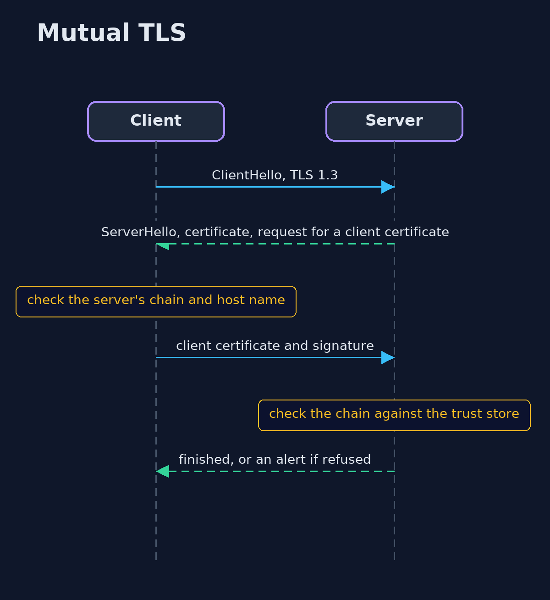
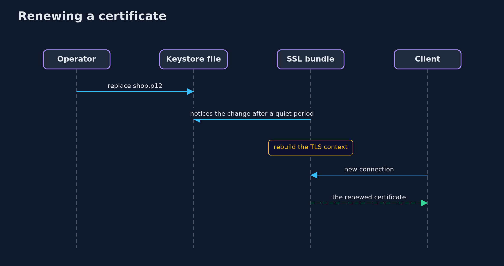

# An HTTPS Server with Spring Boot — UML Sequence Diagrams

## 1. Mutual TLS

With client-auth need, the server asks for a certificate and checks it against its trust store.

## 2. Renewing a certificate

The bundle watches the file and rebuilds the TLS context; connections made afterwards use the new certificate.

