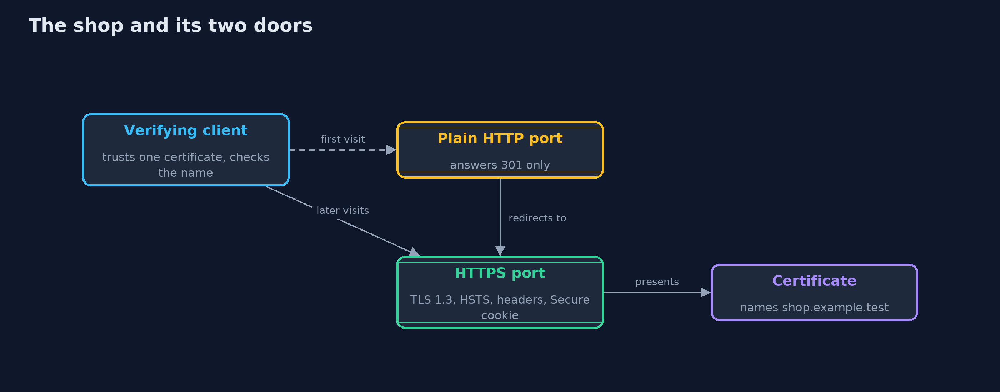
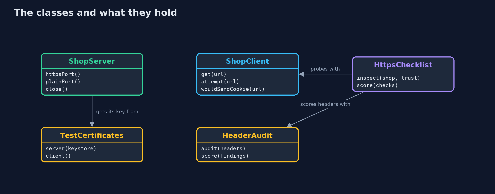

# An HTTPS Server, Put Together

```
src/main/java/com/jk/explore/security/https/
├── HeaderAudit.java       Scores a response against five security headers, one point each
├── HttpsChecklist.java    Probes a running shop from outside and scores it against five HTTPS checks, one point each
├── HttpsDemo.java         Runs the online store story in five numbered acts and prints exact, repeatable results
├── ShopClient.java        A client that verifies the server: it trusts only the shop's certificate and uses the standard HTTPS host name check (java.net.http does it by default)
├── ShopServer.java        The online store's web server, on this machine only: an HTTPS port and a plain HTTP port
└── TestCertificates.java  Two PKCS12 keystores made once with keytool (see docs): the shop's, and an impostor's that claims the same name but is not trusted
```

**A working HTTPS server needs a trusted certificate, TLS 1.3, a redirect from plain HTTP, HSTS, and cookies that stay on HTTPS, and a client must refuse a wrong certificate, a wrong name and a downgrade.**

The earlier projects each showed one piece: a **TLS handshake**, a **certificate chain**, and the **headers and cookies** of HTTP. This one runs them together as a real web server on your machine. The shop serves **HTTPS** with a certificate the client trusts.
Its plain **HTTP** port does one thing, **redirects** to HTTPS. Every HTTPS answer carries **HSTS**, which tells the browser never to use plain HTTP for this shop again. And its session **cookie** is marked **Secure**, so a client never sends it over plain HTTP.

The client side matters just as much. The Java client trusts only the shop's certificate and checks the host name, so it **refuses** a server with a certificate nobody trusts, the right certificate under the wrong name, and a server that only offers old TLS when the client demands 1.3.
The demo ends by scoring a careful shop and a careless one with a five-point checklist, run from outside like an auditor would.

## The idea in everyday terms

Think of a shop with a strong front door, a sign on the side entrance that points everyone to the front, and a standing rule that valuables never leave through the back. The padlock on the door matters, and so does the sign and the rule.
A careless shop has the same padlock but leaves the side door open, so the padlock tells you very little about the whole shop.

## The scenario

An online store runs a web server. Customers must reach it only over HTTPS, log in with a cookie that cannot leak, and be able to tell the real shop from an impostor. The demo starts a careful shop and a careless one on this machine and tests both from outside.

## Run

```bash
./gradlew run
```

The demo tells the story in 5 acts, each printing exact numbers that the tests check:

| Act | What it shows |
| --- | --- |
| 1. An HTTPS request that is checked | The client trusts the shop's certificate, which names shop.example.test; the request returns 200 over TLS 1.3 with all five security headers. |
| 2. Plain HTTP only redirects | The plain port answers 301 to an https address and sends no HSTS; the first request itself still crossed the network in the clear. |
| 3. A cookie that stays on HTTPS | The login cookie is Secure, HttpOnly and SameSite=Lax, so it is sent over HTTPS and not over plain HTTP; the same cookie without Secure leaks. |
| 4. What the client refuses | The client refuses a certificate nobody trusts, the right certificate under another name, and a TLS 1.2 server when it demands 1.3; it accepts 1.2 only when it allows it. |
| 5. Scoring a shop from outside | A five-point checklist gives the careful shop 5 of 5 and the careless shop 1 of 5: its certificate is valid and nothing else is right. |

## Test

```bash
./gradlew test
```

13 tests in `DemoRunsTest`, `HttpsTest`. Everything runs on this machine, on random ports that are not printed. The certificates are fixed test files and the name resolves through the project's own hosts file, so the golden output is the same on every run.

## What the simulation got right, and what it left out

The shop and the client run on the loopback address of the machine running the demo, on random ports that are never printed. The name `shop.example.test` points to this machine through a small hosts file inside the project, so no DNS is used.
The certificates are two PKCS12 test files with demo passwords, made once with `keytool` and valid for a hundred years.

## Technologies and versions

Every version below is pinned in the project's build files and was the latest stable release when the project was built.

| Technology | Version | Used for |
| --- | --- | --- |
| Java | 25 | the language and runtime; a Gradle toolchain finds or downloads the JDK |
| Gradle | 9.8.1 (wrapper) | build and run; nothing to install, the wrapper downloads it |
| org.junit.jupiter:junit-jupiter | 6.1.3, set by junit-bom | JUnit 5: the tests (tests only) |
| org.junit.platform:junit-platform-launcher | 6.1.3, set by junit-bom | JUnit platform launcher, which Gradle needs to run the tests (tests only) |
| videokit | repository tool (`tools/videokit`) | the narrated video and animation: Piper `en_US-amy-medium`, speed 0.8, longer pauses (the amy-slow voice) |

## Learning Material

| Document | What it is for |
| --- | --- |
| [Problem statement](docs/problem-statement.md) | the situation and what the project must show |
| [Prerequisites](docs/prerequisites.md) | what you need to know first |
| [An HTTPS Server, Put Together, explained](docs/https-server-explained.md) | the acts in prose |
| [Session guide](docs/session.md) | a one-hour lesson with exercises |
| [Animated walkthrough](docs/animation.html) | the acts step by step, narrated |
| [Threat model](docs/threat-model.md) | what is protected, who could harm it, and how, using STRIDE |
| [Spec](docs/spec.md) | what this project must be true of |
| [Expected output](docs/expected-output.txt) | the golden demo output every test and every port checks against |

### The idea in one picture

Both doors are on the same machine: the plain one only points to the HTTPS one.



### Where each piece sits

ShopServer is the shop, ShopClient is the careful customer, and HttpsChecklist is the auditor.



### How the data moves

A first visit may start on the plain port; after that the browser goes straight to HTTPS.


### Who calls whom, in order


### Video

`video/https-server-explained.mp4` (with `.m4a` audio and `.srt` subtitles) is built by `video/build_video.sh`. Rendered media is not committed.

## What it costs

- **HSTS cannot protect the first visit.** The first request can still be made in the clear, so high-value sites also join browsers' preload lists, which is hard to undo.
- **HSTS with a long life is a commitment.** If the certificate expires or breaks, browsers will not let users click through, so renewals must be automated and watched.
- **Allowing older TLS is a choice.** Some old clients need TLS 1.2, and allowing it is what a downgrade attack asks for, so keep it only while it is needed.
- **The demo uses a test certificate.** A real shop gets a certificate from a public certificate authority and renews it automatically; the demo trusts one certificate that it made itself.

## When this is too much

For anything public, all of this is the baseline, not an extra. The part that can be too much is custom code: in production most of it is configuration of a proxy or a framework, as the tools projects show, and certificates come from an automated authority.

## Where you have already met this

- The padlock in the browser's address bar, and the warning page when a certificate is wrong.
- Sites that jump from `http://` to `https://` as soon as they load.
- The `Strict-Transport-Security` and `Set-Cookie` lines in browser developer tools.
- SSL Labs and similar tests that score a server's configuration.

## Where this sits

This project is the third in [transport-security](..) and puts together [tls-handshake](../tls-handshake), [certificates-and-chain-of-trust](../certificates-and-chain-of-trust) and the headers of [http-basics-and-headers](../../networking/http-basics-and-headers).
