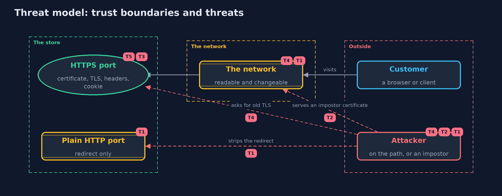

# Threat Model — An HTTPS Server, Put Together

A threat model answers four questions: what are we protecting, who or what could harm it, how, and what do we do about it. This one covers this project's own demo system, not a production deployment. Domain: an online store.

## Scope

An online store's HTTPS web server and the clients that call it: the certificate it presents, the TLS versions it accepts, the plain HTTP port that redirects, the headers it sends and the session cookie. It covers an attacker on the network path and an impostor server.
It does not cover application bugs, the certificate authority's own security, or attacks on the server's host.

## What we protect (assets)

- The confidentiality and integrity of customers' requests and answers.
- The session cookie.
- The server's private key.
- The customer's ability to tell the real shop from an impostor.

## Who and what acts on the system

- Customers using browsers or clients.
- An attacker on the network path who can read, change and block traffic.
- An impostor who runs a server with a certificate nobody trusts, or a trusted one for another name.

## Trust boundaries

A trust boundary is a line that data or a request crosses between parts that trust each other differently. Threats cluster where those lines are.

- Customer to the network: everything crossing it can be read and changed unless TLS protects it.
- Plain HTTP port to HTTPS port: the redirect is the only thing that crosses it.

Each dashed box is a trust boundary. A rose tag such as T1 shows where the threat of that number, in the table below, applies.

## Threats, using STRIDE

STRIDE is a checklist of six kinds of threat: **Spoofing** (S), **Tampering** (T), **Repudiation** (R), **Information disclosure** (I), **Denial of service** (D), **Elevation of privilege** (E).

| Id | Kind | Threat | Where it shows up | Control in this project | What is left |
| --- | --- | --- | --- | --- | --- |
| T1 | Information disclosure | A first visit over plain HTTP, or a stripped redirect, exposes the request or sends the customer to an attacker | `ShopServer` plain port | Redirect to HTTPS, then HSTS for later visits, and HSTS preload for the first | The very first request can still be intercepted without preload |
| T2 | Spoofing | An impostor server presents a certificate nobody trusts, or a trusted one for another name | `ShopClient` | The client trusts only the shop's certificate and checks the host name | Clients that skip verification or trust too many authorities are not protected |
| T3 | Information disclosure | The session cookie is sent over plain HTTP and read on the network | `ShopServer` login | Secure, HttpOnly and SameSite attributes | A cookie set without Secure, as the careless shop does, leaks |
| T4 | Tampering | An attacker forces an older TLS version to use its weaknesses | `ShopClient`, `ShopServer` protocols | The client demands TLS 1.3 where it can, and the server offers only versions it needs | Clients that must support 1.2 stay exposed to downgrade attempts against 1.2 |
| T5 | Denial of service | An expired or broken certificate with HSTS locks customers out | `ShopServer` HSTS header | Automated renewal and monitoring of expiry | HSTS with a long life turns a certificate mistake into an outage |

## Assumptions

- The server's private key stays on the server.
- Clients trust only certificate authorities they should.
- In the demo, the certificates are test files made once, the passwords are demo values, and the shop's name resolves through a local hosts file.

## Out of scope

- Certificate issuance and revocation in the real world.
- Reverse proxies and load balancers.
- Mutual TLS.
- Application-level attacks such as injection.

## How the tests check this

- `HttpsTest` checks a trusted request over TLS 1.3, the five headers, the redirect without HSTS, cookie flags and the leak of an unflagged cookie, the refusal of an impostor certificate, a wrong name and a downgrade, and both checklist scores.
- `DemoRunsTest` compares the whole demo with the golden output.

## Where this model goes next

The next module, safe-habits, turns from how data travels to how systems are kept safe over time: least privilege, patching and backups.
