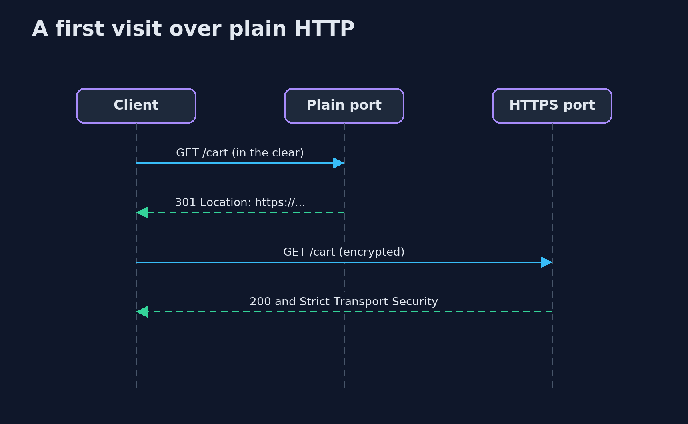
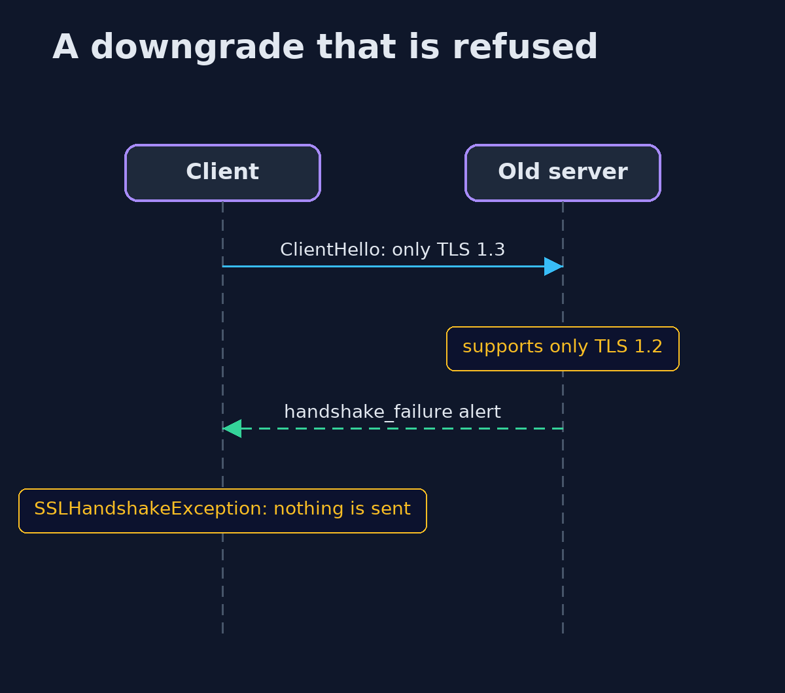

# An HTTPS Server, Put Together — UML Sequence Diagrams

## 1. A first visit over plain HTTP

The redirect is itself sent in the clear, which is why HSTS preload exists.

## 2. A downgrade that is refused

The client demands TLS 1.3, the server offers only 1.2, and the handshake fails.

