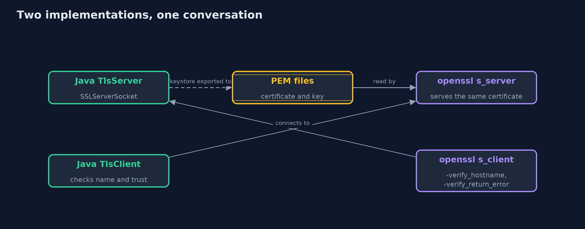
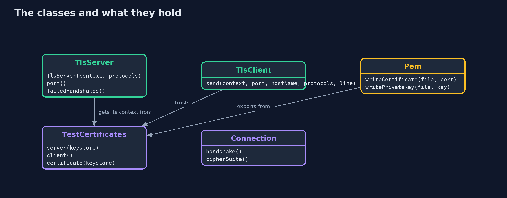
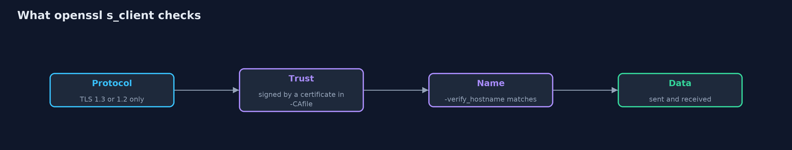
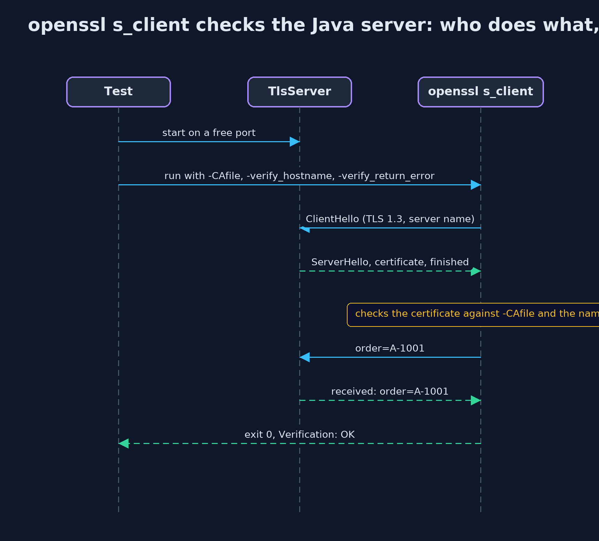

# The TLS Handshake with OpenSSL

```
src/main/java/com/jk/explore/security/tlsopenssl/
├── Connection.java        Two real TLS engines wired together in memory
├── Pem.java               PEM text, the format every other TLS program reads: a label line, the DER bytes in Base64 with 64 characters per line, a closing label line
├── TestCertificates.java  Two PKCS12 keystores made once with keytool: the shop's, and an impostor's that claims the same name but is not trusted
├── TlsClient.java         A TLS client that checks the server's certificate and that its name matches the name the client asked for
├── TlsOpenSslDemo.java    Runs the online store story in five numbered acts, over real sockets on this machine
├── TlsServer.java         A tiny TLS server on the loopback interface
└── Wire.java              What a sniffer sees: the bytes that cross the network, and the TLS record headers in them
```

**A TLS client or server written in Java can be checked by openssl, a program written by other people, which reports the same protocol and cipher, refuses the same wrong names and untrusted certificates, and turns away old versions, but only the checks that you switch on.**

The plain version of this lesson wired two Java TLS engines together in memory. Here the engines meet the network, and a second implementation. **openssl** is a command-line toolkit written by other people, and its
**s_server** and **s_client** commands are a TLS server and a TLS client that report what they negotiated and what they verified. If a Java client and an openssl server agree on a protocol and cipher, and an openssl client
refuses the same impostor and the same wrong name that the Java client refuses, the Java setting is not a private idea. The two sides read the same **PEM** files: text files that hold a certificate or a private key as Base64.

The demo runs a real TLS server and client over the loopback address, writes the PEM files, repeats the trust and version checks, and prints only facts that do not change between runs. The openssl conversations are in the integration tests.

## The idea in everyday terms

Think of asking a stranger to read your map back to you. If a friend who drew the map reads it back the same way you drew it, that proves little. A stranger who reads back the same roads, refuses the same
dead end, and agrees on the same name for the town is better evidence that the map is right, and that it is a map and not a private code.

## The scenario

An online store's server presents a certificate for shop.example.test. A Java client connects to it, an impostor with the same name is tried, a wrong name is tried and old protocol versions are offered. The same server is then checked by openssl,
and the same certificate is served by openssl to the Java client.

## Run

```bash
./gradlew run
```

The demo tells the story in 5 acts, each printing exact numbers that the tests check:

| Act | What it shows |
| --- | --- |
| 1. A real TLS server and client on this machine | A Java client connects to a Java server by the name shop.example.test over TLS 1.3 with TLS_AES_256_GCM_SHA384 and gets its answer; anything that speaks TLS can take the client's place. |
| 2. Giving the certificate and key to other programs | The certificate and private key are written as PEM files, which openssl reads, and the key file is owner-only and holds the key in the clear. |
| 3. Who is on the other end | The client accepts the shop's own certificate, refuses an impostor with the same name, and refuses the real certificate when it asked for a different name. |
| 4. Versions: what each side offers | TLS 1.2 works with a server that allows the defaults, fails against a server that allows only TLS 1.3, and TLS 1.1 fails everywhere. |
| 5. Checking from the outside, and the bill | Two openssl commands check a server or serve a certificate, but a second implementation catches only the settings you pass, and openssl without -verify_return_error carries on after a problem. |

## Test

```bash
./gradlew test
```

16 tests in `DemoRunsTest`, `OpenSsl`, `OpenSslInteropTest`, `SocketsTest`. The ordinary tests and the demo need only a JDK. The integration tests (tagged openssl) run a real openssl as the other end of the connection. They look for OpenSSL 3, skip cleanly without it, and always stop the processes they start.

## What the simulation got right, and what it left out

The demo uses real sockets on the loopback address, with ports chosen by the system and never printed, and prints only facts that are the same every time. The test certificates are two PKCS12 files made once with keytool.
The integration tests start openssl as a separate process on a free port, always stop it, and skip themselves if no OpenSSL 3 is found.

## Technologies and versions

Every version below is pinned in the project's build files and was the latest stable release when the project was built.

| Technology | Version | Used for |
| --- | --- | --- |
| Java | 25 | the language and runtime; a Gradle toolchain finds or downloads the JDK |
| Gradle | 9.8.1 (wrapper) | build and run; nothing to install, the wrapper downloads it |
| org.junit.jupiter:junit-jupiter | 6.1.3, set by junit-bom | JUnit 5: the tests (tests only) |
| org.junit.platform:junit-platform-launcher | 6.1.3, set by junit-bom | JUnit platform launcher, which Gradle needs to run the tests (tests only) |
| OpenSSL (command-line tool) | 3.6.3 | the independent TLS peer: `openssl s_server` and `openssl s_client`; needed for the integration tests, which skip themselves without it |
| videokit | repository tool (`tools/videokit`) | the narrated video and animation: Piper `en_US-amy-medium`, speed 0.8, longer pauses (the amy-slow voice) |

## Learning Material

| Document | What it is for |
| --- | --- |
| [Dependencies](docs/dependencies.md) | what the framework and infrastructure are, and why they are here |
| [Problem statement](docs/problem-statement.md) | the situation and what the project must show |
| [Prerequisites](docs/prerequisites.md) | what you need to know first |
| [The TLS Handshake with OpenSSL, explained](docs/tls-handshake-with-openssl-explained.md) | the acts in prose |
| [Session guide](docs/session.md) | a one-hour lesson with exercises |
| [Animated walkthrough](docs/animation.html) | the acts step by step, narrated |
| [Threat model](docs/threat-model.md) | what is protected, who could harm it, and how, using STRIDE |
| [Spec](docs/spec.md) | what this project must be true of |
| [Expected output](docs/expected-output.txt) | the golden demo output every test and every port checks against |

### The idea in one picture

Java and openssl each play client and server, and read the same PEM files.



### Where each piece sits

TlsServer and TlsClient are the Java ends; Pem and TestCertificates supply the files and keys.



### How the data moves

Each check can fail separately, and -verify_return_error turns a failure into an error.



### Who calls whom, in order




### Video

`video/tls-handshake-with-openssl-explained.mp4` (with `.m4a` audio and `.srt` subtitles) is built by `video/build_video.sh`. Rendered media is not committed.

## What it costs

- **openssl checks only what you ask.** Without `-verify_return_error` it prints a verification problem and carries on, and a script that ignores the exit status and the verification line passes a broken setup.
- **Private keys get copied.** Handing a key to another program means writing it to a file, which is one more copy to protect, with owner-only permissions at least.
- **Versions of the tool differ.** macOS ships LibreSSL as `openssl`, which has different options and output, so the tests look for a real OpenSSL 3 and skip without one.
- **The test certificates are fake.** They are valid for a hundred years, with a published password, and protect nothing.

## When this is too much

For a real service, check a new TLS setup from the outside once with openssl or a scanner, and then keep a regular automated check. For learning, the pairing is always worth it. A production server needs certificates from a real authority,
which is the next project.

## Where you have already met this

- `openssl s_client -connect host:443` in almost every TLS troubleshooting guide.
- `curl -v https://...`, which prints the same handshake information.
- Online TLS scanners that grade a site's protocols and ciphers.
- `.pem`, `.crt` and `.key` files in web server configuration.

## Where this sits

This project follows [tls-handshake](../tls-handshake) and is the second in [transport-security](..). It borrows from [asymmetric-encryption-with-bouncy-castle](../../cryptography/asymmetric-encryption-with-bouncy-castle) the habit of checking Java against OpenSSL.
