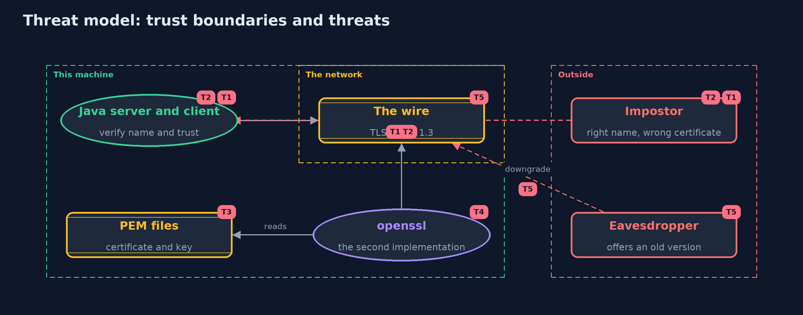

# Threat Model — The TLS Handshake with OpenSSL

A threat model answers four questions: what are we protecting, who or what could harm it, how, and what do we do about it. This one covers this project's own demo system, not a production deployment. Domain: an online store.

## Scope

An online store's TLS server and client on one machine, the certificate and key files that are exported for another program, and the checks that Java and openssl each make. It covers an impostor with the right name, a request for the wrong name,
an attacker who offers an old protocol version, and the handling of exported keys. It does not cover certificate authorities, revocation or mutual TLS.

## What we protect (assets)

- The server's private key, in its keystore and in the exported PEM file.
- The orders sent over the connection.
- The client's decision about whom to trust.

## Who and what acts on the system

- The store's server and clients.
- An impostor who holds a certificate for the right name from nobody the client trusts.
- An eavesdropper or downgrader on the network.
- A person or script running openssl.

## Trust boundaries

A trust boundary is a line that data or a request crosses between parts that trust each other differently. Threats cluster where those lines are.

- Client to network to server: every byte is protected by TLS or it is public.
- Keystore to PEM file: the private key leaves its protected container.

Each dashed box is a trust boundary. A rose tag such as T1 shows where the threat of that number, in the table below, applies.

## Threats, using STRIDE

STRIDE is a checklist of six kinds of threat: **Spoofing** (S), **Tampering** (T), **Repudiation** (R), **Information disclosure** (I), **Denial of service** (D), **Elevation of privilege** (E).

| Id | Kind | Threat | Where it shows up | Control in this project | What is left |
| --- | --- | --- | --- | --- | --- |
| T1 | Spoofing | An impostor presents a certificate for the shop's name that the client does not trust | `TlsClient`, `openssl s_client -CAfile` | The client trusts only listed certificates and refuses the rest | The trust list is a decision: a wrong entry or a stolen key defeats it |
| T2 | Spoofing | A genuine certificate for another name is accepted for the shop's name | `TlsClient`, `-verify_hostname` | Endpoint identification: the name in the certificate must match the name asked for | openssl s_client checks it only if told to, and a script must check the result |
| T3 | Information disclosure | The exported private key file is read by another user or ends up in a backup or repository | `Pem.writePrivateKey` | Owner-only permissions, written in a temporary folder and deleted | The key is in the clear, so keep exported keys short-lived and out of repositories |
| T4 | Repudiation | A broken setup passes a script because openssl printed a problem and carried on | `openssl s_client` without `-verify_return_error` | The tests pass -verify_return_error and check the exit status and the verification line | Any other script must do the same |
| T5 | Tampering | A downgrade to an old protocol version, or reading and changing the traffic | `TlsServer` protocol list | TLS 1.0 and 1.1 are switched off, and a server can require TLS 1.3 | TLS 1.2 stays allowed by default for compatibility, and its configuration needs care |

## Assumptions

- The test certificates and the password in the repository are demo values and protect nothing.
- The loopback address stands in for a network.
- The openssl used in the tests is a genuine OpenSSL 3 installation.

## Out of scope

- Certificate authorities and chains, revocation, and mutual TLS.
- Scanners and policy tools.
- Operating system trust stores.

## How the tests check this

- `SocketsTest` checks the handshake over sockets, an untrusted certificate, a wrong name, protocol versions, PEM round trips, owner-only key files and failed-handshake counts.
- `OpenSslInteropTest` (integration) has openssl as client and server, and checks protocol, cipher, verification, wrong names, untrusted certificates, TLS 1.2, TLS 1.3 only and TLS 1.1.
- `DemoRunsTest` compares the whole demo with the golden output.

## Where this model goes next

The next project, certificates-and-chain-of-trust, looks at who vouches for a certificate, and what happens when the voucher cannot be trusted.
