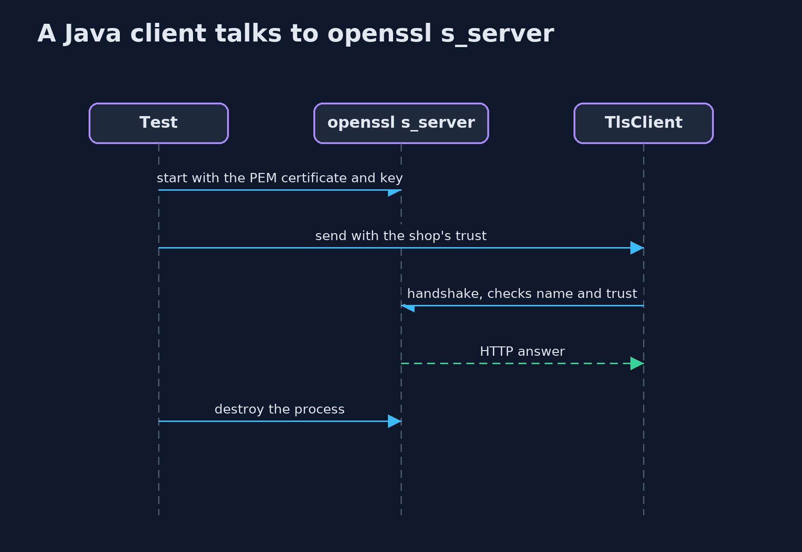
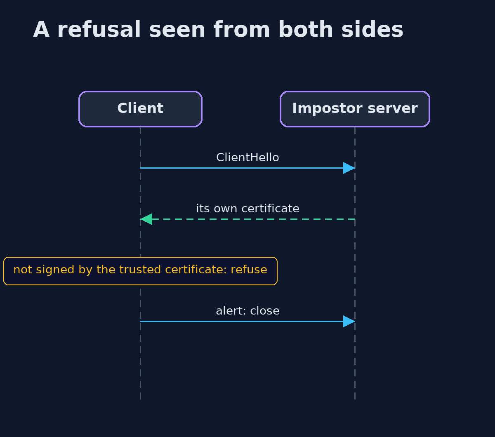

# The TLS Handshake with OpenSSL — UML Sequence Diagrams

## 1. A Java client talks to openssl s_server

The roles are swapped: now openssl serves the certificate that Java wrote.

## 2. A refusal seen from both sides

The impostor is refused by the Java client and by openssl.

