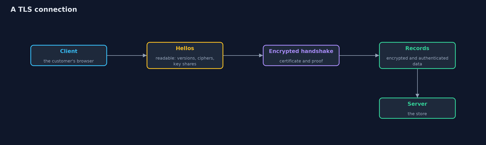
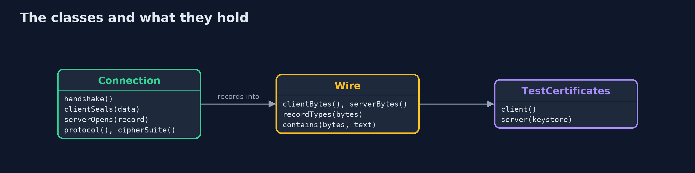
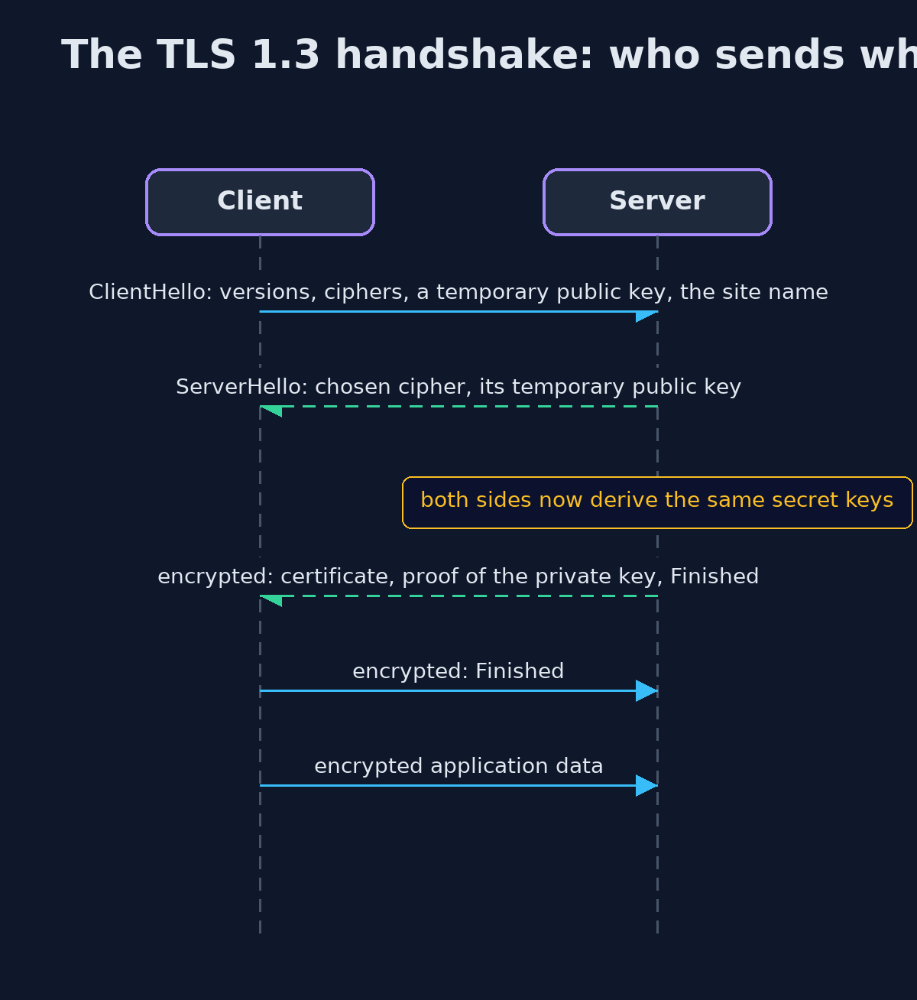

# The TLS Handshake

```
src/main/java/com/jk/explore/security/tls/
├── Connection.java        Two real TLS engines wired together in memory
├── TestCertificates.java  Two PKCS12 keystores made once with keytool (see docs): the shop's, and an impostor's that claims the same name but is not trusted
├── TlsDemo.java           Runs the online store story in five numbered acts and prints exact, repeatable results
└── Wire.java              What a sniffer sees: the bytes that cross the network, and the TLS record headers in them
```

**TLS lets a client and a server agree on secret keys in front of a sniffer, check who the server is, and then protect every record against reading and changing, but it hides neither the site's name nor the sizes of messages.**

**TLS** (Transport Layer Security) is the protection under HTTPS, and under mail, databases and most other things on the internet. It has two jobs. A **handshake** at the start of a connection lets the two sides agree on
secret keys, even though a sniffer is listening to every word, and lets the client check the server's **certificate**, which says that a key belongs to a name. Then the **record layer** protects every piece of data that follows,
so that it cannot be read or changed without being noticed.

This project uses two real TLS engines from the JDK, wired together in memory, so every byte one produces is exactly what would cross a network, and a sniffer class records it. The demo compares the wire with and without TLS,
follows the handshake, makes the client refuse an impostor and a wrong name, changes one bit of a record, and switches off old versions.

## The idea in everyday terms

Think of two people who have never met and must agree on a code word while a stranger listens. They each mix a private colour into a public one and swap the results, and each can finish the mix, while the listener cannot.
Then the server shows a letter signed by someone the client trusts, saying that this person is who they claim to be. From then on every message goes in a tamper-evident sealed envelope.

## The scenario

An online store's customer sends an order with a card number to the store. The demo shows what a sniffer sees without TLS and with it, how the connection is agreed, who the client will talk to, and what happens when a record is changed
or an old protocol is offered.

## Run

```bash
./gradlew run
```

The demo tells the story in 5 acts, each printing exact numbers that the tests check:

| Act | What it shows |
| --- | --- |
| 1. A sniffer on the wire, without and with TLS | Without TLS the sniffer reads the card number; with TLS it sees a record of type 23 and no card number, and the record is only a few dozen bytes larger than the order. |
| 2. The handshake | The client speaks first with a readable ClientHello that shows the site's name; the ServerHello chooses TLS 1.3 and TLS_AES_256_GCM_SHA384; the rest of the handshake, including the certificate, is encrypted. |
| 3. Who is on the other end | The shop's own certificate works; an impostor with the same name but an untrusted certificate is refused; the real certificate with a different requested name is refused. |
| 4. Protecting the data | The server opens an untouched record; the same order in two connections looks different; one changed bit is refused; keys are made fresh each time from temporary key pairs. |
| 5. Settings, and the bill | A client offering only TLS 1.0 fails; TLS 1.2 still works and agrees TLSv1.2 unless the server requires 1.3; the bill is certificates, a round trip, and what still shows. |

## Test

```bash
./gradlew test
```

13 tests in `DemoRunsTest`, `HandshakeTest`. The two engines run in memory and the keys and nonces are random, so the demo prints only facts that do not depend on them: protocol and cipher suite names, the types of records, and yes or no results. The test keystores are fixed files, valid for a hundred years.

## What the simulation got right, and what it left out

Both TLS engines run in one process and pass bytes to each other in memory, so no network or port is used. The keys and nonces are random, so the demo prints only facts that do not depend on them. The test keystores were made once with
`keytool` and are valid for a hundred years, so the demo never expires. The cipher suite shown is the JDK 25 default.

## Technologies and versions

Every version below is pinned in the project's build files and was the latest stable release when the project was built.

| Technology | Version | Used for |
| --- | --- | --- |
| Java | 25 | the language and runtime; a Gradle toolchain finds or downloads the JDK |
| Gradle | 9.8.1 (wrapper) | build and run; nothing to install, the wrapper downloads it |
| org.junit.jupiter:junit-jupiter | 6.1.3, set by junit-bom | JUnit 5: the tests (tests only) |
| org.junit.platform:junit-platform-launcher | 6.1.3, set by junit-bom | JUnit platform launcher, which Gradle needs to run the tests (tests only) |
| keytool (from the JDK) | 25 | made the two test keystores in src/main/resources once; not needed to run anything |
| videokit | repository tool (`tools/videokit`) | the narrated video and animation: Piper `en_US-amy-medium`, speed 0.8, longer pauses (the amy-slow voice) |

## Learning Material

| Document | What it is for |
| --- | --- |
| [Dependencies](docs/dependencies.md) | what the framework and infrastructure are, and why they are here |
| [Problem statement](docs/problem-statement.md) | the situation and what the project must show |
| [Prerequisites](docs/prerequisites.md) | what you need to know first |
| [The TLS Handshake, explained](docs/tls-handshake-explained.md) | the acts in prose |
| [Session guide](docs/session.md) | a one-hour lesson with exercises |
| [Animated walkthrough](docs/animation.html) | the acts step by step, narrated |
| [Threat model](docs/threat-model.md) | what is protected, who could harm it, and how, using STRIDE |
| [Spec](docs/spec.md) | what this project must be true of |
| [Expected output](docs/expected-output.txt) | the golden demo output every test and every port checks against |

### The idea in one picture

A handshake agrees the keys and checks the server, then records carry the data.



### Where each piece sits

Connection holds both engines and the Wire; TestCertificates builds their contexts.



### How the data moves

Only the first messages are readable; the rest is encrypted.


### Who calls whom, in order




### Video

`video/tls-handshake-explained.mp4` (with `.m4a` audio and `.srt` subtitles) is built by `video/build_video.sh`. Rendered media is not committed.

## What it costs

- **Certificates must be obtained, renewed and protected.** An expired certificate is an outage, and a stolen private key lets someone pose as the store.
- **The handshake costs a round trip and some computing.** TLS 1.3 reduced it to one round trip, and resumption can skip most of the rest.
- **The first message is readable.** The ClientHello shows the name of the site, and the sizes and timing of records still show, even though their content does not.
- **TLS ends at the endpoints.** It protects the connection between two ends, not what the ends do with the data, and a proxy that ends TLS sees everything.
- **Settings matter.** Old protocol versions and weak cipher suites must stay switched off, and the defaults of the platform are what keep that true.

## When this is too much

TLS is not optional: every connection that carries anything of value should use it. The choices are about how: modern versions only, certificates from a trusted authority, and automatic renewal.

## Where you have already met this

- The padlock in a browser, and `https://` in every address.
- "Certificate expired" and "your connection is not private" errors.
- `curl -v https://...` showing the handshake and the negotiated cipher.
- Settings called `minimum TLS version` in cloud load balancers.

## Where this sits

This project is the first in [transport-security](..) and uses the keys, hashes and signatures of [cryptography](../../cryptography), and the connections of [networking](../networking).
