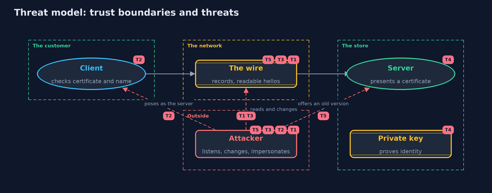

# Threat Model — The TLS Handshake

A threat model answers four questions: what are we protecting, who or what could harm it, how, and what do we do about it. This one covers this project's own demo system, not a production deployment. Domain: an online store.

## Scope

The connection between a customer's client and an online store's server: the handshake, the certificate check, the keys and the records. It covers an attacker who can listen to, record, change and inject traffic, and one who can run a server of their own
with a certificate of their own. It does not cover the endpoints, the certificate authorities, or the web application on top.

## What we protect (assets)

- The content of orders, such as card numbers.
- The integrity of the records.
- The server's private key.
- The client's belief about who it is talking to.

## Who and what acts on the system

- The customer's client.
- The store's server.
- A passive attacker who records traffic.
- An active attacker who can change traffic or pose as the server.

## Trust boundaries

A trust boundary is a line that data or a request crosses between parts that trust each other differently. Threats cluster where those lines are.

- Client to server across the internet: every record crosses it.
- Server to its private key: the key never crosses the network.

Each dashed box is a trust boundary. A rose tag such as T1 shows where the threat of that number, in the table below, applies.

## Threats, using STRIDE

STRIDE is a checklist of six kinds of threat: **Spoofing** (S), **Tampering** (T), **Repudiation** (R), **Information disclosure** (I), **Denial of service** (D), **Elevation of privilege** (E).

| Id | Kind | Threat | Where it shows up | Control in this project | What is left |
| --- | --- | --- | --- | --- | --- |
| T1 | Information disclosure | A passive attacker records traffic and reads the order | `Connection`, `Wire` | Records are encrypted with keys agreed in the handshake | The site name, sizes and timing still show |
| T2 | Spoofing | An attacker poses as the store with a certificate of their own or one for another name | `TestCertificates`, `Connection` | The client trusts only configured certificates and checks the name | A wrongly issued certificate from a trusted authority would be accepted |
| T3 | Tampering | An attacker changes a record in transit | `Connection.serverOpens` | Every record carries an authentication tag, and a changed record is refused | The attacker can still drop the connection |
| T4 | Information disclosure | The server's private key is stolen | the server's keystore | Fresh keys per connection give forward secrecy for recorded traffic | The thief can impersonate the server until the certificate is replaced |
| T5 | Tampering | An attacker pushes the connection down to an old, weak protocol version | `Connection`, protocol settings | Old versions are switched off, and modern versions protect the negotiation | Servers that still allow old versions can be attacked |

## Assumptions

- The client trusts only certificates it was configured to trust.
- The server's private key stays secret.
- In the demo, the keys and certificates are test values in the repository.

## Out of scope

- Certificate authorities and revocation: the next project.
- Attacks on the endpoints.
- Side channels in the implementation.

## How the tests check this

- `HandshakeTest` checks the agreed protocol, the record types, the readable hello, data round trips, every changed byte of a record, untrusted certificates, wrong names, and protocol versions.
- `DemoRunsTest` compares the whole demo with the golden output.

## Where this model goes next

The next project, certificates-and-chain-of-trust, looks at who vouches for a key, and how a chain of certificates is checked.
