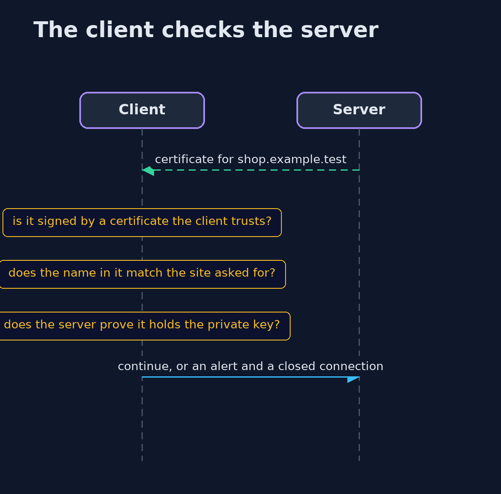
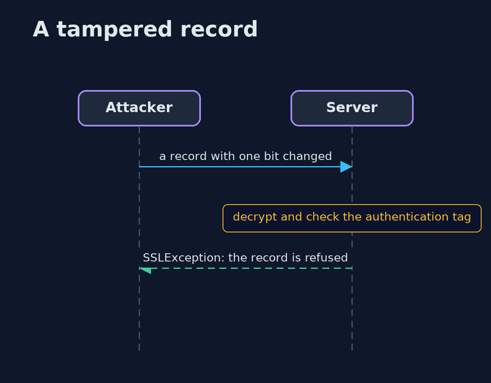

# The TLS Handshake — UML Sequence Diagrams

## 1. The client checks the server

A certificate must chain to a trusted authority and match the name.

## 2. A tampered record

The authentication tag does not match, so the record is refused.

