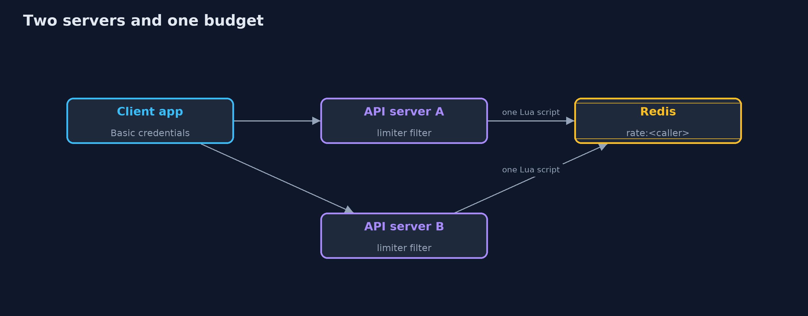
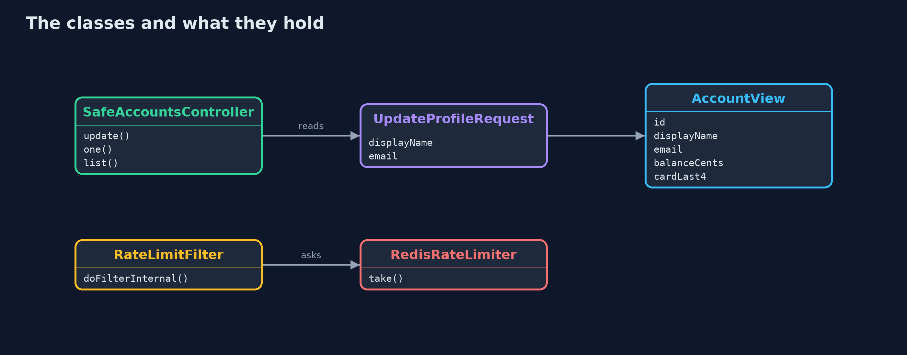
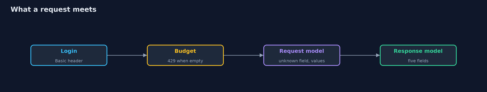
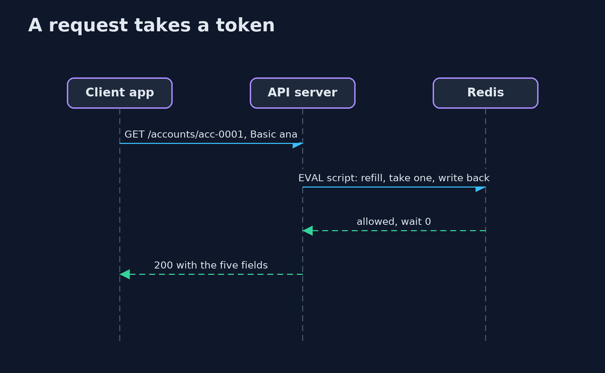

# API Security with Spring Boot and Redis

```
src/main/java/com/jk/explore/security/apispring/
├── Account.java                  The bank's record of a customer, as it is stored
├── AccountView.java              What a customer may see of their own account: no role, no limit, no risk score, no full card number, no PIN hash
├── ApiApp.java                   
├── ApiSecurity.java              Callers sign in with a header, so there are no cookies to forge and no session; the budget is counted per signed-in caller
├── ApiSpringDemo.java            Runs the bank API story in five numbered sections against real Spring Boot servers and a real Redis in Docker, all on the loopback interface
├── Bank.java                     300 customers in memory
├── Client.java                   An app that calls the bank's API with a customer's credentials in a header
├── DirectoryEntry.java           What the customer directory shows of anyone: an id and a name
├── ErrorHandling.java            Short, fixed answers for a bad request: they say what was wrong, never what the server is
├── LocalRateLimiter.java         The same bucket kept in this server's memory
├── ManualClock.java              A clock that stands still until the demo moves it, so a thousand requests all happen "at the same moment" and a refill takes no time to wait for
├── NaiveAccountsController.java  The first version of the API: bind the body to the stored record, return the stored record, and let the caller choose the page size
├── RateLimitFilter.java          Takes one token from the signed-in caller's bucket before the request reaches the controller
├── RateLimiter.java              A budget for each caller: a bucket that holds a few requests and refills steadily
├── RedisLab.java                 A throwaway Redis in a Docker container, bound to the loopback address on a free port, protected by a password and removed on close
├── RedisRateLimiter.java         The bucket kept in Redis, so every server draws on the same one
├── Running.java                  One API server on a free loopback port
├── SafeAccountsController.java   The second version: a request model with its limits, a response model with only what the caller may see, and a page size that has a ceiling
└── UpdateProfileRequest.java     The only fields a customer may change about themselves, with their limits
```

**A Spring Boot API owes its callers three limits: Jackson binds whatever the body names unless a request record, FAIL_ON_UNKNOWN_PROPERTIES and Bean Validation say otherwise, a controller returns whatever object it is given unless a response record says what a caller may see and a page has a ceiling, and a rate limiter that lives in one server's memory gives a caller one budget per server, so the count belongs in Redis, kept in one atomic script.**

The plain [api-security](../api-security) project builds the three limits from scratch. This one uses what a real Spring Boot bank has: **Spring Boot 4.1**, **Jackson 3**, **Bean Validation**, **Spring Security 7**, and a real **Redis 8** in Docker for the budget. It needs Docker for the Redis parts; its tests are tagged `integration` for those: `./gradlew integrationTest`.

What it shows:
- **The first version.** `@RequestBody Account patch` binds every field the caller sends, so `{"role":"admin","creditLimitCents":100000000}` makes Ana an admin with a huge credit limit. The controller returns the stored record with nine fields including the full card number and the PIN hash, a page size of 1,000,000 returns all 300 customers, and 1,000 requests in a loop are all answered.
- **A request model.** An `UpdateProfileRequest` record names the two fields a customer may change, with limits (`@Size`, `@Email`). `spring.jackson.deserialization.fail-on-unknown-properties=true` turns any other field into a **400 `unknown field`**, and nothing is applied from a refused body.
- **A response model and a ceiling.** `AccountView` returns five fields with the card as `****0001`; the directory returns id and name only; a page is capped at 50 and `size=0` is refused.
- **A budget in Redis.** A token bucket per signed-in caller, written as one **Lua script** so taking a token is atomic: 50 answered, then **429 with `Retry-After`**, a refill from the clock, and a separate bucket for each caller.
- **The bill.** Two servers with in-memory budgets answer **100** of 1,000 requests; with the budget in Redis, **50**. When Redis stops answering the API refuses with 503.

**Maps to:** OWASP API Security Top 10 (2023) API3 Broken Object Property Level Authorization, API4 Unrestricted Resource Consumption, API6 Unrestricted Access to Sensitive Business Flows · CWE-915 (mass assignment) · CWE-213 · CWE-770 · OWASP ASVS 5.0 V4 (API and Web Service).

## The idea in everyday terms

A bank counter with a form that has every field on it, including the ones marked "staff only", and a clerk who types in whatever the customer wrote, reads out the whole file in reply, and never closes the queue. The fixes are a shorter form, a shorter reply, and a ticket machine that every counter in the bank shares.

## The scenario

A bank API on Spring Boot lets a customer update a profile and read accounts. The demo starts the real application in two versions, calls it as an app would, and then starts two servers against one Redis to share a budget.

## Run

```bash
./gradlew run
```

The demo tells the story in 5 acts, each printing exact numbers that the tests check:

| Act | What it shows |
| --- | --- |
| 1. The first version | Binding the body to the stored record lets a customer become an admin, the response is the whole record, a page size of a million returns every customer, and a thousand requests are all answered. |
| 2. A request model | A record names the two fields a customer may change, unknown fields are a 400, values are validated, and nothing is applied from a refused body. |
| 3. A response model and a page ceiling | A response record has five fields and a masked card, the directory shows id and name only, a page is capped at 50, and size 0 and no login are refused. |
| 4. The budget runs out, and refills | A token bucket per caller in Redis, taken by one Lua script: 50 answered, then 429 with Retry-After 1s, a refill from the clock, and a separate bucket for each caller. |
| 5. The bill | Two servers with in-memory budgets answer 100 of 1000 requests, with the budget in Redis 50; when Redis stops answering the API refuses with 503. |

## Test

```bash
./gradlew test
```

19 tests in `ApiSpringTest`, `DemoRunsTest`, `RedisLimiterTest`. Most tests run without Docker with the budget in memory; the tests of the Redis budget and the full demo start a real Redis and are tagged integration (./gradlew integrationTest). Nothing printed changes between runs.

## What the simulation got right, and what it left out

The bank is a real Spring Boot application with Spring Security, and the budget is a real Redis in a container bound to 127.0.0.1 on a free port, protected by a password and removed at the end. The limiter takes its time from a clock the demo can move, so a thousand requests happen at one moment and a refill takes no time to wait for. Only statuses, field names and counts are printed.

## Technologies and versions

Every version below is pinned in the project's build files and was the latest stable release when the project was built.

| Technology | Version | Used for |
| --- | --- | --- |
| Java | 25 | the language and runtime; a Gradle toolchain finds or downloads the JDK |
| Gradle | 9.8.1 (wrapper) | build and run; nothing to install, the wrapper downloads it |
| org.springframework.boot:spring-boot-starter-webmvc | 4.1.1, set by spring-boot-dependencies | library the code uses |
| org.springframework.boot:spring-boot-starter-security | 4.1.1, set by spring-boot-dependencies | library the code uses |
| org.springframework.boot:spring-boot-starter-validation | 4.1.1, set by spring-boot-dependencies | library the code uses |
| org.springframework.boot:spring-boot-starter-data-redis | 4.1.1, set by spring-boot-dependencies | library the code uses |
| org.junit.jupiter:junit-jupiter | 6.1.3, set by junit-bom | JUnit 5: the tests (tests only) |
| org.junit.platform:junit-platform-launcher | 6.1.3, set by junit-bom | JUnit platform launcher, which Gradle needs to run the tests (tests only) |
| videokit | repository tool (`tools/videokit`) | the narrated video and animation: Piper `en_US-amy-medium`, speed 0.8, longer pauses (the amy-slow voice) |

## Learning Material

| Document | What it is for |
| --- | --- |
| [Problem statement](docs/problem-statement.md) | the situation and what the project must show |
| [Prerequisites](docs/prerequisites.md) | what you need to know first |
| [API Security with Spring Boot and Redis, explained](docs/api-security-with-spring-boot-and-redis-explained.md) | the acts in prose |
| [Session guide](docs/session.md) | a one-hour lesson with exercises |
| [Animated walkthrough](docs/animation.html) | the acts step by step, narrated |
| [Threat model](docs/threat-model.md) | what is protected, who could harm it, and how, using STRIDE |
| [Spec](docs/spec.md) | what this project must be true of |
| [Expected output](docs/expected-output.txt) | the golden demo output every test and every port checks against |

### The idea in one picture

Every request takes a token from the caller's bucket in Redis before the controller sees it.



### Where each piece sits

The second version has a model for what comes in, a model for what goes out, and a filter for how often.



### How the data moves

In order: the login, the budget, the request model, the controller and the response model.



### Who calls whom, in order




### Video

`video/api-security-with-spring-boot-and-redis-explained.mp4` (with `.m4a` audio and `.srt` subtitles) is built by `video/build_video.sh`. Rendered media is not committed.

## What it costs

- **Every field is a line in a record,** so adding a field to the API is a visible change, which is the point and a little more work.
- **Validation messages need care:** short and fixed, so they say what was wrong and never what the server is.
- **A page ceiling means clients must page,** and some will complain.
- **Redis is in every request,** so its latency is the API's latency, and its failure is the API's failure.
- **A limit that is too tight refuses real customers,** and one that is too loose protects nothing: the numbers need watching.

## When this is too much

An internal API with one trusted caller does not need a Redis budget, but it still needs the request and response records. A public API with many servers needs all of it, and a gateway in front of it may already hold the budget.

## Where you have already met this

- `@RequestBody` on an entity or a JPA class.
- A response that includes `password`, `ssn` or a token field.
- `?size=1000000` in a pen test report.
- `429 Too Many Requests` and a `Retry-After` header.

## Where this sits

This is the tools version of [api-security](../api-security), in the [api-security](..) module. It follows the same story and the same three limits, on a real framework, with the budget moved into Redis.
