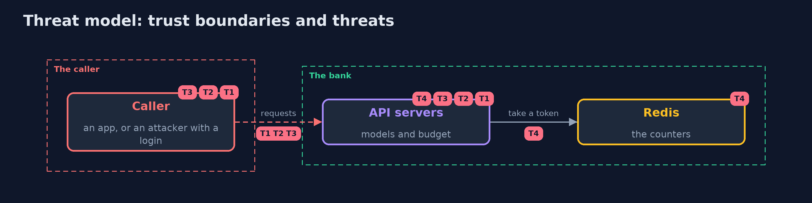

# Threat Model — API Security with Spring Boot and Redis

A threat model answers four questions: what are we protecting, who or what could harm it, how, and what do we do about it. This one covers this project's own demo system, not a production deployment. Domain: a bank API.

## Scope

A Spring Boot bank API called by authenticated customers. It covers what a body may set, what a response may show, how much a caller may ask for and the counter that limits it. It does not cover access to other customers' objects, which belongs to broken-access-control.

## What we protect (assets)

- The customers' roles, credit limits and risk scores.
- The card numbers and PIN hashes.
- The availability of the API.

## Who and what acts on the system

- A customer with a valid login who sends crafted bodies.
- An attacker who scripts requests with a stolen login.
- A developer who adds a field to the record.

## Trust boundaries

A trust boundary is a line that data or a request crosses between parts that trust each other differently. Threats cluster where those lines are.

- The caller to the API: the body, the query and the headers are all untrusted.
- The API to Redis: a password on the loopback address.

Each dashed box is a trust boundary. A rose tag such as T1 shows where the threat of that number, in the table below, applies.

## Threats, using STRIDE

STRIDE is a checklist of six kinds of threat: **Spoofing** (S), **Tampering** (T), **Repudiation** (R), **Information disclosure** (I), **Denial of service** (D), **Elevation of privilege** (E).

| Id | Kind | Threat | Where it shows up | Control in this project | What is left |
| --- | --- | --- | --- | --- | --- |
| T1 | Elevation of privilege | A caller sets a field that is not theirs to set | `NaiveAccountsController.update` | A request record, fail-on-unknown-properties, and a controller that copies named fields only | A field added to the request record without review |
| T2 | Information disclosure | A response carries fields or records the caller should not see | `NaiveAccountsController.one`, `list` | A response record, a masked card, a directory with id and name only | A new field added to a view |
| T3 | Denial of service | A caller asks for everything, or for ever | `list`, the whole API | A page ceiling and a budget per caller | A caller who spreads requests over many logins |
| T4 | Denial of service | The budget is per server, or the counter is down and the API runs without one | `LocalRateLimiter`, `RedisRateLimiter`, `RateLimitFilter` | One atomic script in a store every server shares, and a refusal when it cannot answer | A long Redis outage that stops the API |

## Assumptions

- Callers have valid logins; the lesson is about what they can do with one.
- Redis is reachable only from the API servers.

## Out of scope

- Reading another customer's account, which has its own project.
- Attacks on Redis itself.

## How the tests check this

- `ApiSpringTest` starts real servers and checks mass assignment, the whole-record response, the unlimited loop, unknown fields, validation, partial updates, the view and the masked card, the page ceiling, the 429 and Retry-After, the refill, the cap, separate callers and the budget per server.
- `RedisLimiterTest` uses a real Redis for the shared budget, the exact count under concurrency, the bucket's expiry and the refusal when Redis stops answering.
- `DemoRunsTest` compares the whole demo with the golden output.

## Where this model goes next

The next module, identity-and-access, moves from limits on what a caller may do to proving who the caller is: tokens, OAuth 2.0 and OpenID Connect.
