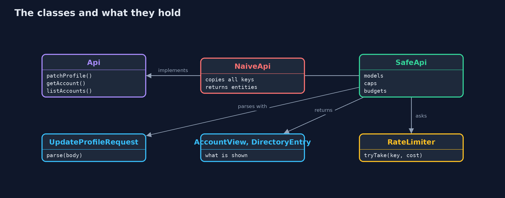
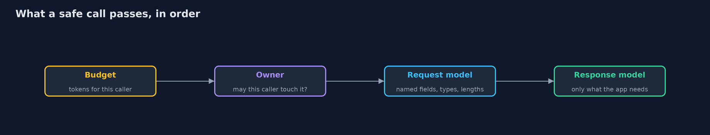

# API Security: Mass Assignment, Data Exposure and Resource Limits

```
src/main/java/com/jk/explore/security/apisec/
├── Account.java               A bank account as the database holds it: some fields are the customer's to change, most are not
├── AccountView.java           What the API shows of an account: only what the customer's app needs, with the card number masked
├── Api.java                   The bank's API as a customer's app sees it
├── ApiResponse.java           A status and a body; {@code retryAfterSeconds} is set on 429
├── ApiSecurityDemo.java       Runs the bank API story in five numbered acts and prints exact, repeatable results
├── Bank.java                  The bank's data: 300 accounts with fixed contents
├── DirectoryEntry.java        What the branch directory shows of any account: an id and a display name, nothing about money or cards
├── NaiveApi.java              The first version
├── RateLimiter.java           A token bucket for each caller and each kind of call: a burst up to {@code capacity}, refilled at {@code perSecond}
├── SafeApi.java               The fixed version: an explicit request model, an explicit response model, a hard cap on page size, and budgets
├── SimClock.java              A clock that only moves when the demo or a test says so, in seconds, so rate limits are exact
└── UpdateProfileRequest.java  The only things a customer may change about an account, read from the JSON by name, with unknown fields refused rather than ignored
```

**An API that binds every field the caller sends, returns the whole record and answers any request count and size lets a customer promote themselves, read other people's data and exhaust the service, so use explicit request and response models, cap page sizes, and give each caller a budget.**

A bank's mobile app talks to a JSON API. Three habits make it easy to build and easy to attack:
- **Binding every field** the app sends into the database record (**mass assignment**, API3): a caller adds `"role": "admin"` and it works.
- **Returning the record itself** (**excessive data exposure**, also API3): the response carries the full card number, the PIN hash and the risk score because they are in the entity.
- **Answering anything, any number of times** (**unrestricted resource consumption**, API4): a page size of a million returns every customer, and a loop of requests is never slowed.

The defences, in the order this project shows them:
- **An explicit request model:** a few named fields, with types and lengths, and unknown fields refused.
- **An explicit response model:** the app gets what the app needs, with the card number masked.
- **Caps and budgets:** a maximum page size, and a token bucket for each caller that returns 429 with `Retry-After`.

**Maps to:** OWASP API Security Top 10 (2023) API3 Broken Object Property Level Authorization and API4 Unrestricted Resource Consumption · API6 Unrestricted Access to Sensitive Business Flows · CWE-915 · CWE-213 · CWE-770.

## The idea in everyday terms

Think of a counter clerk who, to update your address, hands you your whole file and lets you cross out and rewrite anything in it, including the line that says "customer".
The fixed counter has a form with two boxes, shows you a card with the few things you need, and serves a limited number of customers per minute.

## The scenario

A bank API has three calls: change my profile, show an account, and list the branch directory. The demo runs the calls in plain Java against 300 fixed accounts, and measures what each version lets a signed-in customer do.
Ownership of accounts is checked in every version, because that is a different lesson (broken-access-control); this one is about what an owner-or-not caller may set, see and ask for.

## Run

```bash
./gradlew run
```

The demo tells the story in 5 acts, each printing exact numbers that the tests check:

| Act | What it shows |
| --- | --- |
| 1. A profile call that works | Ana changes her display name and gets her account back. |
| 2. Whatever the caller sends becomes a field | Adding role and creditLimitCents to the JSON makes Ana an admin with a limit of a million dollars. |
| 3. The response is the whole record, and a list has no end | The account response includes the card number and PIN hash; a page size of a million returns 300 accounts; 1000 requests are all answered. |
| 4. Explicit models, a page cap and a budget | Unknown fields are refused with 400 and nothing changes; the response shows five fields with the card masked; a page is capped at 50 and shows only ids and names. |
| 5. The budget runs out, and refills | Of 1000 requests in a loop 49 are answered and the rest get 429 with Retry-After 1s; after waiting the call works again, and another customer is not affected. |

## Test

```bash
./gradlew test
```

10 tests in `ApiSecurityTest`, `DemoRunsTest`. Time is simulated and the data is fixed, so the demo prints the same text on every run.

## What the simulation got right, and what it left out

There is no HTTP server: the API is a Java interface whose calls take the user and the parsed JSON, which keeps the focus on the rules. The clock is simulated, so the rate limiter's numbers are exact
and the demo prints the same text on every run.

## Technologies and versions

Every version below is pinned in the project's build files and was the latest stable release when the project was built.

| Technology | Version | Used for |
| --- | --- | --- |
| Java | 25 | the language and runtime; a Gradle toolchain finds or downloads the JDK |
| Gradle | 9.8.1 (wrapper) | build and run; nothing to install, the wrapper downloads it |
| org.junit.jupiter:junit-jupiter | 6.1.3, set by junit-bom | JUnit 5: the tests (tests only) |
| org.junit.platform:junit-platform-launcher | 6.1.3, set by junit-bom | JUnit platform launcher, which Gradle needs to run the tests (tests only) |
| videokit | repository tool (`tools/videokit`) | the narrated video and animation: Piper `en_US-amy-medium`, speed 0.8, longer pauses (the amy-slow voice) |

## Learning Material

| Document | What it is for |
| --- | --- |
| [Problem statement](docs/problem-statement.md) | the situation and what the project must show |
| [Prerequisites](docs/prerequisites.md) | what you need to know first |
| [API Security: Mass Assignment, Data Exposure and Resource Limits, explained](docs/api-security-explained.md) | the acts in prose |
| [Session guide](docs/session.md) | a one-hour lesson with exercises |
| [Animated walkthrough](docs/animation.html) | the acts step by step, narrated |
| [Threat model](docs/threat-model.md) | what is protected, who could harm it, and how, using STRIDE |
| [Spec](docs/spec.md) | what this project must be true of |
| [Expected output](docs/expected-output.txt) | the golden demo output every test and every port checks against |

### The idea in one picture

Each limit is a rule in the API, between the app and the data.


### Where each piece sits

Two implementations of one API; the safe one uses models and a limiter.



### How the data moves

The budget is checked first, so a refused or expensive call costs little.



### Who calls whom, in order


### Video

`video/api-security-explained.mp4` (with `.m4a` audio and `.srt` subtitles) is built by `video/build_video.sh`. Rendered media is not committed.

## What it costs

- **Explicit models are more code,** and they must be kept in step with the database. Tests that compare the fields of a response with the model catch drift.
- **Refusing unknown fields breaks clients that send extras,** which is why older clients need a version, and why a refusal is better than silently ignoring: silence hides bugs and attacks.
- **Limits need numbers,** and the numbers come from measuring real use. Too low breaks real apps; too high protects nothing.
- **Rate limits live somewhere shared.** With several servers, the buckets must be in a shared store; the with-Redis version shows that.
- **Cost is not only request count.** A call that returns a hundred rows costs more than one that returns one, and so the budget charges per row here.

## When this is too much

A rate limit in front of every call is not a substitute for authorization, and a response model is not a substitute for deciding which fields a caller may read in the first place.
Do not log full request bodies to detect mass assignment; log the names of refused fields.

## Where you have already met this

- A `PATCH` that copies a JSON map onto an entity with a mapper or `BeanUtils.copyProperties`.
- `return repository.findAll()` and `return entity` in a controller.
- A `limit` or `pageSize` parameter with no upper bound.
- HTTP 429 and the `Retry-After` header.

## Where this sits

This project is in [api-security](..) and follows the web-security projects. It builds on [broken-access-control](../../web-security/broken-access-control) for ownership,
and prepares the Redis-backed rate limiter in api-security-with-spring-boot-and-redis.
