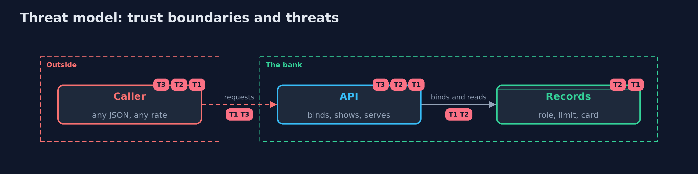

# Threat Model — API Security: Mass Assignment, Data Exposure and Resource Limits

A threat model answers four questions: what are we protecting, who or what could harm it, how, and what do we do about it. This one covers this project's own demo system, not a production deployment. Domain: a bank API.

## Scope

A bank's customer-facing JSON API: profile update, account view and directory list. It covers the fields accepted and returned and the amount of work a caller can cause.
It does not cover ownership checks, authentication, or the network.

## What we protect (assets)

- Roles, limits and balances.
- Card numbers, PIN hashes and risk scores.
- The API's availability for other customers.

## Who and what acts on the system

- Ana, a customer using the official app.
- A customer who sends hand-made requests.

## Trust boundaries

A trust boundary is a line that data or a request crosses between parts that trust each other differently. Threats cluster where those lines are.

- Caller to API: the JSON, the page size and the request rate are untrusted.
- API to records: the shape of the record must not decide the shape of the API.

Each dashed box is a trust boundary. A rose tag such as T1 shows where the threat of that number, in the table below, applies.

## Threats, using STRIDE

STRIDE is a checklist of six kinds of threat: **Spoofing** (S), **Tampering** (T), **Repudiation** (R), **Information disclosure** (I), **Denial of service** (D), **Elevation of privilege** (E).

| Id | Kind | Threat | Where it shows up | Control in this project | What is left |
| --- | --- | --- | --- | --- | --- |
| T1 | Elevation of privilege | A caller sets fields it may not change, such as role and credit limit | `NaiveApi.patchProfile` | An explicit request model that refuses unknown fields | A field added to the model later without a decision about who may set it |
| T2 | Information disclosure | Responses reveal fields the app does not need: full card, PIN hash, risk score | `NaiveApi.getAccount`, `listAccounts` | Response models and a directory view | A view that grows fields over time; compare responses with the model in tests |
| T3 | Denial of service | Huge pages and request loops exhaust the service and scrape data | `NaiveApi.listAccounts` | A page cap and per-caller token buckets charged per row, with 429 and Retry-After | Many accounts together (distributed callers); monitor totals and block patterns |

## Assumptions

- Authentication and ownership are enforced elsewhere (and are checked in the demo).
- One server instance; shared limits come with the Redis version.

## Out of scope

- Object-level authorization: broken-access-control.
- Distributed rate limiting: api-security-with-spring-boot-and-redis.

## How the tests check this

- `ApiSecurityTest` checks both APIs: mass assignment, response shape, masking, page caps, validation, ownership, the budget, 429 and refill.
- `DemoRunsTest` compares the whole demo with the golden output.

## Where this model goes next

The next project, cors, covers which other sites a browser lets read these answers.
