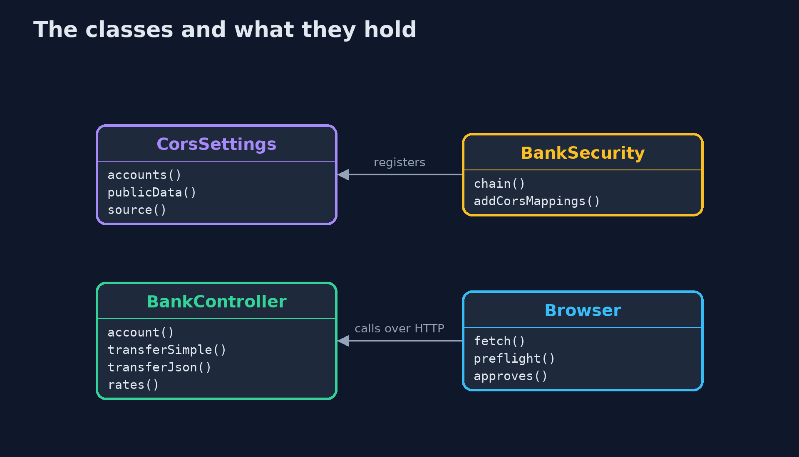
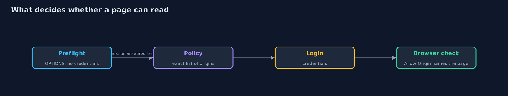
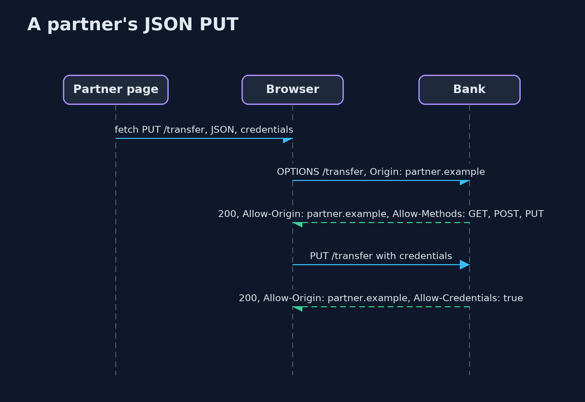

# CORS with Spring Boot

```
src/main/java/com/jk/explore/security/corsspring/
├── BankApp.java         
├── BankController.java  The bank's API
├── BankSecurity.java    The bank takes the customer's credentials in a header that the browser attaches itself, which is what "credentials" means in CORS (cookies and HTTP authentication both count)
├── Browser.java         A model of the browser rules that matter, speaking real HTTP to the real bank: a page may <em>send</em> some cross-origin requests without asking, may <em>read</em> the answer only when the server names the page's origin (and, with credentials, also says credentials are allowed), and asks first with a preflight for anything that is not simple
├── CorsSettings.java    The CORS policy for each mode of the lesson, built the way Spring wants it: a {@link CorsConfiguration} per path pattern
├── CorsSpringDemo.java  Runs the bank API story in five numbered acts against real Spring Boot servers on the loopback interface
├── FetchResult.java     What a script on a page got: did the request reach the bank's code, and was the page allowed to read the answer?
├── Processed.java       The requests that reached the bank's own code, so the demo can show what CORS does not stop
└── Running.java         A bank started on a free loopback port with the given CORS policy
```

**A browser lets any page send many requests to your API but lets it read the answer only if your API names that page's origin; Spring Boot gives a CorsConfiguration for that, and the ways to get it wrong are a reflecting origin pattern, a null origin, a pattern that matches a lookalike, a policy registered after the login check, and treating a browser rule as a defence against callers that are not browsers.**

The plain [cors](../cors) project models the browser's rules and the bank's policy from scratch. This one uses what a real Spring Boot bank has: **Spring Boot 4.1**, **Spring Framework 7** `CorsConfiguration` and **Spring Security 7** `http.cors()`, in real servers on the loopback address. A browser stand-in speaks real HTTP to them and applies the browser's rules to the real headers.

What it shows:
- **No policy.** A page on evil.example can **send** a simple `POST /transfer` that the bank processes, but cannot read the answer. A `PUT` with JSON never reaches the bank because the preflight is refused.
- **Policies that look like fixes.** `allowedOrigins("*")` with credentials is refused by Spring at the first cross-origin request (a 500). The usual way round it, `allowedOriginPatterns("*")`, **reflects every origin**, including evil.example, the lookalike evilbank.example and `null`. An exact list that also lists `null` lets sandboxed frames read. A pattern `https://*bank.example` matches the lookalike, because it has no dot.
- **An exact allow-list.** Only partner.example reads and writes. Spring answers any other origin with **403 `Invalid CORS request` before the controller runs**, sends `Vary: Origin`, and leaves the bank's own page alone.
- **Where the policy is registered.** The same list registered in Spring MVC fails for a JSON `PUT`, because Spring Security asks for a login before MVC sees the **preflight** (401). Registered with `http.cors()` it is answered first (200).
- **The bill.** A wildcard is fine for public data without credentials and is refused with them. A `POST` with no `Origin` header, from a server or a script, still moves money: CORS is a browser rule, not a defence.

**Maps to:** OWASP Top 10 (2025) A02 Security Misconfiguration · CWE-942 (overly permissive cross-domain whitelist) · CWE-346 (origin validation error) · OWASP ASVS 5.0 V3 · MDN's CORS guide.

## The idea in everyday terms

A bank counter with a guest list at the door. The door staff decide which visitors may carry the answer away, but the clerk behind the counter has already heard every question. The list only helps if its names are exact, and it helps nobody who comes in by the back door.

## The scenario

A bank API on Spring Boot with an account page, a transfer endpoint and public rates. The demo starts the real application several times with different CORS policies, and a browser stand-in calls it as pages on different origins would.

## Run

```bash
./gradlew run
```

The demo tells the story in 5 acts, each printing exact numbers that the tests check:

| Act | What it shows |
| --- | --- |
| 1. No policy: a page may send, but not read | With no CORS policy, the bank's own page reads the account, evil.example cannot read it, its simple POST still moves money, and its JSON PUT never reaches the bank. |
| 2. Policies that look like fixes | A wildcard with credentials is refused by Spring, the usual workaround reflects every origin, a list with null lets sandboxed frames read, and a pattern without a dot matches the lookalike. |
| 3. An exact allow-list | Only partner.example reads and writes; every other origin gets a 403 from Spring before the controller runs; public rates are readable by all; Vary: Origin is sent. |
| 4. Where the policy is registered | The same exact list fails for a JSON PUT when it is registered in Spring MVC, because the preflight meets the login check first (401), and works when it is registered with http.cors() (200). |
| 5. The bill | A wildcard is fine for public data without credentials and refused with them; a POST with no Origin header still moves money, because CORS is a browser rule and not a defence. |

## Test

```bash
./gradlew test
```

16 tests in `CorsSpringTest`, `DemoRunsTest`. Each test starts a real bank on a free loopback port and stops it. Nothing is printed that changes between runs.

## What the simulation got right, and what it left out

The bank is a real Spring Boot application with Spring Security, and the browser stand-in is a few lines of Java that apply the browser's CORS rules to real responses. Only statuses, booleans and short messages are printed, never ports, so the demo prints the same text on every run.

## Technologies and versions

Every version below is pinned in the project's build files and was the latest stable release when the project was built.

| Technology | Version | Used for |
| --- | --- | --- |
| Java | 25 | the language and runtime; a Gradle toolchain finds or downloads the JDK |
| Gradle | 9.8.1 (wrapper) | build and run; nothing to install, the wrapper downloads it |
| org.springframework.boot:spring-boot-starter-webmvc | 4.1.1, set by spring-boot-dependencies | library the code uses |
| org.springframework.boot:spring-boot-starter-security | 4.1.1, set by spring-boot-dependencies | library the code uses |
| org.junit.jupiter:junit-jupiter | 6.1.3, set by junit-bom | JUnit 5: the tests (tests only) |
| org.junit.platform:junit-platform-launcher | 6.1.3, set by junit-bom | JUnit platform launcher, which Gradle needs to run the tests (tests only) |
| videokit | repository tool (`tools/videokit`) | the narrated video and animation: Piper `en_US-amy-medium`, speed 0.8, longer pauses (the amy-slow voice) |

## Learning Material

| Document | What it is for |
| --- | --- |
| [Problem statement](docs/problem-statement.md) | the situation and what the project must show |
| [Prerequisites](docs/prerequisites.md) | what you need to know first |
| [CORS with Spring Boot, explained](docs/cors-with-spring-boot-explained.md) | the acts in prose |
| [Session guide](docs/session.md) | a one-hour lesson with exercises |
| [Animated walkthrough](docs/animation.html) | the acts step by step, narrated |
| [Threat model](docs/threat-model.md) | what is protected, who could harm it, and how, using STRIDE |
| [Spec](docs/spec.md) | what this project must be true of |
| [Expected output](docs/expected-output.txt) | the golden demo output every test and every port checks against |

### The idea in one picture

The browser asks first with a preflight, the policy decides, and the browser decides whether the page may read.


### Where each piece sits

The policy is built in one place and registered in one of two.



### How the data moves

In order: the preflight, the login, the policy, and the browser's check of the headers.



### Who calls whom, in order




### Video

`video/cors-with-spring-boot-explained.mp4` (with `.m4a` audio and `.srt` subtitles) is built by `video/build_video.sh`. Rendered media is not committed.

## What it costs

- **An exact list is maintenance.** Every new partner or environment is a change to the list, and each one needs a test.
- **Preflights add a round trip,** which `maxAge` softens at the price of slower policy changes.
- **Credentials force exact origins,** so the convenience of a wildcard is gone for anything with a login.
- **Two places to register a policy** (Spring MVC and Spring Security) means two places to get it wrong.
- **CORS says nothing about non-browser callers,** so logins and tokens are still needed.

## When this is too much

A public, read-only API with no login can use a wildcard without credentials. Anything that takes a cookie, a token the browser attaches or HTTP authentication needs an exact list, registered where the preflight can reach it.

## Where you have already met this

- `@CrossOrigin(origins = "*")` on a controller.
- `allowedOriginPatterns("*")` pasted from a Stack Overflow answer after an "allowCredentials" error.
- A preflight that fails with 401 while the same call works in curl.
- A browser console message: "has been blocked by CORS policy".

## Where this sits

This is the tools version of [cors](../cors), in the [api-security](..) module. It follows the same story and the same cast of origins, on a real framework.
