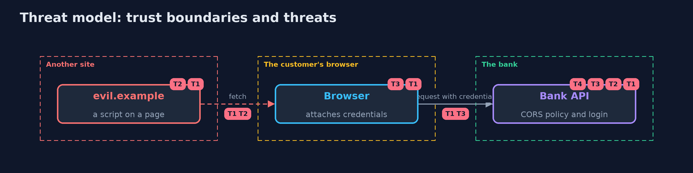

# Threat Model — CORS with Spring Boot

A threat model answers four questions: what are we protecting, who or what could harm it, how, and what do we do about it. This one covers this project's own demo system, not a production deployment. Domain: a bank API.

## Scope

A bank API on Spring Boot called from browsers on other origins. It covers who may read a response, how the policy is built and where it is registered. It does not cover forged requests, which are the subject of the CSRF projects, or non-browser callers.

## What we protect (assets)

- The customer's account data in the response.
- The customer's credentials, which the browser attaches.

## Who and what acts on the system

- A customer using a partner's page.
- An attacker who controls a page on another origin.
- A developer who changes the policy.

## Trust boundaries

A trust boundary is a line that data or a request crosses between parts that trust each other differently. Threats cluster where those lines are.

- Origin to origin: the browser's same-origin rule.
- The preflight to the login check: the preflight carries no credentials.

Each dashed box is a trust boundary. A rose tag such as T1 shows where the threat of that number, in the table below, applies.

## Threats, using STRIDE

STRIDE is a checklist of six kinds of threat: **Spoofing** (S), **Tampering** (T), **Repudiation** (R), **Information disclosure** (I), **Denial of service** (D), **Elevation of privilege** (E).

| Id | Kind | Threat | Where it shows up | Control in this project | What is left |
| --- | --- | --- | --- | --- | --- |
| T1 | Information disclosure | A page on another origin reads the customer's data | `CorsSettings.accounts` | An exact list of origins, no reflection, no null, a pattern with a dot, and a test for each | A listed partner whose own site is compromised |
| T2 | Tampering | A simple cross-site request changes state | `BankController.transferSimple` | A login and a token on every state-changing route; the policy does not stop it | Callers that send no Origin header |
| T3 | Denial of service | A legitimate partner's request is refused because the preflight meets the login check | `BankSecurity.chain` | Register the policy with http.cors() so the preflight is answered first | A second filter that sits ahead of the CORS filter |
| T4 | Information disclosure | A cache serves one origin's answer to another | `/account` responses | Vary: Origin on every response that depends on the origin | A cache that ignores Vary |

## Assumptions

- The browser enforces the CORS rules.
- Customers visit pages that the attacker controls.

## Out of scope

- Callers that are not browsers.
- Forged requests, covered by the CSRF projects.

## How the tests check this

- `CorsSpringTest` starts a real bank per policy and checks no policy, the star with credentials, a reflecting pattern, null, the lookalike pattern, the exact list, Spring's 403, `Vary`, public rates, the two registration places, the preflight and a caller with no `Origin` header.
- `DemoRunsTest` compares the whole demo with the golden output.

## Where this model goes next

The next project in this module, api-security-with-spring-boot-and-redis, moves from which pages may read the answer to how often anyone may ask: validation, response shaping and a Redis-backed rate limiter.
