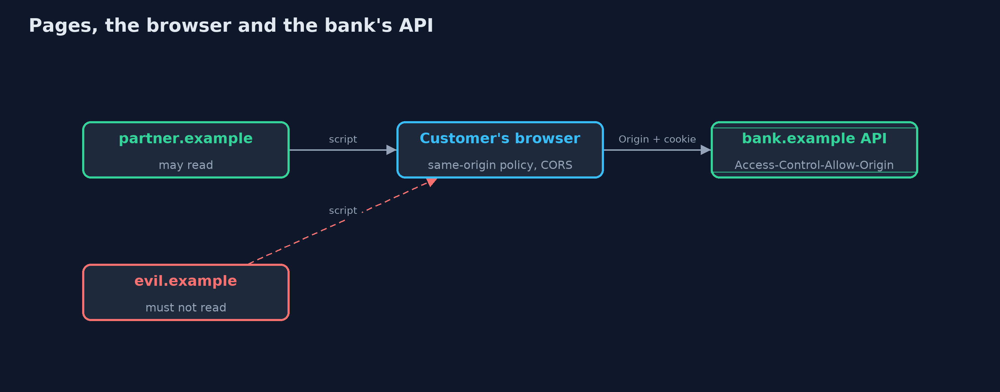
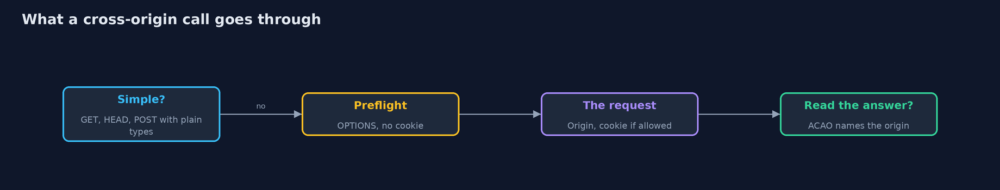

# CORS Done Right

```
src/main/java/com/jk/explore/security/cors/
├── BankApi.java      The bank's API on https://bank.example
├── Browser.java      A model of the browser rules that matter: a page may <em>send</em> some cross-origin requests without asking, may <em>read</em> the answer only when the server names the page's origin (and, with cookies, also says credentials are allowed), and asks first with a preflight for anything that is not simple
├── CorsDemo.java     Runs the bank API story in five numbered acts and prints exact, repeatable results
├── CorsPolicy.java   Decides which {@code Origin} header values the bank API will name in {@code Access-Control-Allow-Origin}
├── FetchResult.java  What a script on a page got: did the request reach the bank's code, and was the page allowed to read the answer?
├── Request.java      A request as the bank API sees it: method, path, headers with lower-case names, and whether the browser attached the session cookie
└── Response.java     A response: status, headers with lower-case names, and a body
```

**A browser lets any page send many requests to your API but lets it read the answer only if your API names that page's origin, so an allow-list must be exact, never reflect the Origin header, never allow null, and never be mistaken for a defence against forged requests.**

A browser runs pages from many sites in one window. The **same-origin policy** keeps a page on evil.example from *reading* what your bank's API answers. But sometimes a partner's page really needs to read the API,
and **CORS** (cross-origin resource sharing) is how the API says so: it names the origin in `Access-Control-Allow-Origin`, and adds `Access-Control-Allow-Credentials: true` if cookies are involved.
Teams that hit the browser's error often "fix" it in the easiest way, and the easy ways are the unsafe ones.

What goes wrong, in the order this project shows it:
- **CORS is about reading, not sending.** A simple `POST` from any page still reaches the bank. CORS is not a CSRF defence.
- **Reflecting the `Origin` header** with credentials lets every site read the customer's account.
- **Allowing `null`** (an opaque origin sandboxed frames and local files have) lets an attacker's page read it too.
- **Matching a suffix or prefix** passes look-alike domains such as evilbank.example.

The defences:
- **An exact, case-sensitive allow-list** of origins, compared as whole strings.
- **`Vary: Origin`** so caches keep one answer for each origin.
- **A wildcard only for public data without cookies;** browsers refuse `*` with credentials.
- **Preflight answers that name only the methods and headers really needed.**

**Maps to:** OWASP Top 10 (2025) A02 Security Misconfiguration · CWE-942 · OWASP ASVS 5.0, the browser security and API chapters.

## The idea in everyday terms

Think of the same-origin policy as a rule that letters from other buildings may be opened only by their own recipient. CORS is the building's list of other buildings whose people may read its mail. Writing
"anyone who asks" on the list, or "anyone whose address ends in bank", or "anyone with no address at all" is how the mail gets read.

## The scenario

A bank has an API on https://bank.example with an account call that needs the session cookie, a public rates call, and a transfer call. A partner site, an attacker's site and a look-alike site all run scripts in the customer's browser.
The demo includes a model of the browser rules (simple requests, preflight, reading the response, credentials) so every claim can be tested.

## Run

```bash
./gradlew run
```

The demo tells the story in 5 acts, each printing exact numbers that the tests check:

| Act | What it shows |
| --- | --- |
| 1. Same origin needs no CORS | The bank's own page reads its balance. |
| 2. No CORS headers: a page may send, but not read | An attacker's page cannot read the account, but its simple POST to /transfer still reaches the bank and is processed; a JSON PUT is stopped by the preflight. |
| 3. Policies that look like fixes | Reflecting the origin lets every site read; an exact list that allows null lets a sandboxed page read; a suffix match lets evilbank.example read. |
| 4. An exact allow-list | Only partner.example can read, including a JSON PUT after a successful preflight; evil.example, a look-alike and null are blocked; public rates are readable by anyone; responses carry Vary: Origin. |
| 5. Wildcard and cookies never combine | A browser refuses Access-Control-Allow-Origin: * when the request carried cookies, and accepts it without them. |

## Test

```bash
./gradlew test
```

12 tests in `CorsTest`, `DemoRunsTest`. Everything is fixed data, so the demo prints the same text on every run.

## What the simulation got right, and what it left out

The bank API and a model of the browser's CORS rules are plain Java: the Origin header, simple versus preflighted requests, the credentials check on the response and the opaque `null` origin. The model follows the Fetch standard
for the cases shown. Sites are logical names and nothing is sent anywhere.

## Technologies and versions

Every version below is pinned in the project's build files and was the latest stable release when the project was built.

| Technology | Version | Used for |
| --- | --- | --- |
| Java | 25 | the language and runtime; a Gradle toolchain finds or downloads the JDK |
| Gradle | 9.8.1 (wrapper) | build and run; nothing to install, the wrapper downloads it |
| org.junit.jupiter:junit-jupiter | 6.1.3, set by junit-bom | JUnit 5: the tests (tests only) |
| org.junit.platform:junit-platform-launcher | 6.1.3, set by junit-bom | JUnit platform launcher, which Gradle needs to run the tests (tests only) |

## Learning Material

| Document | What it is for |
| --- | --- |
| [Problem statement](docs/problem-statement.md) | the situation and what the project must show |
| [Prerequisites](docs/prerequisites.md) | what you need to know first |
| [CORS Done Right, explained](docs/cors-explained.md) | the acts in prose |
| [Session guide](docs/session.md) | a one-hour lesson with exercises |
| [Animated walkthrough](docs/animation.html) | the acts step by step |
| [Threat model](docs/threat-model.md) | what is protected, who could harm it, and how, using STRIDE |
| [Spec](docs/spec.md) | what this project must be true of |
| [Expected output](docs/expected-output.txt) | the golden demo output every test and every port checks against |

### The idea in one picture

The browser sits between the pages and the API and applies the CORS rules to what comes back.



### Where each piece sits

A policy decides the header; the browser decides whether to show the answer.


### How the data moves

A preflight comes first for anything that is not a simple request.



### Who calls whom, in order


## What it costs

- **An exact list needs upkeep.** Every new partner is a deploy or a config change, which is the point.
- **Wildcard subdomains are risky.** Allowing `*.partner.example` also allows any subdomain that has a takeover or user content.
- **Preflight adds a round trip,** which `Access-Control-Max-Age` reduces; browsers cap the cache time.
- **Credentialed CORS needs the cookie to be sent cross-site,** which SameSite=None requires, and which brings CSRF back as a concern.
- **Caches can mix up answers** unless `Vary: Origin` is set.

## When this is too much

If the partner can call your API from their server, no CORS is needed at all: a server-to-server call has no browser rules. And if the API and the page are on the same origin (or behind one reverse proxy), leave CORS off.
Do not "test" CORS by switching it to reflect everything on a shared environment.

## Where you have already met this

- The browser console message "has been blocked by CORS policy".
- `Access-Control-Allow-Origin: *` on an API.
- `@CrossOrigin(origins = "*")` or a filter that copies the `Origin` header into the response.
- A finding titled "Cross-Origin Resource Sharing Misconfiguration" with CWE-942.

## Where this sits

This project is in [api-security](..). It builds on [cross-site-request-forgery](../../web-security/cross-site-request-forgery), which covers forged requests that CORS does not stop,
and [api-security](../api-security), which covers what the API returns in the first place.
