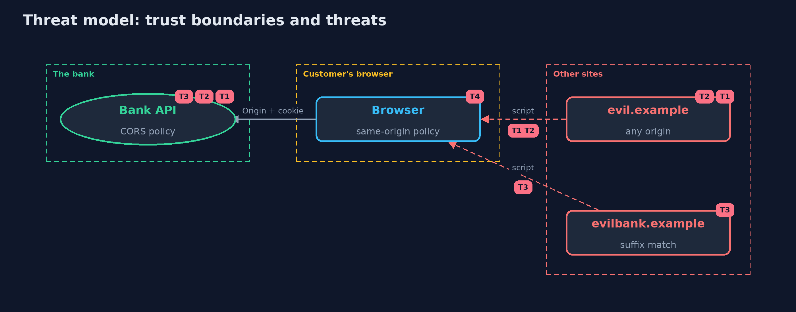

# Threat Model — CORS Done Right

A threat model answers four questions: what are we protecting, who or what could harm it, how, and what do we do about it. This one covers this project's own demo system, not a production deployment. Domain: a bank API.

## Scope

A bank API that is called from partner pages in browsers. It covers the CORS headers it sends and what the browser lets a page do with them.
It does not cover CSRF defences, authentication, or server-to-server calls.

## What we protect (assets)

- Account data returned to a logged-in customer.
- The customer's session cookie, attached to cross-origin requests when credentials are allowed.

## Who and what acts on the system

- A customer using the bank and a partner.
- An attacker whose page the customer visits.
- An attacker who registers a look-alike domain.

## Trust boundaries

A trust boundary is a line that data or a request crosses between parts that trust each other differently. Threats cluster where those lines are.

- Page to browser: scripts from any site run in the customer's browser.
- Browser to API: Origin and cookie are attached, and the answer is shown to the page only if the API allows it.

Each dashed box is a trust boundary. A rose tag such as T1 shows where the threat of that number, in the table below, applies.

## Threats, using STRIDE

STRIDE is a checklist of six kinds of threat: **Spoofing** (S), **Tampering** (T), **Repudiation** (R), **Information disclosure** (I), **Denial of service** (D), **Elevation of privilege** (E).

| Id | Kind | Threat | Where it shows up | Control in this project | What is left |
| --- | --- | --- | --- | --- | --- |
| T1 | Information disclosure | Any site reads the customer's account because the API reflects the Origin header | `CorsPolicy.REFLECT_ANY` | An exact, case-sensitive allow-list | A listed partner that is itself compromised |
| T2 | Information disclosure | A sandboxed page or local file reads the account because null is allowed | `CorsPolicy.exactAndNull` | null is never allowed with credentials | None known in the model |
| T3 | Spoofing | A look-alike domain passes a suffix or prefix test | `CorsPolicy.suffix` | Compare the whole origin string with a list | A takeover of a listed subdomain |
| T4 | Tampering | CORS is mistaken for protection against forged requests | `Browser` (simple requests) | CSRF tokens, SameSite and Fetch Metadata checks, kept as separate controls | A state-changing endpoint reachable by a simple request with no CSRF defence |

## Assumptions

- The browser enforces the same-origin policy and the CORS rules as modelled.
- The session cookie is sent cross-site (SameSite=None) for the partner scenario.

## Out of scope

- CSRF defences: cross-site-request-forgery.
- Cross-site scripting on the partner's page.

## How the tests check this

- `CorsTest` checks every policy against the partner, the attacker, a look-alike and null, preflight, the Vary header, the wildcard rule and same-origin calls.
- `DemoRunsTest` compares the whole demo with the golden output.

## Where this model goes next

The next module, identity-and-access, follows how a user is recognised across the sites that this module lets talk to each other.
