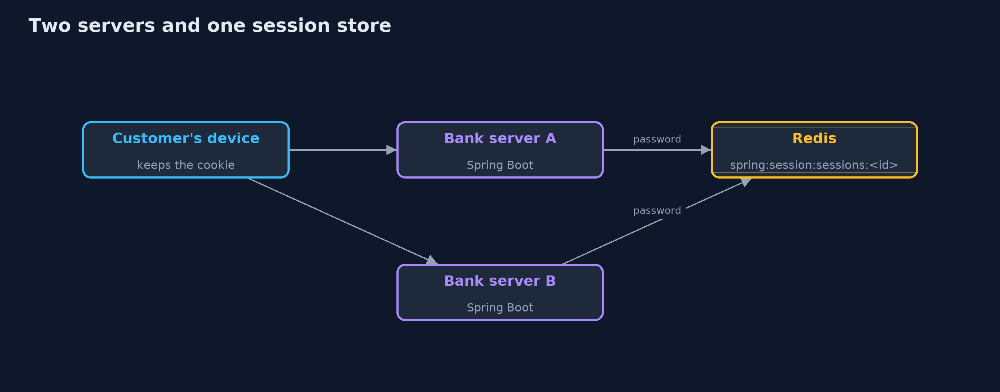
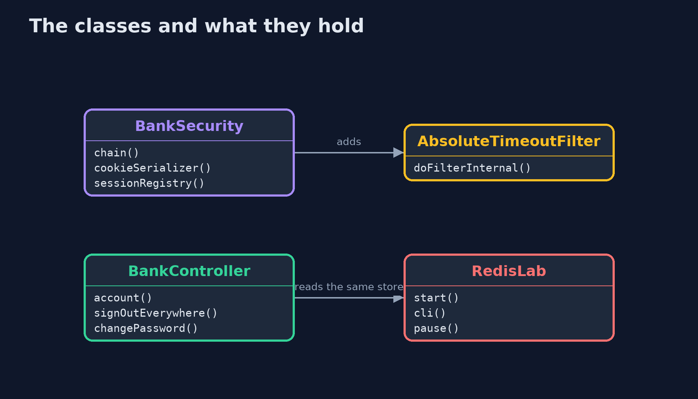
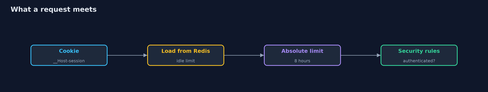
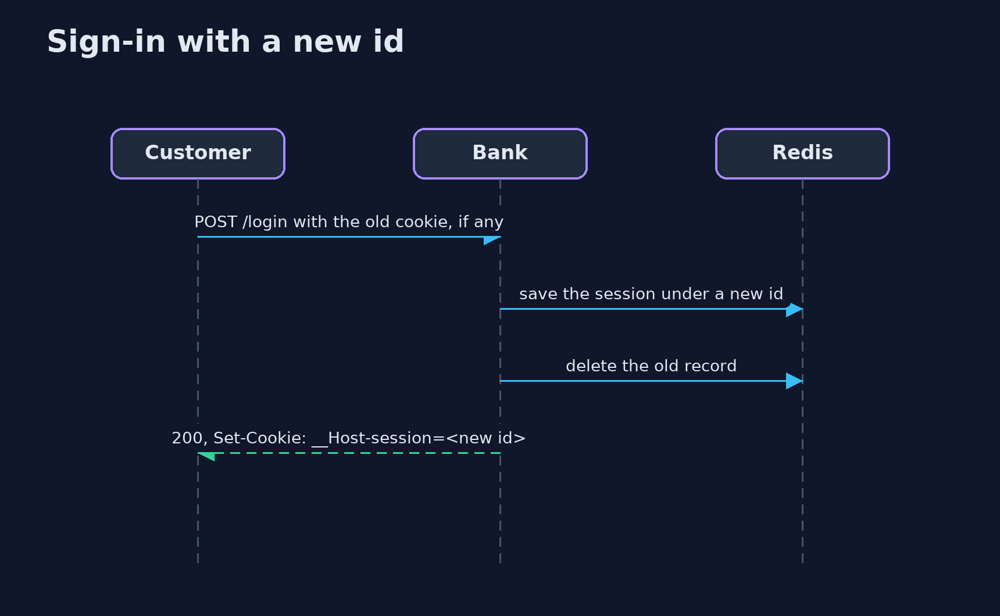

# Session Management with Spring Session and Redis

```
src/main/java/com/jk/explore/security/sessionredis/
├── AbsoluteTimeoutFilter.java  Spring Session ends a session that has been idle too long, but it has no limit on how old a busy session may get
├── BankApp.java                
├── BankController.java         A page for visitors who have not signed in
├── BankSecurity.java           Form login with the session in Redis, answers a program can read (200 or 401, never a redirect), and the session rules of the lesson: a new id at sign-in, a limit on concurrent sessions, an absolute timeout, and a cookie with every protection
├── Browser.java                A customer's device as far as this lesson needs one: it keeps the session cookie the bank sets and sends it back to every page
├── OffsetClock.java            The system clock plus an offset the demo can move forward, so eight hours take no time to wait for
├── RedisLab.java               A throwaway Redis in a Docker container, bound to the loopback address on a free port, protected by a password and removed on close
├── Running.java                One bank server on a free loopback port, with its sessions in the given Redis
└── SessionRedisDemo.java       Runs the bank story in five numbered acts against real Spring Boot servers and a real Redis in Docker, all on the loopback interface
```

**Spring Session keeps the session in Redis so any server can serve any request, and Spring Security still gives a new id at sign-in; but the id is stored as itself so Redis needs a password, an idle limit is enforced by Spring while the absolute limit is yours to add, ended sessions linger in Redis for five minutes, an unauthenticated request can create a record unless the request cache is off, and a bank that cannot reach Redis must refuse.**

The plain [session-management](../session-management) project builds ids, rotation, timeouts and sign-out from scratch, and ends with the bill: two servers need a shared store. This one pays that bill with **Spring Session 4** and a real **Redis 8** in Docker, on **Spring Boot 4.1** and **Spring Security 7**, all on the loopback address. It needs Docker, and its tests are tagged `integration`: `./gradlew integrationTest`.

What it shows:
- **The session lives in Redis.** Redis refuses a client with no password. The cookie is the Redis key's id, encoded, so a stolen copy of the keys, turned into cookies, **opens live sessions**: unlike the plain store, which kept only a hash of each id.
- **A new id at every sign-in.** With the id kept, a planted id becomes ana's and the stranger reads her account. With Spring Security's default `changeSessionId` it does not, and the old record is no longer live.
- **How long a session lives.** Spring Session ends an idle session, and Redis keeps the dead record five more minutes. It has **no absolute timeout**, so a 20-line filter of our own ends a busy session at 8 hours.
- **Signing out, everywhere, and the limit.** Sign-out ends the session on the server. `FindByIndexNameSessionRepository` finds every session of a customer to end them all, and a password change ends the others and renews this one. A limit of 3 sessions ends the oldest.
- **The bill.** Two servers with separate stores refuse a request that lands on the other; with one Redis they allow it. **A Redis that stops answering makes the bank refuse**, never allow. And with Spring Security's default request cache, 20 requests from strangers create 20 session records in Redis.

**Maps to:** OWASP Top 10 (2025) A07 Authentication Failures · CWE-384 (session fixation) · CWE-613 (insufficient session expiration) · CWE-614 (cookie without Secure) · OWASP ASVS 5.0 V7 (Session Management).

## The idea in everyday terms

A coat check that used to keep tickets in one cloakroom and now keeps them in a safe shared by every branch. Any branch can return your coat, which is the point, and anyone who copies the safe's list holds every ticket, which is the price.

## The scenario

An online bank on Spring Boot signs customers in with a form and keeps each session in Redis. The demo starts the real application, sometimes twice, against a real Redis, and a device stand-in that keeps the session cookie signs in, waits, signs out and tries copies of cookies.

## Run

```bash
./gradlew run
```

The demo tells the story in 5 acts, each printing exact numbers that the tests check:

| Act | What it shows |
| --- | --- |
| 1. The session lives in Redis | Redis needs a password, the cookie carries the Redis key's id, and a stolen copy of the keys turned into cookies opens live sessions. |
| 2. A new id at every sign-in | With the id kept, a planted id becomes ana's and the stranger reads her account; with Spring Security's default the ids differ and the stranger's copy is refused. |
| 3. How long a session lives | Spring Session enforces the idle timeout and Redis keeps the dead record five more minutes; there is no absolute timeout, so a small filter of our own ends a busy session at 8 hours. |
| 4. Signing out, everywhere, and the limit | Sign-out ends the session on the server, sign-out everywhere ends 3 sessions, a password change ends the others and renews this one, and a limit of 3 ends the oldest. |
| 5. The bill | Two servers need one shared store, a Redis that stops answering makes the bank refuse, and with the request cache on, 20 strangers create 20 session records. |

## Test

```bash
./gradlew test
```

15 tests in `DemoRunsTest`, `SessionRedisTest`. The tests start a real Redis in Docker and real bank servers and remove the container afterwards. Run them with ./gradlew integrationTest; nothing printed changes between runs.

## What the simulation got right, and what it left out

The bank servers are real Spring Boot applications, and Redis is a real container bound to 127.0.0.1 on a free port, protected by a password and removed at the end. The device stand-in reads the Set-Cookie header and sends the cookie back, which is what a browser does over https. Only statuses, booleans and counts are printed, never ids or ports.

## Technologies and versions

Every version below is pinned in the project's build files and was the latest stable release when the project was built.

| Technology | Version | Used for |
| --- | --- | --- |
| Java | 25 | the language and runtime; a Gradle toolchain finds or downloads the JDK |
| Gradle | 9.8.1 (wrapper) | build and run; nothing to install, the wrapper downloads it |
| org.springframework.boot:spring-boot-starter-webmvc | 4.1.1, set by spring-boot-dependencies | library the code uses |
| org.springframework.boot:spring-boot-starter-security | 4.1.1, set by spring-boot-dependencies | library the code uses |
| org.springframework.boot:spring-boot-starter-session-data-redis | 4.1.1, set by spring-boot-dependencies | library the code uses |
| org.junit.jupiter:junit-jupiter | 6.1.3, set by junit-bom | JUnit 5: the tests (tests only) |
| org.junit.platform:junit-platform-launcher | 6.1.3, set by junit-bom | JUnit platform launcher, which Gradle needs to run the tests (tests only) |
| videokit | repository tool (`tools/videokit`) | the narrated video and animation: Piper `en_US-amy-medium`, speed 0.8, longer pauses (the amy-slow voice) |

## Learning Material

| Document | What it is for |
| --- | --- |
| [Problem statement](docs/problem-statement.md) | the situation and what the project must show |
| [Prerequisites](docs/prerequisites.md) | what you need to know first |
| [Session Management with Spring Session and Redis, explained](docs/session-management-with-spring-session-and-redis-explained.md) | the acts in prose |
| [Session guide](docs/session.md) | a one-hour lesson with exercises |
| [Animated walkthrough](docs/animation.html) | the acts step by step, narrated |
| [Threat model](docs/threat-model.md) | what is protected, who could harm it, and how, using STRIDE |
| [Spec](docs/spec.md) | what this project must be true of |
| [Expected output](docs/expected-output.txt) | the golden demo output every test and every port checks against |

### The idea in one picture

Any server can serve any request because the session is in Redis, behind a password.



### Where each piece sits

Spring Session supplies the repository and the cookie; the bank adds the filter and the rules.



### How the data moves

The session is loaded from Redis before the security rules run; any failure ends in a refusal.



### Who calls whom, in order




### Video

`video/session-management-with-spring-session-and-redis-explained.mp4` (with `.m4a` audio and `.srt` subtitles) is built by `video/build_video.sh`. Rendered media is not committed.

## What it costs

- **Redis is now in every request.** If it is slow the bank is slow, and if it is down the bank refuses.
- **Redis holds every live id as itself.** Its password, its address and its backups are as sensitive as the cookie jar.
- **Spring Session keeps ended sessions five more minutes,** and has no absolute timeout, so the second rule is yours to write and to test.
- **A short idle timeout annoys customers** who stop to read a statement.
- **Operations work moves to Redis:** persistence, memory limits and failover are now the bank's sessions.

## When this is too much

A single server that restarts rarely can keep sessions in memory. Move them to Redis when a second server arrives or when a deployment must not sign everyone out, and protect Redis as you would the cookie jar.

## Where you have already met this

- `@EnableRedisIndexedHttpSession` or `spring-session-data-redis` in a pom.
- Keys such as `spring:session:sessions:<uuid>` in a Redis browser.
- A customer signed out on every device after a password change.
- Load balancers with sticky sessions that Redis makes unnecessary.

## Where this sits

This is the tools version of [session-management](../session-management), in the [api-security](..) module. It follows the same story and picks up where the plain project's bill left off.
