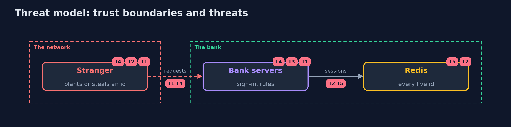

# Threat Model — Session Management with Spring Session and Redis

A threat model answers four questions: what are we protecting, who or what could harm it, how, and what do we do about it. This one covers this project's own demo system, not a production deployment. Domain: an online bank.

## Scope

A Spring Boot bank that keeps sessions in Redis. It covers session fixation, the life of a session, the store itself and the bank's behaviour when the store is unavailable. It does not cover Redis clustering or the sign-in method.

## What we protect (assets)

- The customers' sessions and the accounts they open.
- Redis, which holds every live session id.

## Who and what acts on the system

- A customer on several devices.
- A stranger who can plant or steal a session id.
- Someone who can read Redis's keys or its backups.

## Trust boundaries

A trust boundary is a line that data or a request crosses between parts that trust each other differently. Threats cluster where those lines are.

- The device to the bank: the cookie.
- The bank to Redis: a password on the loopback address.

Each dashed box is a trust boundary. A rose tag such as T1 shows where the threat of that number, in the table below, applies.

## Threats, using STRIDE

STRIDE is a checklist of six kinds of threat: **Spoofing** (S), **Tampering** (T), **Repudiation** (R), **Information disclosure** (I), **Denial of service** (D), **Elevation of privilege** (E).

| Id | Kind | Threat | Where it shows up | Control in this project | What is left |
| --- | --- | --- | --- | --- | --- |
| T1 | Spoofing | A planted id becomes the customer's session at sign-in | `BankSecurity.chain`, session fixation | A new id at every sign-in (changeSessionId) | A site that sets cookies for the bank's domain |
| T2 | Information disclosure | Someone reads Redis's keys and uses them as cookies | `spring:session:sessions:<id>` | A Redis password, a loopback address, no persistence of sessions to shared backups, short timeouts | An attacker with access to the bank servers' memory |
| T3 | Elevation of privilege | A busy session lives for ever | `AbsoluteTimeoutFilter` | An absolute limit on top of the idle limit | A stolen session that is still inside both limits |
| T4 | Denial of service | Strangers create session records until Redis is full | Spring Security's request cache | Request cache off for an API, so only sign-in creates a record | A flood of sign-in attempts, which the rate limiter in the next project addresses |
| T5 | Denial of service | Redis stops answering and the bank allows requests without a session check | `SessionRepositoryFilter` | A timeout on Redis and a refusal when it fails | A long outage that signs everyone out |

## Assumptions

- The connection to the bank is https in production, so the Secure cookie travels.
- Redis is reachable only from the bank servers.

## Out of scope

- Attacks on the host that runs Redis.
- Single sign-on and tokens.

## How the tests check this

- `SessionRedisTest` starts a real Redis and real bank servers and checks the password, the cookie, the stolen key, fixation in both modes, the idle and absolute limits, sign-out, sign-out everywhere, the password change, the session limit, two servers, a Redis that stops answering, and the request cache.
- `DemoRunsTest` compares the whole demo with the golden output.

## Where this model goes next

The next project in this module, api-security-with-spring-boot-and-redis, adds validation, response shaping and a Redis-backed rate limiter, which also answers the flood of sign-in attempts left open here.
