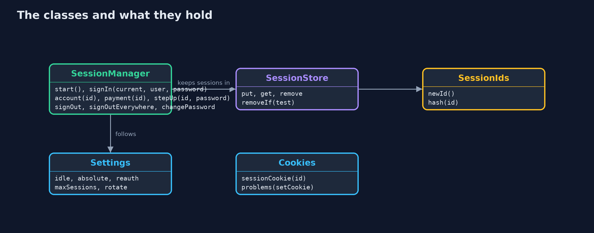
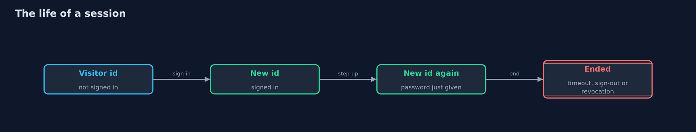
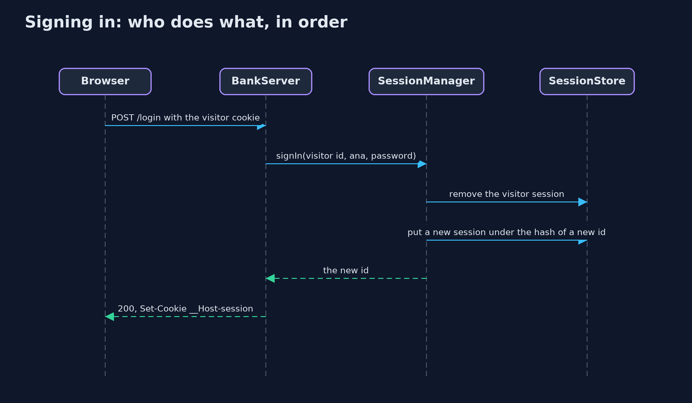

# Session Management: Ids, Rotation, Timeouts and Sign-Out

```
src/main/java/com/jk/explore/security/sessions/
├── Answer.java          What the bank answers to a request that carries a session id
├── BankClient.java      A real HTTP client that keeps its cookies in a {@link Browser}, so the session cookie is handled the way the demo describes
├── BankServer.java      The bank's sign-in, account and sign-out pages on a real HTTP server on this machine's loopback address
├── Browser.java         A browser's cookie jar, enough to follow what happens to the session cookie
├── Cookies.java         The session cookie, written with every attribute that protects it, and a check that lists what a Set-Cookie header is missing
├── Session.java         One session as the server stores it
├── SessionDemo.java     Runs the online bank story in five numbered acts and prints exact, repeatable results
├── SessionIds.java      Session ids: 128 bits from SecureRandom, written as 22 base64url characters
├── SessionManager.java  The bank's session manager
├── SessionStore.java    Where sessions live, keyed by the hash of their id
├── Settings.java        How long sessions last and how the manager treats them
├── SimClock.java        A clock in seconds that moves only when told, so every timeout in the demo happens at the same moment on every run
└── Users.java           The bank's customers and their passwords, kept as salted PBKDF2 hashes and checked in constant time
```

**A session id is as good as a password for as long as it lives, so the server makes it random and stores only its hash, issues a new one at every sign-in and step-up, ends it after idle and absolute timeouts, and forgets it on sign-out, everywhere and after a password change.**

After a customer signs in, the bank does not ask for the password on every request. It hands the browser a **session id** in a cookie, and from then
on that id is all that proves who is asking. A session id is therefore as good as a password for as long as it lives, and session management is
about keeping that window small and safe.

The rules this project builds, one act each:
- A **random id**: 128 bits from `SecureRandom`, stored on the server only as its SHA-256, and compared in constant time.
- A **new id at every sign-in and step-up**, so an id that someone knew before the customer signed in is worthless after it (session fixation).
- **Idle and absolute timeouts**, and the password again for a payment.
- **Sign-out that ends the session on the server**, sign-out everywhere, sessions ended by a password change, and a limit on sessions. The cookie
  carries `Secure`, `HttpOnly`, `SameSite=Strict` and the `__Host-` prefix.

**Maps to:** OWASP Top 10 (2025) A07 Authentication Failures · CWE-384 Session Fixation · CWE-613 Insufficient Session Expiration · CWE-331
Insufficient Entropy · CWE-614 Sensitive Cookie Without Secure · CWE-1004 Sensitive Cookie Without HttpOnly · OWASP ASVS 5.0, the session management chapter.

## The idea in everyday terms

Think of a cloakroom ticket. Whoever holds it gets the coat, so the ticket must be impossible to guess, the cloakroom keeps only a record it can check
a ticket against, a new ticket is printed when a valuable coat is handed in, old tickets stop working at closing time, and a ticket handed back is
torn up, not just dropped in the customer's pocket.

## The scenario

An online bank signs customers in and keeps them signed in with a session cookie. The demo runs the bank's session manager in process with a clock that
moves only when told, and once on a real HTTP server on this machine's loopback address. The customer is Ana, with a demo password.

## Run

```bash
./gradlew run
```

The demo tells the story in 5 acts, each printing exact numbers that the tests check:

| Act | What it shows |
| --- | --- |
| 1. A session id: random, and never stored as itself | An id is 128 random bits in 22 base64url characters, a thousand are all different, the store keeps only hashes so a copy of it opens no session, and a changed id is refused. |
| 2. A new id at every sign-in and step-up | A bank that keeps the id at sign-in lets a stranger's planted id read Ana's account; a new id at sign-in and at step-up makes every earlier id worthless. |
| 3. How long a session lives | Idle for 14 minutes is fine and 16 ends the session; a busy session ends at 8 hours after 47 requests; a payment after 6 minutes asks for the password again. |
| 4. Signing out, everywhere, and the cookie | On a real server the cookie has no problems, and a copy made before sign-out gets 401; a sign-out that only clears the cookie leaves the session alive; everywhere, password change and a limit end other sessions. |
| 5. The bill | Two servers with separate session memories refuse each other's sessions; a shared store fixes it; a 20-minute pause costs a sign-in. |

## Test

```bash
./gradlew test
```

25 tests in `CookieAndServerTest`, `DemoRunsTest`, `SessionIdsTest`, `SessionManagerTest`. SHA-256 is checked against the FIPS 180-2 value for "abc". The clock is simulated and ids are never printed, so the output is the same on every run; the loopback server is tested with a real HTTP client.

## What the simulation got right, and what it left out

The session manager runs in process with a clock that moves only when the demo moves it, so every timeout happens at the same moment on every run. One act
uses a real HTTP server on this machine's loopback address; the port is never printed. Session ids are random and are never printed either, so the demo
prints only facts that do not depend on them.

## Technologies and versions

Every version below is pinned in the project's build files and was the latest stable release when the project was built.

| Technology | Version | Used for |
| --- | --- | --- |
| Java | 25 | the language and runtime; a Gradle toolchain finds or downloads the JDK |
| Gradle | 9.8.1 (wrapper) | build and run; nothing to install, the wrapper downloads it |
| org.junit.jupiter:junit-jupiter | 6.1.3, set by junit-bom | JUnit 5: the tests (tests only) |
| org.junit.platform:junit-platform-launcher | 6.1.3, set by junit-bom | JUnit platform launcher, which Gradle needs to run the tests (tests only) |
| videokit | repository tool (`tools/videokit`) | the narrated video and animation: Piper `en_US-amy-medium`, speed 0.8, longer pauses (the amy-slow voice) |

## Learning Material

| Document | What it is for |
| --- | --- |
| [Problem statement](docs/problem-statement.md) | the situation and what the project must show |
| [Prerequisites](docs/prerequisites.md) | what you need to know first |
| [Session Management: Ids, Rotation, Timeouts and Sign-Out, explained](docs/session-management-explained.md) | the acts in prose |
| [Session guide](docs/session.md) | a one-hour lesson with exercises |
| [Animated walkthrough](docs/animation.html) | the acts step by step, narrated |
| [Threat model](docs/threat-model.md) | what is protected, who could harm it, and how, using STRIDE |
| [Spec](docs/spec.md) | what this project must be true of |
| [Expected output](docs/expected-output.txt) | the golden demo output every test and every port checks against |

### The idea in one picture

The browser holds the id in a cookie; the bank holds only its hash, with the session's times.


### Where each piece sits

SessionManager holds every rule; SessionStore holds sessions by the hash of their id.



### How the data moves

A new id at each step that raises trust, and an end on the server however the session ends.



### Who calls whom, in order




### Video

`video/session-management-explained.mp4` (with `.m4a` audio and `.srt` subtitles) is built by `video/build_video.sh`. Rendered media is not committed.

## What it costs

- **Server-side sessions need a store.** With more than one server, every server must see the same sessions, so the store is shared, for example in Redis.
- **Timeouts cost convenience.** A customer who stops for twenty minutes signs in again; the right numbers depend on what the session can do.
- **Asking for the password again adds friction** to every payment after the first few minutes.
- **A stolen id still works for a while.** Rotation, timeouts and sign-out limit how long, not whether, so the cookie's attributes and HTTPS matter too.

## When this is too much

Every site with sign-in needs random ids, rotation at sign-in, server-side sign-out and the cookie attributes; there is no smaller version. Absolute
timeouts, step-up for payments and session limits are for sites where a session can move money or change an account, such as a bank.

## Where you have already met this

- Cookies named `JSESSIONID`, `__Host-session` or similar in a browser's developer tools.
- "Your session has expired, please sign in again."
- "Sign out of all other devices" in account settings.
- Banking apps that ask for the password or a fingerprint again before a payment.

## Where this sits

This project is in [api-security](..) and builds on [authentication-vs-authorization](../../../beginner/identity/authentication-vs-authorization), which introduced
sessions and stale roles, and [http-basics-and-headers](../../../beginner/networking/http-basics-and-headers), which introduced cookie attributes.
